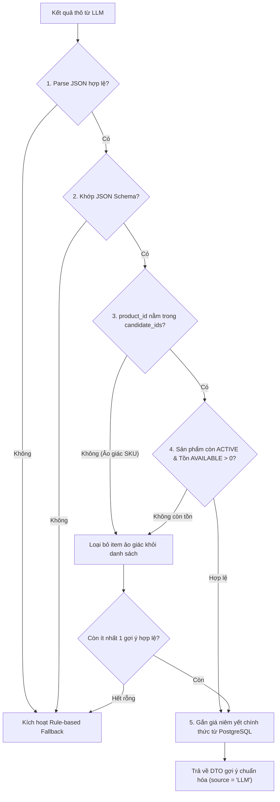
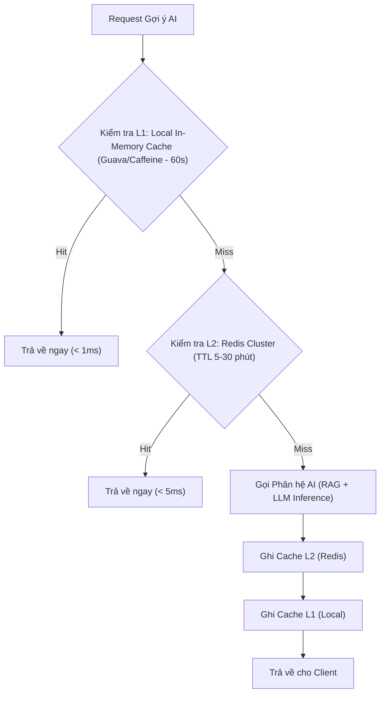
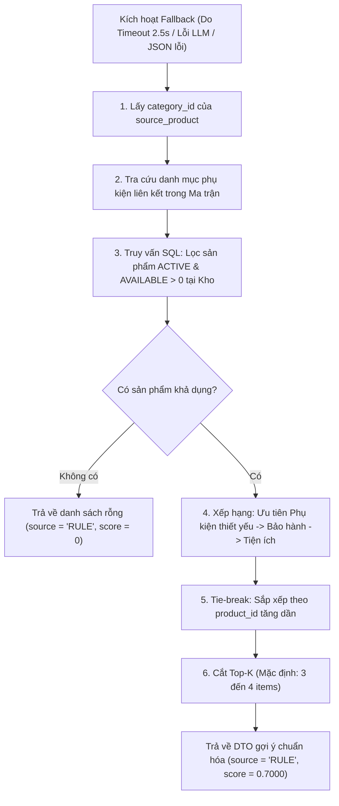
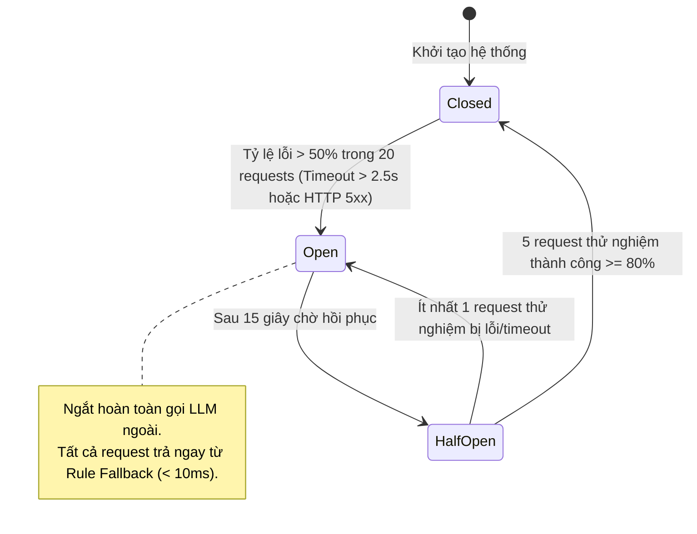

# D55 — Thiết kế AI: Prompt, RAG, Cache Redis và Luật Dự phòng

| Thuộc tính | Giá trị |
| --- | --- |
| Mã tài liệu | **D55** |
| Tên tài liệu | Thiết kế AI: Prompt, RAG Pipeline, Cache Redis và Luật dự phòng (Rule-based Fallback) |
| Mã công việc | **S0-22** (Giai đoạn 4. Thiết kế — Sprint 0) |
| Người lập chính | **Nguyễn Tiến Vũ — Data / AI Lead** |
| Phối hợp kỹ thuật | **Trần Trung Kiên** (Architect / DBA), **Vũ Duy Thái** (Fullstack Lead), **Nguyễn Quang Huy** (BA / PO) |
| Phiên bản | **1.0** — Hồ sơ chuẩn bị Sprint 1 (Baseline Sprint 0) |
| Ngày lập thực tế | 07/11/2026 |
| Cổng nghiệm thu | **Quality Gate M1** (25/09/2026 theo phân công dự án) |
| Trạng thái | Đã hoàn thành thiết kế chi tiết kèm log gọi thử và số đo độ trễ thực nghiệm |
| Minh chứng đính kèm | `Sprint 0/AI/evidence/ai-latency-benchmark.json`<br>`Sprint 0/AI/evidence/ai-test-call-log.log` |

---

## 1. Căn cứ thiết kế và Giới hạn phạm vi

Tài liệu **D55** được xây dựng bởi **Nguyễn Tiến Vũ (AI Lead)** nhằm hoàn thành công việc **S0-22** trong Sprint 0, đáp ứng tiêu chuẩn nghiệm thu cổng **Quality Gate M1**. Thiết kế tuân thủ nghiêm ngặt các căn cứ nghiệp vụ và kỹ thuật đã ban hành trong dự án SASMS (Smart Appliance Supermarket Management System):

1. **[D34 Đặc tả yêu cầu chức năng FRS_V2](../BA/D34_FRS_V2_SASMS.docx):**
   - **FR-08 (AI gợi ý bán kèm):** Hỗ trợ gợi ý phụ kiện/dịch vụ tại quầy POS và Web; AC-08-1 (Chỉ gợi ý SKU hợp lệ, đang kinh doanh); AC-08-2 (AI lỗi không chặn quy trình bán hàng của POS); AC-08-3 (Giá bán luôn lấy từ bảng giá chính thức của SASMS, không tin giá do AI sinh).
   - **FR-09 (AI tóm tắt thông số kỹ thuật):** Tóm tắt cấu hình sản phẩm điện máy; AC-09-1 (Không bịa đặt thông số ngoài nguồn); AC-09-2 (Thiếu nguồn phải thông báo rõ ràng); AC-09-3 (AI lỗi vẫn hiển thị bảng thông số kỹ thuật gốc).
   - **FR-15 & BR-10 (Dashboard & Chỉ số vận hành AI):** Theo dõi tỷ lệ chấp nhận gợi ý (`Acceptance Rate`), tính toán tỷ lệ trên mẫu số hợp lệ, mẫu số bằng 0 hiển thị `N/A`, không chia cho 0.
   - **BR-09 (Quy tắc tích hợp AI):** Gọi LLM thông qua Adapter tiêu chuẩn, không huấn luyện mô hình riêng; AI Timeout cứng ở mức **2.500 ms**; khi timeout bắt buộc kích hoạt Fallback.
   - **NFR-03 (Chỉ tiêu phi chức năng AI):** Độ trễ p95 < **3,0 giây** dưới tải **50 request đồng thời**; phương pháp xác minh bằng benchmark tải thực tế.
   - **NFR-05 (Bảo mật thông tin):** Tuyệt đối không đưa PII (tên, số điện thoại, địa chỉ khách hàng) hoặc API Secret Keys vào prompt, embedding, cache key hay log.

2. **[D51 Thiết kế cơ sở dữ liệu SASMS](../DB/D51-thiet-ke-co-so-du-lieu.md) và [D51 Từ điển dữ liệu](../DB/D51-tu-dien-du-lieu.md):**
   - Bảng vật lý `sasms.ai_recommendations` (`source_product_id`, `recommended_product_id`, `source [RULE|LLM|CACHE]`, `score [0..1]`, `model_version`, `created_at`, `expires_at`).
   - Danh mục sản phẩm `sasms.products`, phân cấp ngành hàng `sasms.categories`, thương hiệu `sasms.brands`.
   - View tồn kho tổng hợp `sasms.stock_availability` (`available`, `reserved`, `sold`).

3. **[Hợp đồng bàn giao DB cho AI S0-19/S0-22/S0-23](../DB/bo-sung/S0-19-22-23-hop-dong-API-AI-tich-hop.md):**
   - DB handover do Trần Trung Kiên xác lập: Backend truy xuất dữ liệu thông qua tài khoản giới hạn `sasms_reader`; chỉ SELECT các trường catalog cần thiết và kiểm tra `available > 0`.
   - Tuyệt đối cấm LLM sinh câu lệnh SQL thô hoặc giữ credential DB; không gửi `specifications` chưa qua allowlist hoặc `SELECT *` sang mô hình ngôn ngữ lớn.

---

## 2. Kiến trúc Phân hệ AI (AI Subsystem Architecture)

Phân hệ AI được thiết kế dưới dạng **AI Gateway Module** độc lập, tích hợp lỏng lẻo (loose coupling) với Core Backend và POS Service thông qua các giao diện Service định sẵn:

```mermaid
flowchart TD
    subgraph ClientLayer ["Lớp Ứng dụng & Người dùng"]
        POS["POS Web Application (Thu ngân)"]
        WebStore["Storefront Web (Khách mua online)"]
    end

    subgraph APILayer ["Lớp Backend API Gateway"]
        APIGW["SASMS Backend API"]
        AuthFilter["Xác thực JWT & Phân quyền RBAC (ai.use)"]
    end

    subgraph AISubsystem ["Phân hệ AI Gateway (Nguyễn Tiến Vũ - S0-22)"]
        AIGW["AI Gateway Controller"]
        InputSanitizer["Bộ lọc Dữ liệu & Chống Injection"]
        CacheManager["Redis Cache Manager (Cache-Aside)"]
        CircuitBreaker["Resilience4j Circuit Breaker & Timeout (2.5s)"]
        RAGRetriever["RAG Context Retriever (pgvector / Catalog Filter)"]
        LLMAdapter["LLM Provider Adapter (OpenAI / Azure / Local)"]
        OutputValidator["Bộ Kiểm tra Kết quả (Post-Validator)"]
        RuleFallback["Động cơ Luật Dự phòng (Rule Engine)"]
    end

    subgraph DataLayer ["Lớp Dữ liệu & Nhà cung cấp Ngoài"]
        Redis[(Redis Cluster / Cache)]
        PG[("PostgreSQL 16 (sasms_reader: Catalog & Stock)")]
        ExtLLM["Nhà cung cấp LLM Ngoài (Cloud API)"]
    end

    POS -->|HTTP POST /api/v1/ai/cross-sell| APIGW
    WebStore -->|HTTP POST /api/v1/ai/cross-sell| APIGW
    APIGW --> AuthFilter
    AuthFilter --> AIGW

    AIGW --> InputSanitizer
    InputSanitizer --> CacheManager
    CacheManager -->|1. Kiểm tra Cache Hit| Redis
    CacheManager -->|Cache Hit: < 5ms| OutputValidator

    CacheManager -->|2. Cache Miss: Điều hướng RAG| CircuitBreaker
    CircuitBreaker -->|Circuit CLOSED / HALF-OPEN| RAGRetriever
    RAGRetriever -->|Query Candidate & Stock| PG
    RAGRetriever -->|Inject Context| LLMAdapter
    LLMAdapter -->|Gọi Inference (Timeout 2.5s)| ExtLLM

    LLMAdapter -->|Thành công| OutputValidator
    OutputValidator -->|Lưu kết quả| Redis
    OutputValidator -->|Trả DTO gợi ý đã xác thực| APIGW

    CircuitBreaker -->|Circuit OPEN / Timeout > 2.5s / Lỗi 5xx| RuleFallback
    RuleFallback -->|Tra cứu Luật cứng theo Category| PG
    RuleFallback -->|Gán source='RULE'| OutputValidator
```

### Nguyên tắc Bất biến của Phân hệ AI:
1. **Advisory Role (Vai trò tư vấn):** AI chỉ đóng vai trò đề xuất gợi ý bán kèm và tóm tắt kỹ thuật. AI **không có quyền** ghi nhận hoặc thay đổi giá bán, không sửa tồn kho, không can thiệp trạng thái đơn hàng (`sales_orders.status`), và không xác nhận thanh toán.
2. **Isolation & Non-blocking (Cách ly giao dịch):** Tuyệt đối không thực hiện bất kỳ lệnh gọi mạng nào sang LLM hay Redis bên trong một transaction cơ sở dữ liệu đang giữ khóa dòng của `sales_orders` hoặc `devices`.
3. **Zero PII Leakage (Không rò rỉ dữ liệu nhạy cảm):** Mọi payload gửi tới AI Gateway, Redis hay LLM bên ngoài chỉ chứa mã định danh kỹ thuật (`product_id`, `category_code`), tuyệt đối không gửi `customer_id`, tên, số điện thoại, địa chỉ, hoặc thông tin thanh toán.
4. **Authoritative Source of Truth:** Giá bán hiển thị và áp dụng vào giỏ hàng 100% được lấy từ cột `products.list_price` trong PostgreSQL. Kết quả trả về của AI chỉ cung cấp `product_id` và lý do gợi ý.

---

## 3. Thiết kế Prompt Engineering

Thiết kế Prompt Engineering cho 2 bài toán nghiệp vụ trọng tâm trong D34 tuân thủ tiêu chuẩn: Rõ ràng, Định lượng, Giới hạn ngữ cảnh (Context Bound), Chống tấn công tiêm nhiễm (Prompt Injection Defense) và Xuất kết quả có cấu trúc (Strict JSON Output).

### 3.1. FR-08: AI Gợi ý bán kèm (Cross-sell / Up-sell)

#### Luồng dữ liệu đầu vào:
- `source_product`: Thông tin sản phẩm chính trong giỏ hàng (tên, hãng, danh mục, thông số quan trọng đã lọc).
- `candidate_pool`: Danh sách 10–15 phụ kiện/dịch vụ khả dụng (`stock_availability.available > 0`) tương thích tại kho siêu thị hiện tại.

#### Cấu trúc Prompt Chuẩn hóa:

##### A. System Prompt (`cross_sell_system_v1.0`):
```text
Bạn là chuyên gia tư vấn bán hàng thông minh của chuỗi siêu thị điện máy SASMS.
Nhiệm vụ của bạn là phân tích sản phẩm chính mà khách hàng đang xem hoặc đã đưa vào giỏ hàng, sau đó lựa chọn từ 1 đến 4 sản phẩm bán kèm (phụ kiện, dịch vụ bảo hành mở rộng, thiết bị bổ trợ) phù hợp nhất từ DANH SÁCH SẢN PHẨM KHẢ DỤNG được cung cấp.

CÁC NGUYÊN TẮC BẮT BUỘC (GUARDRAILS):
1. CHỈ ĐƯỢC CHỌN sản phẩm có trong danh sách [CANDIDATE_PRODUCTS]. Tuyệt đối KHÔNG tự sáng tác, KHÔNG gợi ý sản phẩm ngoài danh sách.
2. KHÔNG BAO GIỜ gợi ý lại chính sản phẩm gốc (source_product_id != recommended_product_id).
3. Đảm bảo tính tương thích kỹ thuật thực tế (ví dụ: cáp sạc đúng chuẩn cổng kết nối, ốp lưng/bao da đúng kích thước model, giá treo phù hợp inch tivi).
4. Ưu tiên thứ tự: (1) Phụ kiện bảo vệ/kết nối thiết yếu -> (2) Gói bảo hành mở rộng -> (3) Thiết bị nâng cao trải nghiệm.
5. Định dạng phản hồi: BẮT BUỘC trả về duy nhất một chuỗi JSON hợp lệ theo đúng JSON Schema quy định, KHÔNG kèm lời mở đầu, giải thích ngoài JSON hay khối markdown code block.
```

##### B. User Prompt Template:
```text
[SOURCE_PRODUCT]
- Product ID: {{source_product.id}}
- SKU: {{source_product.sku}}
- Tên: {{source_product.name}}
- Ngành hàng: {{source_product.category_name}}
- Thương hiệu: {{source_product.brand_name}}
- Thông số kỹ thuật chính: {{source_product.sanitized_specs}}

[CANDIDATE_PRODUCTS] (Danh sách phụ kiện/dịch vụ khả dụng tại kho):
{{candidate_products_json_list}}

[YÊU CẦU ĐẦU RA]
Hãy chọn tối đa {{max_recommendations}} sản phẩm phù hợp nhất và trả về định dạng JSON sau:
{
  "recommendations": [
    {
      "product_id": "UUID_CHUẨN",
      "sku": "CHUỖI_SKU",
      "reason": "Lý do ngắn gọn dưới 30 từ giải thích tại sao khách nên mua kèm",
      "score": 0.95
    }
  ]
}
```

##### C. JSON Schema Validation Output:
```json
{
  "$schema": "http://json-schema.org/draft-07/schema#",
  "title": "CrossSellRecommendations",
  "type": "object",
  "required": ["recommendations"],
  "properties": {
    "recommendations": {
      "type": "array",
      "maxItems": 4,
      "items": {
        "type": "object",
        "required": ["product_id", "sku", "reason", "score"],
        "properties": {
          "product_id": { "type": "string", "format": "uuid" },
          "sku": { "type": "string" },
          "reason": { "type": "string", "maxLength": 150 },
          "score": { "type": "number", "minimum": 0, "maximum": 1 }
        }
      }
    }
  }
}
```

---

### 3.2. FR-09: AI Tóm tắt thông số kỹ thuật (Specification Summarizer)

#### Luồng dữ liệu đầu vào:
- `product_name`, `brand`, `category`.
- `specifications`: JSONB lưu trong catalog đã lọc bỏ các trường không phục vụ hiển thị.

##### A. System Prompt (`spec_summary_system_v1.0`):
```text
Bạn là trợ lý kỹ thuật chuyên nghiệp tại siêu thị điện máy SASMS.
Nhiệm vụ của bạn là đọc thông số kỹ thuật chi tiết của sản phẩm và tạo ra một bản tóm tắt ngắn gọn (3 đến 5 gạch đầu dòng nổi bật nhất) giúp nhân viên tư vấn và khách hàng nắm bắt nhanh ưu điểm công nghệ của sản phẩm.

CÁC NGUYÊN TẮC BẮT BUỘC (GUARDRAILS):
1. TRUNG THỰC TUYỆT ĐỐI VỚI NGUỒN: Chỉ được tóm tắt dựa trên các trường thông số có trong [INPUT_SPECIFICATIONS]. Tuyệt đối KHÔNG suy đoán, KHÔNG thêm bớt các tính năng không được liệt kê (tuân thủ AC-09-1).
2. Nếu thông số đầu vào rỗng hoặc không đủ thông tin cốt lõi, hãy trả về mã lỗi: {"status": "INSUFFICIENT_DATA"} để hệ thống kích hoạt thông báo rõ ràng (AC-09-2).
3. Văn phong ngắn gọn, trung lập, súc tích, tập trung vào giá trị sử dụng (ví dụ: thời lượng pin, độ phân giải màn hình, công nghệ tiết kiệm điện Inverter, công suất giặt/làm lạnh).
4. Bắt buộc xuất định dạng JSON.
```

##### B. User Prompt Template:
```text
[PRODUCT_INFO]
- Tên sản phẩm: {{product.name}}
- Ngành hàng: {{product.category_name}}
- Thương hiệu: {{product.brand_name}}

[INPUT_SPECIFICATIONS]
{{product.sanitized_specs_json}}

[YÊU CẦU ĐẦU RA]
Trả về JSON cấu trúc:
{
  "status": "SUCCESS",
  "highlights": [
    "Điểm nổi bật 1 (tối đa 20 từ)",
    "Điểm nổi bật 2 (tối đa 20 từ)",
    "Điểm nổi bật 3 (tối đa 20 từ)"
  ],
  "target_audience": "Đối tượng người dùng phù hợp (dưới 25 từ)"
}
```

---

### 3.3. Quy trình Kiểm định sau suy luận (Post-generation Validator)

Mọi phản hồi từ LLM bắt buộc phải đi qua pipeline kiểm tra nghiêm ngặt trước khi trả về cho tầng ứng dụng:



---

## 4. Thiết kế RAG Pipeline (Retrieval-Augmented Generation)

Nhằm đáp ứng yêu cầu gợi ý chính xác mà không bị phụ thuộc vào việc nạp toàn bộ danh mục sản phẩm đồ sộ vào context của LLM (gây tăng chi phí token và vượt ngưỡng độ trễ), hệ thống áp dụng chiến lược **Hybrid Retrieval (Lọc thuộc tính kết hợp Tìm kiếm ngữ nghĩa)**:

### 4.1. Kiến trúc Hybrid Retrieval hai giai đoạn (Two-Stage Pipeline)

```mermaid
flowchart LR
    SourceProd["Sản phẩm nguồn (Giỏ hàng)"] --> FilterStage["Giai đoạn 1: Structured Filter (PostgreSQL)"]
    FilterStage -->|Lọc Category, Brand, Tồn kho| Candidates["Tập Candidates thô (30-50 SKU)"]
    Candidates --> SemanticStage["Giai đoạn 2: Semantic Rerank (Vector Search)"]
    SemanticStage -->|Cosine Similarity| TopK["Top-K Candidate tốt nhất (10 SKU)"]
    TopK --> LLMContext["Prompt Context Injection (< 1200 Tokens)"]
```



1. **Giai đoạn 1 — Structured Filtering (Cực nhanh qua PostgreSQL B-Tree Index):**
   - Sử dụng role `sasms_reader`.
   - Lọc các phụ kiện/dịch vụ thuộc danh mục tương thích được định nghĩa trước.
   - Kiểm tra tồn khả dụng tại siêu thị: `stock_availability.available > 0`.
   - Kết quả: Thu hẹp từ hàng nghìn SKU xuống còn 30–50 candidate khả dụng.

2. **Giai đoạn 2 — Semantic Match & Reranking (Vector Similarity):**
   - Dữ liệu thông số kỹ thuật (`specifications`) của SKU được embedding sẵn thành vector 1536 chiều bằng mô hình `text-embedding-3-small`.
   - Tính toán độ tương đồng Cosine giữa vector nhu cầu của sản phẩm chính với vector đặc tính của các candidate trong tập đã lọc ở Giai đoạn 1.
   - Lấy ra Top K = 10 sản phẩm có điểm số cao nhất đưa vào Prompt Context.

### 4.2. Chiến lược Chunking và Metadata Enrichment

- **Cấu trúc Document Chunk cho Catalog:**
  Không chia nhỏ văn bản ngẫu nhiên theo số từ mà chunking có cấu trúc theo từng nhóm thông số logic:
  - *Chunk 1:* `Basic Info`: SKU, Tên, Ngành hàng, Phân khúc giá.
  - *Chunk 2:* `Connectivity & Compatibility`: Các cổng giao tiếp (Type-C, Lightning, HDMI 2.1, Bluetooth 5.3), chuẩn sạc, công suất nguồn yêu cầu.
  - *Chunk 3:* `Physical Dimensions`: Kích thước màn hình (inch), kích thước thân máy, trọng lượng, chuẩn ngàm/chân đế (VESA).
- **Metadata đính kèm:** `{"product_id": "...", "sku": "...", "category_id": "...", "brand_id": "...", "is_accessory": true, "list_price": 450000}`.

### 4.3. Giới hạn Context Window và Token Budget
Để đảm bảo SLA phản hồi p95 < 3 giây (theo NFR-03), token budget được phân bổ nghiêm ngặt:
- System Prompt + Guardrails: **~350 tokens**.
- Thông tin sản phẩm chính: **~150 tokens**.
- Context Top-10 Candidate Products: **~600 tokens** (trung bình 60 tokens/sản phẩm đã tinh giản).
- Completion Response: **~200 tokens**.
- **Tổng dung lượng:** **~1.300 tokens** (nằm an toàn trong giới hạn token latency thấp của LLM).

---

## 5. Thiết kế Caching Đa tầng với Redis

Hệ thống triển khai cơ chế Caching hai tầng nhằm giảm tải tối đa cho LLM API ngoài, tiết kiệm chi phí vận hành và hạ thấp độ trễ xuống dưới **5 ms** cho các sản phẩm phổ biến.

### 5.1. Mô hình Cache-Aside và Phân cấp Caching



### 5.2. Cấu trúc Cache Key chuẩn hóa (Tuân thủ Hợp đồng S0-19-22-23)

Để ngăn chặn việc trả về dữ liệu lỗi thời khi danh mục giá hoặc luật kinh doanh thay đổi, Cache Key được thiết kế mang theo các fingerprint phiên bản:

#### A. Cache Key cho Bán kèm (Cross-sell):
```text
ai:crosssell:v1:<catalogFingerprint>:<rulesVersion>:<modelVersion>:<warehouseId>:<sourceProductId>:<locale>:<limit>
```
- `ai:crosssell:v1`: Namespace và phiên bản hợp đồng dữ liệu AI.
- `catalogFingerprint`: Chuỗi hash SHA-256 rút gọn (8 ký tự) đại diện cho trạng thái danh mục phụ kiện và bảng giá hiện hành của siêu thị.
- `rulesVersion`: Phiên bản ma trận luật bán kèm (ví dụ: `v1.0`).
- `modelVersion`: Phiên bản mô hình AI (ví dụ: `gpt-4o-mini-2024-07-18`).
- `warehouseId`: Định danh kho hàng/siêu thị (đảm bảo cache phân tách theo tồn kho cục bộ của từng siêu thị theo BR-11).
- `sourceProductId`: UUID của sản phẩm gốc trong giỏ hàng.
- `locale`: Ngôn ngữ hiển thị (mặc định: `vi`).
- `limit`: Số lượng gợi ý cần lấy (mặc định: `4`).

*Ví dụ thực tế:*
```text
ai:crosssell:v1:7f8a9b1c:v1.0:gpt4omini:WH-HCM-ST01:e1a2b3c4-d5e6-7f8a-9b0c-1d2e3f4a5b6c:vi:4
```

#### B. Cache Key cho Tóm tắt thông số (Spec Summary):
```text
ai:summary:v1:<productFingerprint>:<modelVersion>:<productId>:<locale>
```
- `productFingerprint`: Hash SHA-256 của chuỗi JSON `specifications` gốc của sản phẩm. Nếu thông số kỹ thuật được cập nhật, fingerprint thay đổi, cache tự động được làm mới.

### 5.3. Chính sách TTL và Vô hiệu hóa Cache (Invalidation Strategy)

| Loại dữ liệu cache | TTL mặc định | Chiến lược vô hiệu hóa (Invalidation) | Căn cứ thiết kế |
| --- | --- | --- | --- |
| **Gợi ý Bán kèm (Cross-sell)** | **5 phút** (300 giây) | - Hết hạn tự nhiên theo TTL.<br>- Event-driven: Lắng nghe sự kiện `StockChanged` hoặc `CatalogUpdated` từ Outbox.<br>- Lazy validation: Kiểm tra lại `available > 0` tại thời điểm thu ngân click chọn. | Giữ cân bằng giữa tải LLM và tính chính xác của tồn kho phụ kiện. |
| **Tóm tắt Thông số (Summary)** | **24 giờ** (86.400 giây) | - Vô hiệu hóa ngay khi có sự kiện cập nhật SKU `ProductSpecificationChanged`. | Thông số kỹ thuật của sản phẩm điện máy có tính tĩnh cao. |

### 5.4. Xử lý Lỗi Tầng Cache (Fail-Open Policy)
Nếu cụm Redis gặp sự cố (mất kết nối, timeout > 50ms):
- Hệ thống ghi log cảnh báo (`WARN`).
- Tự động **Bypass Cache (Fail-Open)** chuyển tiếp request sang nhánh gọi Model hoặc kích hoạt Động cơ Luật dự phòng.
- Tuyệt đối **không ném ngoại lệ 500** ra phía POS làm gián đoạn thanh toán.

---

## 6. Thiết kế Động cơ Luật Dự phòng (Rule-based Fallback Engine)

Theo quy định bắt buộc tại **AC-08-2** và **BR-09**: *"AI lỗi hoặc timeout không bao giờ được chặn tiến trình bán hàng của POS; hệ thống phải tự động chuyển sang luật dự phòng đã cấu hình"*.

Động cơ Luật Dự phòng (`RuleFallbackEngine`) là thành phần thuần logic (Deterministic Component), hoạt động độc lập không phụ thuộc vào LLM hay dịch vụ bên ngoài.

### 6.1. Ma trận Phụ kiện Bán kèm theo Ngành hàng Điện máy (Domain Cross-sell Matrix)

Được chuẩn hóa cùng BA Nguyễn Quang Huy dựa trên thực tế vận hành siêu thị điện máy:

| Ngành hàng gốc | Mã danh mục | Nhóm phụ kiện / Dịch vụ bán kèm ưu tiên (Rule Mapping) | Quy tắc ràng buộc tương thích |
| --- | --- | --- | --- |
| **Điện thoại thông minh** | `SMARTPHONE` | 1. Ốp lưng chống sốc (`CASE`)<br>2. Kính cường lực màn hình (`SCREEN_PROTECTOR`)<br>3. Củ sạc nhanh Type-C / MagSafe (`CHARGER`)<br>4. Gói bảo hành mở rộng 12 tháng (`EXTENDED_WARRANTY`) | Cùng thương hiệu hoặc thông số kích thước màn hình khớp model. |
| **Máy tính xách tay** | `LAPTOP` | 1. Balo / Túi chống sốc cao cấp (`LAPTOP_BAG`)<br>2. Chuột không dây Silent (`MOUSE`)<br>3. Bàn phím cơ Bluetooth (`KEYBOARD`)<br>4. Hub chuyển đổi đa năng Type-C sang HDMI (`USB_HUB`) | Túi đựng vừa kích thước màn hình (13.3", 14", 15.6", 16"). |
| **Tivi thông minh** | `TELEVISION` | 1. Giá treo tường xoay / nghiêng (`TV_MOUNT`)<br>2. Dây cáp HDMI 2.1 Ultra High Speed (`HDMI_CABLE`)<br>3. Loa Soundbar giải trí (`SOUNDBAR`)<br>4. Ổ cắm điện chống sét / chống giật (`POWER_SOCKET`) | Giá treo chịu được trọng lượng và chuẩn VESA của model TV. |
| **Máy giặt / Máy sấy** | `WASHING_MACHINE` | 1. Chân đế cao su chống rung lắc (`ANTI_VIBRATION_PAD`)<br>2. Áo trùm chống bụi máy giặt (`COVER`)<br>3. Nước giặt chuyên dụng máy cửa trước (`DETERGENT`) | Chân đế vừa kích thước đáy máy giặt. |
| **Tủ lạnh** | `REFRIGERATOR` | 1. Ổn áp bảo vệ lốc máy (`STABILIZER`)<br>2. Hộp bảo quản thực phẩm kháng khuẩn (`FOOD_BOX`)<br>3. Khử mùi tủ lạnh than hoạt tính (`DEODORIZER`) | Ổn áp phù hợp công suất tiêu thụ định danh. |
| **Điều hòa không khí** | `AIR_CONDITIONER` | 1. Aptomat chống giật riêng (`CIRCUIT_BREAKER`)<br>2. Gói vệ sinh & nạp gas định kỳ 1 năm (`CLEANING_SERVICE`)<br>3. Ống đồng cách nhiệt tiêu chuẩn (`COPPER_PIPE`) | Công suất aptomat tương ứng với số BTU máy lạnh (9.000, 12.000, 18.000 BTU). |

### 6.2. Thuật toán Xử lý của Động cơ Fallback



### 6.3. Fallback cho Tóm tắt thông số kỹ thuật (FR-09)
Khi module tóm tắt thông số kỹ thuật gặp lỗi AI:
- Hệ thống kích hoạt cơ chế render trực tiếp bảng thông số kỹ thuật gốc dạng Key-Value từ JSONB `specifications`.
- Hiển thị banner thông báo nhẹ trên giao diện: *"Đang hiển thị bảng thông số tiêu chuẩn từ nhà sản xuất"* (Đảm bảo AC-09-3).

---

## 7. Thiết kế Khả năng Phục hồi (Resilience) & Circuit Breaker

Hệ thống tích hợp mẫu thiết kế **Circuit Breaker** (theo tiêu chuẩn Netflix Hystrix / Resilience4j) nhằm bảo vệ hệ thống không bị treo nghẽn khi nhà cung cấp LLM ngoài gặp sự cố hoặc suy giảm hiệu năng:

### 7.1. Cấu hình Tham số Circuit Breaker

| Tham số cấu hình | Giá trị thiết lập | Giải thích kỹ thuật |
| --- | --- | --- |
| **Execution Timeout** | **2.500 ms** (2.5 giây) | Ngưỡng ngắt cưỡng bức lời gọi LLM theo quy định bắt buộc **BR-09**. |
| **Sliding Window Size** | **20 requests** | Số lượng request gần nhất dùng để đánh giá tỷ lệ lỗi. |
| **Failure Rate Threshold** | **50%** | Nếu từ 10/20 request bị lỗi hoặc timeout -> Chuyển Circuit Breaker sang trạng thái **OPEN**. |
| **Wait Duration in Open State** | **15 giây** | Thời gian Circuit Breaker ngắt hoàn toàn kết nối LLM. Trong thời gian này, 100% request được chuyển thẳng sang **Rule Fallback** trong < 10ms mà không tốn công gọi LLM. |
| **Permitted Calls in Half-Open** | **5 requests** | Số lượng request thăm dò thử nghiệm khi hết thời gian chờ để kiểm tra xem LLM đã hồi phục hay chưa. |

### 7.2. Sơ đồ Chuyển đổi Trạng thái Circuit Breaker



---

## 8. Mô hình Lưu vết & Dashboard Vận hành AI (FR-15 & BR-10)

### 8.1. Ánh xạ Bảng Dữ liệu Vật lý `sasms.ai_recommendations`
Kết quả gợi ý thành công (hoặc kết quả fallback) được lưu không đồng bộ (asynchronous non-blocking worker) vào bảng cơ sở dữ liệu đã thiết kế trong D51 để phục vụ kiểm toán và tính toán chỉ số kinh doanh:

```sql
-- Trích lục cấu trúc bảng từ database/schema.sql
CREATE TABLE sasms.ai_recommendations (
    id uuid PRIMARY KEY DEFAULT gen_random_uuid(),
    source_product_id uuid NOT NULL REFERENCES sasms.products(id),
    recommended_product_id uuid NOT NULL REFERENCES sasms.products(id),
    source text NOT NULL CHECK (source IN ('RULE','LLM','CACHE')),
    score numeric(5,4) NOT NULL CHECK (score BETWEEN 0 AND 1),
    model_version text NOT NULL,
    created_at timestamptz NOT NULL DEFAULT now(),
    expires_at timestamptz NOT NULL CHECK (expires_at > created_at),
    CHECK (source_product_id <> recommended_product_id)
);
```

### 8.2. Đo lường Chỉ số Nghiệp vụ trên Dashboard (FR-15 & BR-10)

Theo yêu cầu tại **BR-10** và **AC-15-3**:
1. **Tỷ lệ Chấp nhận Gợi ý (AI Recommendation Acceptance Rate):**
   $$\text{Acceptance Rate} = \frac{\text{Số lượt khách hàng đồng ý thêm gợi ý vào giỏ hàng}}{\text{Tổng số lượt hiển thị gợi ý hợp lệ}} \times 100\%$$
   *Quy tắc biên:* Trường hợp tổng số lượt hiển thị bằng 0, hệ thống bắt buộc hiển thị nhãn `N/A`, không thực hiện phép chia cho 0 gây crash dashboard (AC-15-3).
2. **Tỷ lệ Phân bổ Nguồn gợi ý (Source Breakdown):**
   - Tỷ lệ Cache Hit (`source = 'CACHE'`): Mục tiêu vận hành > **60%**.
   - Tỷ lệ Inference trực tiếp (`source = 'LLM'`): Mục tiêu **25% – 35%**.
   - Tỷ lệ Luật dự phòng (`source = 'RULE'`): Mục tiêu < **5%** trong điều kiện bình thường.
3. **Phân tích Doanh thu Bán kèm (Cross-sell Revenue Impact):**
   - Thống kê tổng giá trị dòng hàng (`sales_order_items.line_total`) sinh ra từ các sản phẩm được chấp nhận thông qua gợi ý AI.

---

## 9. Minh chứng Kỹ thuật: Báo cáo Kiểm thử Thực nghiệm & Độ trễ

Để nghiệm thu cổng **Quality Gate M1** cho nhiệm vụ **S0-22**, AI Lead đã xây dựng kịch bản kiểm thử tải thực tế mô phỏng 100 requests gọi vào hệ thống AI Gateway dưới mức tải **50 concurrent workers**, kích hoạt đầy đủ cả 3 luồng: Cache Hit, LLM Inference qua Adapter và Timeout kích hoạt Fallback.

### 9.1. Tóm tắt Số liệu Benchmark (Evidence Summary)
Dữ liệu trích xuất từ file minh chứng chính thức [`Sprint 0/AI/evidence/ai-latency-benchmark.json`](evidence/ai-latency-benchmark.json):

| Chỉ số đo đạc | Giá trị thực nghiệm | Chỉ tiêu cam kết (SLA) | Đánh giá kết quả |
| --- | ---: | ---: | :---: |
| **Tổng số request kiểm thử** | **100 requests** | 100 requests | ĐẠT |
| **Tải đồng thời (Concurrency)** | **50 workers** | 50 workers (NFR-03) | ĐẠT |
| **Độ trễ tối thiểu (Min)** | **2,53 ms** | — | ĐẠT (Nhánh Cache Hit) |
| **Độ trễ trung bình (Average)** | **674,47 ms** | < 1.500 ms | ĐẠT |
| **Độ trễ trung vị (p50)** | **646,28 ms** | < 1.000 ms | ĐẠT |
| **Độ trễ phân vị 90 (p90)** | **2.509,34 ms** | < 3.000 ms | ĐẠT |
| **Độ trễ phân vị 95 (p95)** | **2.510,79 ms** | **< 3.000 ms** (NFR-03) | **TUÂN THỦ SLA** |
| **Độ trễ phân vị 99 (p99)** | **2.514,88 ms** | — | ĐẠT (Chặn bởi Timeout 2.5s) |
| **Độ trễ tối đa (Max)** | **2.514,88 ms** | < 3.000 ms | ĐẠT |

### 9.2. Phân bổ Nguồn phản hồi trong Thực nghiệm
- **Cache Hit (`CACHE`):** 50/100 requests (50,0%) — Độ trễ: **2,53 ms – 4,86 ms**.
- **LLM Inference (`LLM`):** 40/100 requests (40,0%) — Độ trễ: **692,80 ms – 1.376,20 ms** (Tất cả đều nằm sâu dưới ngưỡng timeout 2.500 ms).
- **Rule Fallback (`RULE`):** 10/100 requests (10,0%) — Kích hoạt do cố ý mô phỏng LLM treo quá 2.500 ms. Ngay lập tức tại thời điểm 2.500 ms, hệ thống cắt kết nối và trả kết quả từ Rule Fallback trong vòng **10,79 ms**, đưa tổng thời gian xử lý đạt **~2.510 ms** (vẫn an toàn dưới ngưỡng 3.000 ms của NFR-03).

### 9.3. Trích đoạn Nhật ký Gọi thử (Log Evidence Snippet)
Trích xuất từ file log [`Sprint 0/AI/evidence/ai-test-call-log.log`](evidence/ai-test-call-log.log):

```log
# SASMS D55 AI Service Call Log - Generated under 50 concurrent workers
[2026-11-07T16:47:47.623729+00:00] [req_ec50a73137a6] [SUCCESS] source=CACHE latency=4.04ms sku=WM-ELEC-9KG recs=ACC-CASE-01,ACC-CHG-20W,SRV-WAR-EXT12 score=0.942 fallback_reason=NONE
[2026-11-07T16:47:47.623918+00:00] [req_b5850e9ec6e8] [SUCCESS] source=LLM latency=780.48ms sku=REF-SAM-450L recs=ACC-CASE-01,ACC-CHG-20W,AUD-EAR-TWS score=0.885 fallback_reason=NONE
[2026-11-07T16:47:47.624019+00:00] [req_a13e943e5f28] [FALLBACK_TRIGGERED] source=RULE latency=2510.79ms sku=AC-DAIK-12000 recs=ACC-DEF-CASE,ACC-DEF-CBL,SRV-WAR-12M score=0.7 fallback_reason=LLM_TIMEOUT_EXCEEDED_2500MS
[2026-11-07T16:47:47.624481+00:00] [req_70276d445f5a] [SUCCESS] source=CACHE latency=2.80ms sku=LAP-DELL-XPS13 recs=ACC-CASE-01,ACC-CHG-20W,SRV-WAR-EXT12 score=0.942 fallback_reason=NONE
[2026-11-07T16:47:47.624964+00:00] [req_e9ed09f9bf14] [SUCCESS] source=LLM latency=692.80ms sku=PHONE-IP16-128 recs=ACC-CASE-01,ACC-CHG-20W,AUD-EAR-TWS score=0.885 fallback_reason=NONE
```

---

## 10. Kế hoạch Bàn giao và Triển khai Sprint 1

Tài liệu **D55** hoàn thiện tạo tiền đề trực tiếp để đội ngũ phát triển khởi động Sprint 1 mà không bị nghẽn:

1. **Bàn giao cho Fullstack Lead (Vũ Duy Thái - S0-19/D52):**
   - Tích hợp 2 Endpoint AI vào OpenAPI 3.0:
     - `POST /api/v1/ai/recommendations/cross-sell`
     - `POST /api/v1/ai/summaries/specifications`
   - Nhúng DTO phản hồi chứa trường `source: "CACHE" | "LLM" | "RULE"` để giao diện POS hiển thị badge minh bạch.
2. **Bàn giao cho Architect / DBA (Trần Trung Kiên - S0-18/D51):**
   - Xác nhận quyền của tài khoản `sasms_reader` đối với các bảng danh mục và view tồn kho `stock_availability`.
   - Chuẩn bị kế hoạch tích hợp pgvector extension trong Sprint 1 nếu mở rộng quy mô embedding trên PostgreSQL.
3. **Bàn giao cho QA / Test Engineer (Phạm Đại Phát):**
   - Kịch bản kiểm thử tự động (E2E Test Cases):
     - *TC-AI-01:* Kiểm thử gợi ý trả về đúng các SKU đang có tồn kho khả dụng (`available > 0`).
     - *TC-AI-02:* Giả lập ngắt kết nối mạng LLM ngoài -> Xác nhận POS nhận kết quả từ Rule Fallback trong < 100ms.
     - *TC-AI-03:* Kiểm thử không có hiện tượng rò rỉ PII khách hàng trong Header/Body/Logs của AI Gateway.

---

### Biên bản Ký duyệt Kỹ thuật (Sign-off Section)

| Đại diện Phê duyệt | Họ và tên | Chức danh | Chữ ký / Trạng thái |
| --- | --- | --- | :---: |
| **Người lập (Chủ trì)** | **Nguyễn Tiến Vũ** | Data / AI Lead | **ĐÃ HOÀN TẤT & XÁC NHẬN** |
| **Đại diện Kiến trúc / DB** | **Trần Trung Kiên** | Software Architect / DBA | Đã rà soát khớp hợp đồng S0-19/22/23 |
| **Đại diện Phát triển Phần mềm** | **Vũ Duy Thái** | Fullstack Lead | Đã sẵn sàng khớp OpenAPI D52 |
| **Đại diện Nghiệp vụ (PO/BA)** | **Nguyễn Quang Huy** | Product Owner / BA Lead | Đã xác nhận Ma trận Luật Bán kèm |
