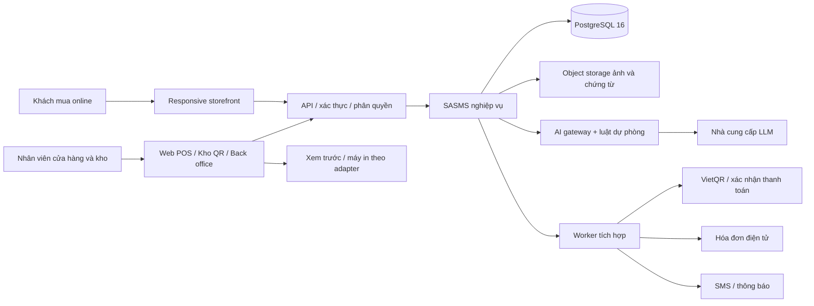
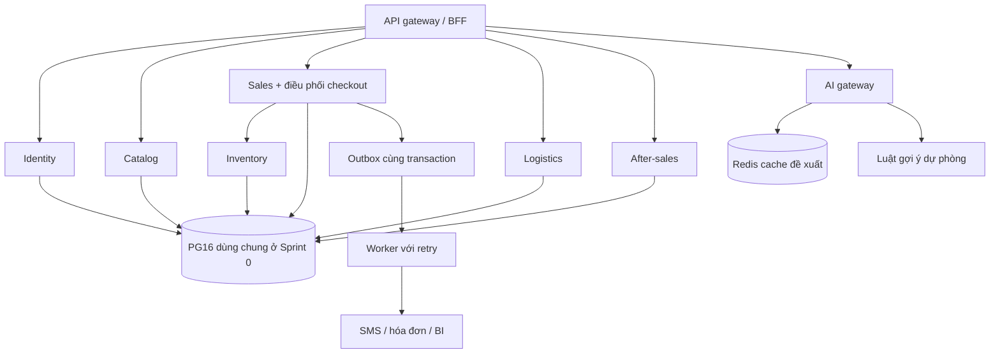
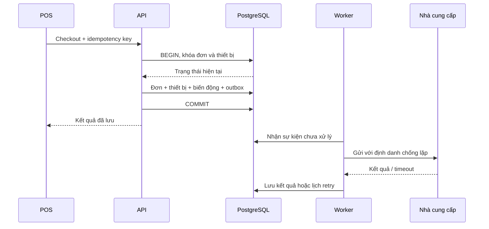

# D50 — Kiến trúc hệ thống SASMS

| Thuộc tính | Giá trị |
| --- | --- |
| Công việc | S0-17 — Thiết kế kiến trúc hệ thống |
| Phụ trách | Trần Trung Kiên — Architect / DBA |
| Phiên bản | 1.1 — Bổ sung môi trường FE/BE và phân tách tài khoản DB runtime (Kiên xác nhận) |
| Ngày lập thực tế | 07/11/2026 (Cập nhật: 11/11/2026) |
| Kỳ Sprint theo phân công | 12–25/09/2026; không dùng ngày này làm ngày ký giả định |
| Trạng thái | Đã cập nhật & xác nhận: vị trí root FE/BE, baseline Java 26 + Spring Boot 4.1.1 và quyền DB runtime sasms_app |

## 1. Cơ sở và giới hạn thiết kế

Thiết kế phục vụ hệ thống siêu thị điện máy SASMS với kho theo từng Serial/IMEI, POS và bán online, AI bán kèm, giao/lắp, bảo hành/đổi trả và BI. Sprint 0 bàn giao nền dữ liệu, tài liệu thiết kế và cách kiểm chứng; không tuyên bố đã xây dựng các dịch vụ ứng dụng.

| Nguồn trong repo | Thông tin sử dụng | Điều chưa thể kết luận |
| --- | --- | --- |
| [D05](../PM/D05.docx), mục 1 và 3 | Sáu module; Serial duy nhất; quy mô mục tiêu 100.000 thiết bị; scan dưới 1 giây, POS dưới 2 giây, AI dưới 3 giây, uptime 99,9% | Đây là mục tiêu nghiệm thu, chưa có số đo hệ thống |
| [D06](../PM/D06.docx), mục 2–3 | Hướng kiến trúc microservices; Kiên phụ trách kiến trúc, schema và security | Chưa có kế hoạch hạ tầng đã chọn |
| [D08](../PM/D08.docx), mục 2, 3 và 5 | Giao dịch checkout atomic; AI timeout/fallback; bản MVP ưu tiên kho/POS | Backend, phạm vi máy in và lịch trình khác D05/D06/D33 |
| [D33](../BA/D33.docx), KS35–KS46 | Cần xác nhận phân quyền, lưu giữ, QR, kiểm kê, thanh toán và in | Là bộ câu hỏi, chưa có câu trả lời hoặc người xác nhận thực tế |
| Bảng phân công Sprint 0, S0-17/18/21 | D50, D51, D54, D57 là đầu ra của Kiên | D34 FRS_V2 và D22 không có trong repo tại lúc thiết kế |

Mọi quyết định ghi **đề xuất** ở dưới cần BA/PM/Dev Lead review cùng D34/D22 khi có. Không suy diễn trạng thái ký trong một tài liệu PM thành phê duyệt tài liệu D50 này.

## 2. Bối cảnh hệ thống

Trình duyệt chỉ gọi API qua HTTPS; không kết nối PostgreSQL, Redis hoặc nhà cung cấp bằng khóa bí mật. QR thiết bị mang mã định danh hoặc token tra cứu, không mang thông tin khách hàng hay mật khẩu. Nội dung QR cụ thể chờ KS41.

## 3. Thành phần và quyền sở hữu dữ liệu

**Đề xuất cho Sprint 0:** một PostgreSQL 16 với schema nghiệp vụ chung, nhóm bảng theo miền; một backend có các module tách rõ trách nhiệm. Cách triển khai này cho phép kiểm chứng giao dịch kho/POS bằng transaction cục bộ. Các nhóm bên dưới là ranh giới thiết kế, không khẳng định đang có microservice độc lập hoặc database riêng.

| Miền / dịch vụ mục tiêu | Bảng sở hữu theo D51/D57 | Trách nhiệm |
| --- | --- | --- |
| Identity & Access | `users`, `roles`, `permissions`, `user_roles`, `role_permissions` | Xác thực, trạng thái tài khoản, RBAC |
| Catalog | `brands`, `categories`, `products`, `product_images`, `warranty_policies` | Danh mục, giá và chính sách bảo hành |
| Organization & Inventory | `stores`, `warehouses`, `suppliers`, `purchase_orders`, `purchase_order_items`, `goods_receipts`, `goods_receipt_items`, `devices`, `inventory_movements`, `stocktakes`, `stocktake_items` | Nhận hàng, nhận diện thiết bị, tồn kho, đối chiếu kiểm kê |
| Sales & Payment | `customers`, `sales_orders`, `sales_order_items`, `order_devices`, `payments`, `invoices` | Đơn POS/online, giữ/bán từng thiết bị, thanh toán, hóa đơn |
| Logistics | `deliveries`, `delivery_items`, `technician_assignments` | Giao hàng, bàn giao, phân công lắp đặt |
| After-sales | `warranties`, `warranty_claims`, `returns`, `return_items` | Bảo hành và đổi trả gắn thiết bị đã bán |
| AI & Analytics | `ai_recommendations`; dữ liệu đọc phục vụ báo cáo | Gợi ý, kết quả dự phòng, số liệu phân tích |
| Platform | `audit_logs`, `outbox_events` | Dấu vết nghiệp vụ và sự kiện tích hợp |

Chỉ module sở hữu ghi trực tiếp bảng của mình. Checkout là ngoại lệ được điều phối trong một transaction backend chung giữa Sales và Inventory ở giai đoạn dùng chung DB. Dev Lead cần giữ việc điều phối trong một lớp nghiệp vụ rõ ràng, không để controller hay AI gọi SQL tùy ý.

**Hướng microservices sau MVP:** tách AI/notifications/reporting trước vì ít phụ thuộc transaction; inventory và sales chỉ tách khi đã có hợp đồng sự kiện, cơ chế giữ hàng có hạn, saga bù trừ và kiểm thử lỗi mạng. Khi tách DB, bỏ FK xuyên dịch vụ có kiểm soát và thay bằng bản sao đọc/sự kiện; không thực hiện join xuyên database hoặc giả định transaction phân tán đã tồn tại.

Redis là cache có thể bỏ và xây lại; dữ liệu tồn kho, thanh toán và quyền truy cập không lấy Redis làm nguồn chân lý. Chưa có Redis hoặc worker ứng dụng trong đầu ra DB Sprint 0.

## 4. Giao dịch và nhất quán

### 4.1 Nhận hàng

Backend xác nhận quyền kho, kiểm tra phiếu mua/phiếu nhận cùng ngữ cảnh, rồi trong một transaction ghi phiếu nhận, thiết bị và biến động kho. Unique index bảo vệ Serial/IMEI khi hai request nhập cùng lúc. Lỗi một thiết bị làm rollback toàn bộ thao tác theo chính sách phiếu nguyên khối đề xuất. Nếu BA chọn nhận từng phần, mỗi đợt nhận phải có định danh/idempotency riêng và được đối soát với số lượng đặt.

Hợp đồng DB Sprint 0 dùng các hàm `receive_device`, `reserve_order`, `complete_sale`, `cancel_order` trong D57 để tập trung quy tắc nhận/giữ/bán/hủy. Backend gọi hàm trong transaction sau khi kiểm tra quyền và phạm vi. Cơ chế lặp lại thao tác dựa trên trạng thái nghiệp vụ trong hàm không thay thế kho idempotency API có so sánh payload; việc đó thuộc tầng ứng dụng.

### 4.2 Checkout và tránh bán trùng

1. Xác thực quyền `sales.checkout` và cửa hàng của người dùng; kiểm tra idempotency key cùng payload tại backend.
2. Mở transaction; khóa đơn và các thiết bị theo thứ tự ID ổn định bằng `SELECT ... FOR UPDATE`; kiểm tra lại trạng thái, SKU và kho thuộc cửa hàng.
3. Ghi chi tiết đơn và liên kết thiết bị. DB kiểm tra số lượng/liên kết, unique/FK và những chuyển trạng thái được D57 hiện thực; service thực hiện các quy tắc còn lại theo D51.
4. Cập nhật trạng thái thiết bị và ghi biến động kho trong cùng transaction. Ghi `outbox_events` cho thông báo/tích hợp; commit.
5. Trả kết quả sau commit. In hoặc gửi SMS lỗi không được tạo lại đơn hay ghi nhận tiền lần hai.

Khóa có thời hạn chờ; timeout/deadlock trả lỗi có thể retry giới hạn với cùng idempotency key. Không giữ transaction mở khi chờ AI, thiết bị in hay nhà cung cấp thanh toán. Unique constraint là chốt cuối cho tranh chấp; kiểm tra tồn trước transaction chỉ phục vụ hiển thị.

### 4.3 Thanh toán và tích hợp

VietQR chỉ là dữ liệu hướng dẫn chuyển khoản; hiển thị QR hoặc khách nhấn “đã chuyển” không chứng minh đã thu tiền. Backend xác minh nguồn, chữ ký, định danh giao dịch và số tiền của webhook theo hợp đồng nhà cung cấp. Thiết kế lưu định danh chống lặp và trạng thái để tra soát khi kết quả chưa rõ. Thứ tự nhận tiền, hết hạn giữ hàng và hoàn tiền chờ KS44/KS46; demo phải ghi rõ phương thức xác nhận thủ công hoặc sandbox.

Worker xử lý sự kiện theo cơ chế ít nhất một lần; consumer phải chống lặp theo ID sự kiện/ID nghiệp vụ. Claim batch bằng khóa hàng, lưu số lần thử và lỗi đã lọc; retry có backoff và giới hạn, sau đó chuyển hàng đợi lỗi để tra soát. Chỉ đánh dấu xử lý xong sau khi đã lưu kết quả. Việc gọi provider thành công rồi crash trước ghi DB vẫn có thể lặp, nên phải sử dụng idempotency của provider hoặc đối soát.

### 4.4 Đổi trả, bảo hành và kiểm kê

Đổi trả gắn với thiết bị và lần bán hợp lệ, có người duyệt độc lập; hoàn tiền dùng trạng thái riêng, không xóa giao dịch gốc. Thiết bị trả về phải qua kiểm tra trước khi thành hàng bán được. Kiểm kê lưu số liệu đối chiếu, người duyệt và biến động điều chỉnh; chính sách khóa giao dịch trong vùng kiểm kê chờ KS43. D57 hiện lưu chính sách tham chiếu và ngày bắt đầu/kết thúc bảo hành; chưa lưu snapshot nội dung điều kiện. Trước khi triển khai bảo hành thực tế, cần phiên bản chính sách bất biến hoặc snapshot lúc bán để việc sửa chính sách không làm thay đổi quyền lợi đã ghi nhận.

## 5. Triển khai và cấu hình

| Môi trường | Thiết kế đề xuất | Dữ liệu / truy cập |
| --- | --- | --- |
| Dev | PostgreSQL 16 cục bộ hoặc container; chạy schema/seed/test theo D57 | Chỉ dữ liệu giả; cổng bind loopback; tài khoản migration riêng |
| Staging | Cùng major PG16 và cấu hình migration với Prod; ứng dụng và DB tách mạng | Dữ liệu giả hoặc đã ẩn danh; provider sandbox; log không chứa secret |
| Prod | Ứng dụng sau reverse proxy HTTPS; DB private network; pool kết nối; lưu trữ và backup tách biệt | Secret manager; tài khoản runtime ít quyền; chỉ DBA/bastion được bảo trì |

### 5.1 Cấu trúc mã nguồn tại root repository (`TV4-S0-ARCH-01` — Phương án A1)

Đồng thuận đặt toàn bộ mã nguồn ứng dụng và hạ tầng tại thư mục gốc repository để đảm bảo tính liên tục của lịch sử git (`git log`, `git blame`) qua các Sprint:
- `backend/`: Mã nguồn dịch vụ backend Spring Boot (POS, Catalog, Inventory, IAM integration), kèm `backend/.gitignore` riêng.
- `frontend/`: Mã nguồn ứng dụng frontend React / Vite (Web POS, Mobile Scanner), kèm `frontend/.gitignore` riêng.
- `database/`: Schema, DBML, migrations, seed, tests và role provisioning của PostgreSQL.
- `infra/`: Ma trận môi trường, kịch bản triển khai và tài liệu vận hành.
- `scripts/`: Bộ công cụ tự động hóa kiểm tra, migration (`migrate_db.py`, `validate_sprint1.py`, `provision_s1_db.ps1`).

Việc đặt tại root tránh phân mảnh mã nguồn theo từng thư mục Sprint con (`Sprint 0/Fullstack/`), triệt tiêu rủi ro lỗi công cụ build do khoảng trắng đường dẫn Windows và thống nhất với cấu trúc phân phối của nhóm.

### 5.2 Môi trường thực thi của Frontend và Backend (`TV4-S0-ARCH-02` — Phương án B1)

Chốt baseline công nghệ chính thức theo hiện trạng mã nguồn đã được kiểm chứng bằng thực nghiệm:

- **Backend (BE):**
  - **Runtime & SDK:** **Java 26** (OpenJDK / Oracle JDK 26, bytecode level 70.0). Giữ nguyên theo source hiện có để bảo toàn tính toàn vẹn của bằng chứng kiểm thử tự động Sprint 0 và Sprint 1.
  - **Framework:** **Spring Boot 4.1.1** (sử dụng các starter: `spring-boot-starter-webmvc`, `spring-boot-starter-jdbc`, `spring-boot-starter-security`, `spring-boot-starter-oauth2-resource-server`).
  - **Công cụ build:** Apache Maven 3.9+ thông qua Maven Wrapper (`./mvnw` trên Linux/macOS, `mvnw.cmd` trên Windows).
  - **Quản lý cấu hình & CSDL:** PostgreSQL JDBC Driver (`org.postgresql:postgresql`). Biến môi trường Datasource gồm `SASMS_DB_URL`, `SASMS_DB_USERNAME`, `SASMS_DB_PASSWORD`. Thiết lập `spring.sql.init.mode=never` (không để Spring Boot tự ý DDL/khởi tạo CSDL).
  - **Bảo mật ứng dụng:** OAuth2 / JWT Resource Server với cơ chế fail-closed (chỉ mở các status endpoint công khai khi chưa cấu hình JWT, mọi route nghiệp vụ đều yêu cầu Bearer token hợp lệ).

- **Frontend (FE):**
  - **Runtime:** **Node.js 18+ / 22** và trình quản lý gói `npm`.
  - **Framework & Bundler:** **React** với công cụ xây dựng **Vite** (`vite.config.js`).
  - **Thư viện chuyên dụng:** Quét mã vạch/QR qua camera HTML5 bằng `@zxing/browser` (khóa version `0.1.5` tương thích Node 22) và `@zxing/library` (`0.21.3`).
  - **Kết nối API:** HTTP client dùng chung (`httpClient.js`) kết nối đến backend thông qua biến môi trường `VITE_API_BASE_URL` (mặc định `http://127.0.0.1:8080/api`).

### 5.3 Phân tách tài khoản CSDL: Phân quyền `sasms_app` cho Backend Runtime (`TV4-S0-ARCH-03` — Phương án C2)

Tuân thủ nghiêm ngặt nguyên tắc đặc quyền tối thiểu (Least Privilege) đã đề ra tại [D54](D54-bao-mat-phan-quyen.md) và [database/runtime-roles.sql](../../database/runtime-roles.sql):

- **Tài khoản Quản trị / DDL (`sasms_owner`):**
  - Chỉ dùng riêng cho DBA và các script/pipeline hạ tầng thực thi DDL, nạp schema (`schema.sql`), chạy migrations (`sasms_meta.schema_migrations`) và nạp seed dữ liệu khởi tạo.
  - **TUYỆT ĐỐI CẤM:** Không sử dụng `sasms_owner` làm tài khoản chạy ứng dụng Backend hoặc chạy các bài test nghiệp vụ hàng ngày.
- **Tài khoản Chạy ứng dụng Backend (`sasms_app`):**
  - Backend khi khởi chạy (`spring-boot:run`) và các bài kiểm thử JDBC (`PostgreSqlConnectionSmokeTest`, `Sprint1PostgreSqlIntegrationTest`) **bắt buộc sử dụng tài khoản LOGIN kế thừa nhóm quyền `sasms_app`**.
  - `sasms_app` là một group role bảo mật (`NOLOGIN`, `NOSUPERUSER`, `NOCREATEDB`, `NOCREATEROLE`, `NOREPLICATION`, `NOBYPASSRLS`).
  - Quyền hạn được cấp cho `sasms_app`:
    - `USAGE` trên schema `sasms`.
    - `SELECT` trên toàn bộ bảng và view nghiệp vụ (phục vụ truy vấn dữ liệu và kiểm tra metadata schema).
    - Quyền ghi hạn chế: `INSERT` trên `sasms.sales_orders` (chỉ các cột được phép: `id`, `code`, `idempotency_key`, `store_id`, `warehouse_id`, `customer_id`, `channel`, `created_by`; chặn client tự set `status` hay `total_amount`); `INSERT, UPDATE, DELETE` trên `sales_order_items`, `order_devices`, `payments`.
    - Gọi hàm giao dịch lõi: `EXECUTE` trên `sasms.receive_device`, `sasms.reserve_order`, `sasms.complete_sale`, `sasms.cancel_order` (Sprint 0) và `sasms.has_permission`, `sasms.assert_permission`, `sasms.create_product`, `sasms.update_product`, `sasms.receive_device_batch` (Sprint 1).
    - **Cơ chế phòng vệ:** Bất kỳ truy vấn nào cố ghi trực tiếp vào `devices`, `inventory_movements`, `audit_logs`, `outbox_events` hoặc sửa các cột bảo vệ đều bị PostgreSQL chặn đứng ngay ở tầng CSDL (`insufficient_privilege`).
  - **Cấp phát đăng nhập an toàn:** Tài khoản đăng nhập thực tế (ví dụ: `sasms_app_dev` hoặc `tv4_s1_app_login`) được tạo động/cục bộ và gắn vào role qua lệnh `GRANT sasms_app TO <login_user>`. Mật khẩu được sinh ngẫu nhiên hoặc lấy từ Secret Manager/biến môi trường, tuyệt đối không hardcode trong mã nguồn hoặc kho lưu trữ Git.

Ngày giờ lưu `timestamptz`, xử lý nhất quán UTC và hiển thị `Asia/Ho_Chi_Minh` theo cửa hàng đề xuất. Tiền dùng kiểu decimal chính xác theo D51, không dùng số thực.

Migration được đánh phiên bản, review cùng SQL/DBML/tài liệu; chạy trên DB mới và DB nâng cấp thử trước Prod. Không sửa một migration đã áp dụng; thêm migration tiến tới. Mỗi phát hành có backup, kế hoạch tương thích và rollback ứng dụng. DDL đảo ngược có mất dữ liệu phải qua quy trình riêng; không tự động drop schema sản xuất.

## 6. Sao lưu, phục hồi và quan sát

**Mục tiêu vận hành đề xuất cần PM duyệt:** Prod RPO tối đa 15 phút, RTO tối đa 4 giờ; Staging RPO 24 giờ, RTO 1 ngày làm việc. `pg_dump` đơn lẻ hằng ngày không đạt RPO 15 phút: để đạt cần base backup cùng lưu WAL liên tục/PITR, kiểm tra lưu WAL và diễn tập khôi phục. Có thể chọn dịch vụ quản trị PG hỗ trợ tương đương sau khi xác nhận chi phí.

Backup mã hóa, đặt nơi tách máy chủ DB; quyền đọc backup được giới hạn như dữ liệu Prod. Đề xuất giữ 7 bản ngày và 4 bản tuần, cấu hình vòng đời sau review yêu cầu lưu giữ. Ít nhất mỗi tháng khôi phục vào môi trường cô lập, kiểm tra count/checksum nghiệp vụ và transaction mẫu, ghi thời gian thực tế cùng biên bản. Sau phục hồi phải đối soát payment/outbox trước khi bật worker để tránh gửi hoặc thu tiền lặp.

Theo dõi độ trễ query/checkout, số kết nối, transaction chờ khóa/deadlock, dung lượng và tỷ lệ cache, replication/WAL nếu có, backup gần nhất, hàng outbox quá hạn và lỗi provider. Log có request/correlation ID; không ghi mật khẩu, token hoặc toàn bộ địa chỉ/số điện thoại. Cảnh báo có ngưỡng và người nhận do D22/D14 chốt.

100.000 thiết bị là quy mô kiểm tra theo D05. Kiểm tra DB với dữ liệu giả cần lưu phiên bản PG, CPU/RAM, số bản ghi, query và `EXPLAIN (ANALYZE, BUFFERS)`; kết quả DB không chứng minh scan camera, API POS, uptime hay AI đạt SLA. Các mục đó cần kiểm thử ứng dụng và theo dõi vận hành riêng.

## 7. Quyết định còn mở và tiêu chí review

| Mã | Việc cần chốt | Người phối hợp | Điều kiện đóng |
| --- | --- | --- | --- |
| ARC-01 | D34 FRS và D22 chưa có | Huy, Thái, PM | Liên kết baseline và review ảnh hưởng D50/D51 |
| ARC-02 | Sáu module toàn hệ thống và demo kho/POS | Huy, PM, Sponsor | Phạm vi từng Sprint và chấp nhận phần nào đã được ký |
| ARC-03 | Máy in nhiệt 80 mm trong D33 và HTML/PDF theo D08 | Huy, Thái, PM | Quyết định phạm vi + model/giao tiếp thử nếu dùng máy in |
| ARC-04 | Chín vai trò, phạm vi cửa hàng, phê duyệt giao dịch | Huy, PM | Ma trận D54 được xác nhận |
| ARC-05 | QR/Serial theo hãng, giữ hàng, thanh toán, kiểm kê | Huy, trưởng kho, thu ngân | Trả lời KS41–KS46 và D35; cập nhật ràng buộc |
| ARC-06 | Backend/Frontend baseline, tài khoản runtime DB sasms_app, cloud, backup, RPO/RTO và SLA | Thái, Kiên, PM | **ĐÃ CHỐT:** Đặt `backend/` và `frontend/` tại root; BE dùng Java 26 + Spring Boot 4.1.1; FE dùng React + Vite; kết nối backend dùng login thuộc quyền `sasms_app` (không dùng owner). Cloud/PITR chờ hoàn thiện Staging |
| ARC-07 | Mâu thuẫn mã tài liệu: workbook gọi D05 Charter, repo D05 là Scope, D06 là Charter | PM | Danh mục tài liệu thống nhất, không đổi tên mất dấu nguồn |

Review cần kiểm tra: các miền có chủ sở hữu; kho/POS có transaction atomic và chống lặp; thiết bị không bán trùng; provider lỗi không chặn bán hàng; security mặc định từ chối; SQL/DBML/D51 khớp nhau; log chạy thử có thật; các giả định còn mở được ghi nhận. D50 không thay thế biên bản Quality Gate M1.

| Người review / ký | Phạm vi | Trạng thái | Ngày / bằng chứng |
| --- | --- | --- | --- |
| Trần Trung Kiên | Kiến trúc, dữ liệu, baseline FE/BE & quyền DB runtime | ĐÃ XÁC NHẬN | 11/11/2026 (Chấp thuận A1 root repo, B1 Java 26/Spring Boot 4.1.1, C2 sasms_app login) |
| Vũ Duy Thái — Dev Lead | Khả năng hiện thực, triển khai | Chờ review/ký | Đã đề xuất và kiểm chứng kỹ thuật tại bàn giao TV4 |
| Trịnh Quốc An — PM | Phạm vi, vận hành, mốc M1 | Chờ review/ký | Đã chấp thuận A1, B1, C2 ngày 07/11/2026 |
