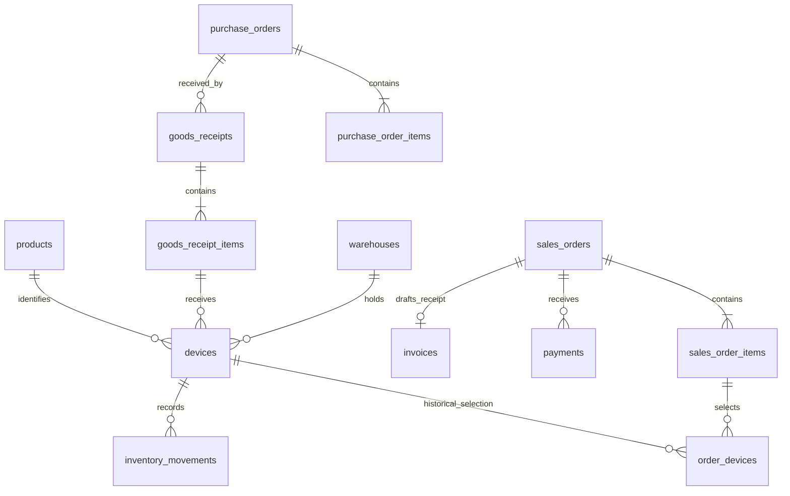

# D51 — Thiết kế cơ sở dữ liệu SASMS

| Thuộc tính | Giá trị |
|---|---|
| Công việc | S0-18 — Trần Trung Kiên, Architect / DBA |
| Phiên bản | 1.0 — thiết kế dựng lại trên nhánh `Kien` |
| Ngày thực hiện | 07/11/2026; phục dựng đầu ra Sprint 0 (12–25/09/2026) |
| Nền tảng | PostgreSQL 16, schema `sasms`, UTF-8, `timestamptz` |
| Phê duyệt | Chờ Kiên, BA Huy và Sponsor review/ký; chưa phải baseline được duyệt |

## 1. Căn cứ và giới hạn

Nguồn: [D05](../PM/D05.docx) mục 1 và tiêu chí Serial unique/100.000 thiết bị; [D06](../PM/D06.docx) mục 2–3; [D20](../PM/D20.docx) mục 8.1 về nhập kho → chọn Serial → checkout → SOLD. Bảng phân công người dùng cung cấp, sheet “Theo người” dòng 19–21 và “Tài liệu và minh chứng” dòng 20/26, yêu cầu ERD, SQL/DBML, log PostgreSQL 16 và test ràng buộc.

Repo chưa có D34 FRS_V2 hoặc bản nháp 37 bảng mà Excel nhắc đến. Bộ **37 bảng dưới đây được thiết kế lại**, không khẳng định đã khôi phục bản nháp đó. D33 là bộ câu hỏi chưa có câu trả lời khảo sát. Các lựa chọn nghiệp vụ dưới đây là đề xuất chờ xác nhận. Xung đột phạm vi được ghi tại [hồ sơ review M1](D126-ho-so-review-M1.md).

Phần thực thi Sprint 0 tập trung dữ liệu kho theo từng thiết bị và POS. Giao/lắp đặt, bảo hành, đổi trả, kiểm kê và AI có cấu trúc dữ liệu nền; chưa có đầy đủ API, state machine hay nghiệp vụ hậu bán. Không coi có bảng là đã hoàn thành module.

## 2. Các giả định thiết kế

| Mã | Lựa chọn đang dùng | Cần xác nhận |
|---|---|---|
| DB-A01 | Mỗi đơn vị hàng có một `devices` record và Serial duy nhất toàn chuỗi | Huy xác nhận phụ kiện theo số lượng; nếu áp dụng phải bổ sung mô hình tồn số lượng |
| DB-A02 | Serial bỏ khoảng trắng hai đầu, chuyển chữ hoa; không chứa khoảng trắng bên trong; dài 1–100 | Quy tắc riêng từng hãng thuộc D35; không tự đoán regex hãng |
| DB-A03 | IMEI có thể NULL, nếu có phải đúng 15 chữ số và duy nhất | Chưa kiểm checksum Luhn hoặc nhiều IMEI trên máy; cần BA xác nhận |
| DB-A04 | QR chứa token thiết bị: `SASMS:DEVICE:<qr_token>`; không chứa khách hàng/giá trị nhạy cảm | Đối chiếu tem QR nhà cung cấp và KS41 của D33 |
| DB-A05 | Một đơn bán từ một kho thuộc một cửa hàng; tiền VND, hai chữ số thập phân | Tách đơn nhiều kho/ngoại tệ cần CR/migration |
| DB-A06 | Giá, chiết khấu, thuế chốt theo dòng đơn; tổng tiền bằng tổng `line_total` làm tròn từng dòng | Cách tính thuế, giá đã gồm thuế hay chưa, làm tròn và quyền giảm giá |
| DB-A07 | Chỉ chốt khi tổng tiền CAPTURED bằng đúng tổng đơn; QR hiện ra chưa chứng minh đã nhận tiền | Hợp đồng provider, ký webhook, đối soát, tiền thừa/thiếu và hoàn tiền |
| DB-A08 | Đơn RESERVED không tự hết hạn ở Sprint 0; hủy đơn có điều kiện trả tồn | BA chốt TTL; worker tương lai không được hủy đơn đã có tiền CAPTURED |
| DB-A09 | Không xóa cứng chứng từ nghiệp vụ; khóa ngoại mặc định NO ACTION | Chính sách lưu giữ/ẩn danh và quy trình sửa sai |

## 3. Ranh giới và danh mục 37 bảng

| Nhóm / chủ sở hữu logic | Bảng | Ý nghĩa |
|---|---|---|
| IAM (6) | `users`, `roles`, `permissions`, `stores`, `user_roles`, `role_permissions` | Danh tính, 9 vai trò đề xuất, quyền và phạm vi cửa hàng |
| Danh mục (6) | `warehouses`, `brands`, `categories`, `products`, `product_images`, `suppliers` | Kho, SKU, thông số JSON, tối đa 3 ảnh/2MiB và nhà cung cấp |
| Nhập kho (4) | `purchase_orders`, `purchase_order_items`, `goods_receipts`, `goods_receipt_items` | PO duyệt thủ công và các đợt nhận hàng theo PO |
| Kho thiết bị (4) | `devices`, `inventory_movements`, `stocktakes`, `stocktake_items` | Danh tính vật lý, trạng thái tồn, biến động và nền kiểm kê |
| POS / CRM (6) | `customers`, `sales_orders`, `sales_order_items`, `order_devices`, `payments`, `invoices` | Khách, đơn, thiết bị bán, xác nhận tiền và bản ghi hóa đơn |
| Logistics (3) | `deliveries`, `delivery_items`, `technician_assignments` | Tách chuyến giao, thiết bị trong chuyến, phân công kỹ thuật |
| Hậu bán (5) | `warranty_policies`, `warranties`, `warranty_claims`, `returns`, `return_items` | Chính sách/kỳ bảo hành, yêu cầu sửa và đề nghị đổi trả |
| AI / nền tảng (3) | `ai_recommendations`, `audit_logs`, `outbox_events` | Gợi ý SKU, audit và sự kiện cùng transaction |

Tất cả cột, kiểu, NULL/default, PK/FK/CHECK/index nằm trong [từ điển sinh từ catalog](D51-tu-dien-du-lieu.md). Xem [DBML đầy đủ](../../database/schema.dbml) và [ERD 37 bảng](../../database/erd.mmd). Sơ đồ nghiệp vụ cốt lõi:

Sơ đồ cốt lõi thể hiện số dòng tối thiểu nghiệp vụ sau reserve; SQL vẫn cho phép tạo header DRAFT chưa có dòng. Draft của nhiều đơn có thể cùng chọn một thiết bị; **quyền giữ tồn** chỉ nằm tại `devices.reserved_order_id`, không nằm ở lựa chọn trong giỏ.

## 4. Chuẩn hóa và lịch sử

- Đạt mục tiêu 3NF cho danh mục, header/line và quan hệ nhiều-nhiều; không lặp mảng Serial trong dòng hóa đơn. `specifications` JSONB chỉ chứa thông số biến đổi theo nhóm hàng, không thay FK nghiệp vụ.
- `order_devices` tách số lượng SKU và danh tính thiết bị. Khóa ngoại ghép bảo đảm Serial được chọn đúng SKU và đúng dòng/đơn.
- `goods_receipt_items` tham chiếu đúng SKU, dòng PO và header PO. Kho phiếu nhận phải khớp kho PO; kho đơn bán phải thuộc cửa hàng trên đơn.
- Các cột phụ trợ `product_id`, `order_id`, `purchase_order_id` được lặp trong khóa ngoại ghép để SQL kiểm tra tính nhất quán. Giá bán, thuế, chiết khấu và địa chỉ giao là snapshot giao dịch có chủ đích; không cập nhật theo giá/địa chỉ danh mục.
- `line_total` là cột sinh; `sales_orders.total_amount` là tổng đóng băng lúc reserve. Runtime không có quyền sửa trực tiếp tổng/trạng thái đơn. Lịch sử bảo hành hiện chưa snapshot toàn văn điều khoản; đó là hạng mục bổ sung trước khi triển khai hậu bán.

## 5. Bất biến và giao dịch

| Bất biến | Thực thi |
|---|---|
| Serial/IMEI/QR không trùng | UNIQUE; CHECK Serial canonical/IMEI15; hàm nhập canonical hóa Serial |
| Không nhận quá số lượng phiếu hoặc PO | `receive_device` khóa PO header → receipt → receipt line → PO line; đếm thiết bị đã nhận trong transaction |
| Giữ đúng đủ số thiết bị, đúng SKU, đúng kho | FK ghép + `reserve_order`; thiết bị được khóa theo UUID tăng dần |
| Không bán cùng một Serial hai lần đồng thời | Khóa dòng `devices`; chỉ nhận `IN_STOCK`, gắn chủ đơn giữ; hoàn tất đòi đúng chủ |
| Không sửa dòng đơn đã giữ hàng | Trigger khóa header cùng transaction trước mọi INSERT/UPDATE/DELETE dòng hoặc lựa chọn thiết bị |
| Không chốt dựa trên QR/PENDING hoặc tiền thiếu/thừa | `complete_sale` chỉ cộng CAPTURED; backend xác thực bằng chứng tiền trước khi ghi CAPTURED |
| Không sửa/xóa khoản tiền đã CAPTURED | Trigger từ chối; hoàn tiền cần workflow riêng được review |
| Hủy không làm mất khoản tiền đã nhận | `cancel_order` từ chối đơn PAID hoặc có CAPTURED; trả thiết bị về IN_STOCK nếu hợp lệ |
| Giao dịch lỗi không để tồn/audit/sự kiện dở dang | Hàm PL/pgSQL cùng transaction; lỗi rollback toàn lời gọi |
| Retry không tạo hóa đơn/SALE/event lần hai | Reserve, hoàn tất, hủy kiểm trạng thái; invoice unique theo đơn, outbox unique theo loại event/aggregate |
| Không xóa dấu vết từ tài khoản backend | Runtime SELECT audit/movements; ghi chỉ qua các hàm được cấp, không UPDATE/DELETE |

Luồng chính: `IN_STOCK → RESERVED → SOLD`; hủy đơn giữ: `RESERVED → IN_STOCK`. Các trạng thái WARRANTY/RETURNED/SCRAPPED được định nghĩa để chuẩn bị mở rộng; không được tự UPDATE trực tiếp để mô phỏng quy trình đã hoàn chỉnh.

Các hàm là hợp đồng giao dịch DB, **không tự xác thực người dùng cuối**. `p_actor` do backend sau xác thực JWT/session và permission/scope cung cấp. `sasms_app` là credential tin cậy của backend; không phát cho trình duyệt. [D54](D54-bao-mat-phan-quyen.md) phân biệt quyền SQL và RBAC nghiệp vụ.

`receive_device` chưa nhận request key riêng: retry Serial trùng bị từ chối nguyên tử. API phải dùng request key và so khớp payload để trả kết quả cũ đúng yêu cầu. `sales_orders.idempotency_key` hỗ trợ chống tạo header trùng; backend phải đối chiếu payload, không xem UUID trùng là chứng minh payload bằng nhau.

## 6. Chỉ mục, quy mô và vận hành

Unique index phục vụ tìm Serial, IMEI, QR token. Index `(warehouse_id, product_id, status)` phục vụ tồn kho; order-store-date, payments-order và audit-entity-date phục vụ truy vấn thường gặp. `stock_availability` đếm trạng thái thiết bị để tránh hai nguồn số tồn độc lập. Partial index outbox chỉ chứa sự kiện chưa publish.

Mục tiêu 100.000 thiết bị xuất phát từ D05. Bài kiểm tra quy mô trong [D57](D57-luoc-do-va-kiem-thu.md) chỉ đo SQL lookup trong môi trường thử; không suy ra SLA QR/API hoặc uptime. Cần test tải HTTP, pool connection và tình huống lock trên Staging để đánh giá <1s QR/<2s POS.

Schema initial chạy nguyên tử và từ chối nếu đã có `sasms`. Không tự DROP hay sửa database đang dùng. Sau review, mọi thay đổi đi bằng migration mới có số thứ tự, chạy Staging và backup trước triển khai. [D50](D50-kien-truc-he-thong.md) mô tả sao lưu/khôi phục và lộ trình tách dịch vụ.

## 7. Điểm chờ phê duyệt

Huy cần chốt DB-A01–09, D35 định dạng Serial/IMEI, 9 vai trò và phạm vi quyền. Thái review hợp đồng API/transaction, schema và việc xác thực tiền. Kiên review khóa/chỉ mục/bảo mật. PM/Sponsor duyệt phạm vi và baseline. [Hồ sơ M1](D126-ho-so-review-M1.md) lưu checklist và ô ký đang chờ.
