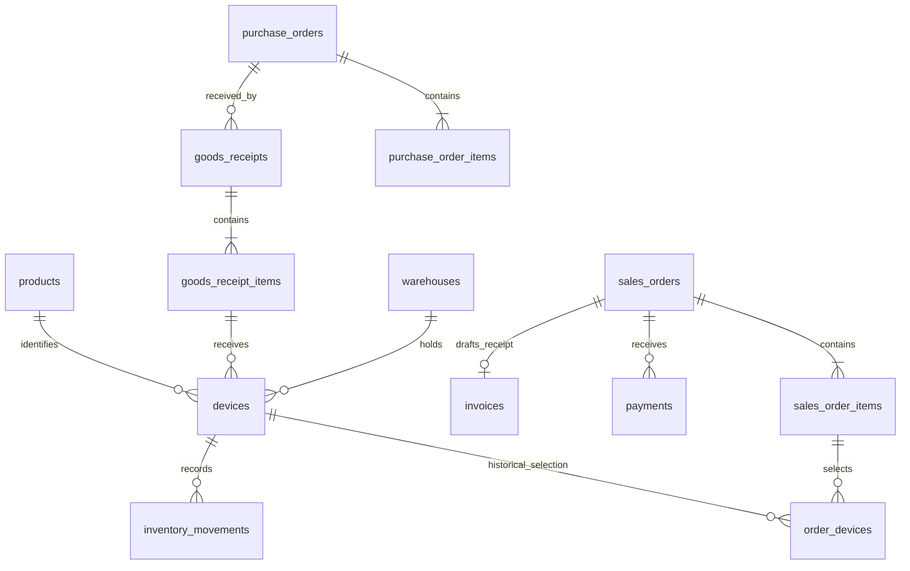

# D51 — Thiết kế cơ sở dữ liệu SASMS

| Thuộc tính | Giá trị |
|---|---|
| Công việc | S0-18 — Trần Trung Kiên, Architect / DBA |
| Phiên bản | 1.1 — giữ mô hình S0, cập nhật đối chiếu nguồn và trạng thái quyết định |
| Ngày thực hiện | Lập 07/11/2026; rà soát tài liệu 20/11/2026; không hồi tố vào kỳ Sprint 0 (12–25/09/2026) |
| Nền tảng | PostgreSQL 16, schema `sasms`, UTF-8, `timestamptz` |
| Phê duyệt | Chờ Kiên, BA Huy và Sponsor review/ký; chưa phải baseline được duyệt |

## 1. Căn cứ và giới hạn

Nguồn: [D05](../PM/D05.docx) mục 1 và tiêu chí Serial unique/100.000 thiết bị; [D06](../PM/D06.docx) mục 2–3; [D20](../PM/D20.docx) mục 8.1 về nhập kho → chọn Serial → checkout → SOLD. Bảng phân công người dùng cung cấp, sheet “Theo người” dòng 19–21 và “Tài liệu và minh chứng” dòng 20/26, yêu cầu ERD, SQL/DBML, log PostgreSQL 16 và test ràng buộc.

Tài liệu [D34 FRS_V2](../BA/D34_FRS_V2_SASMS.docx) và [D35 Quy tắc Serial/IMEI](../BA/D35_Quy_tac_Serial_IMEI_SASMS.docx) của BA Nguyễn Quang Huy đã có trong repo. Bộ 37 bảng dưới đây là nền dữ liệu để đối chiếu các nhóm thực thể của D34; sự hiện diện của bảng chưa chứng minh đã đáp ứng mọi trường dữ liệu, workflow hoặc tiêu chí nghiệm thu. Các quyết định Fullstack cần đối chiếu với D34/D35 và phần DB hiện hành tại [D53 Sổ đăng ký quyết định](../Fullstack/TV4/docs/sprint0/d53/D53_DECISION_REGISTER.md) và [hồ sơ review M1](D126-ho-so-review-M1.md).

Các liên kết BA dạng `_SASMS` trên là nguồn truy vết cụ thể của hợp đồng DB. Repo còn có D34/D36/D41/D42/D43 tên tiếng Việt với mapping mở rộng 25 Use Case, trong khi bộ trước có 15 Use Case; BR/NFR cốt lõi không thay đổi. BA cần công bố bản chuẩn và đối chiếu mapping mới; hồ sơ DB không tự xác nhận bộ nào đã được ký hoặc đổi mã truy vết cũ.

Phần thực thi Sprint 0 tập trung dữ liệu kho theo từng thiết bị và POS. Giao/lắp đặt, bảo hành, đổi trả, kiểm kê và AI có cấu trúc dữ liệu nền; chưa có đầy đủ API, state machine hay nghiệp vụ hậu bán. Không coi có bảng là đã hoàn thành module.

## 2. Quy tắc đã hiện thực và trạng thái review

| Mã | Lựa chọn / phạm vi CSDL | Căn cứ và hợp đồng kỹ thuật | Trạng thái review |
|---|---|---|---|
| DB-A01 | Mỗi đơn vị hàng đang được hỗ trợ có một `devices` record và Serial duy nhất toàn chuỗi | Quản lý thiết bị có Serial/IMEI theo D34 BR-01. Phụ kiện/dịch vụ không Serial theo D52 AI chưa có mô hình tồn/checkout tương ứng trong DB hiện hành | Đã hiện thực cho hàng có Serial; phạm vi hàng không Serial cần BA/Fullstack/DB thống nhất, chưa tự xác nhận hoãn sang Sprint sau |
| DB-A02 | S0/V002 từng upper-case/100 ký tự | V003 theo D35: raw, trim, phân biệt hoa/thường, giữ dấu/space nội bộ, 1–128 và unique | Hiện hành DB; DEC-03 cũ cần consumer đồng bộ |
| DB-A03 | S0/V002 một IMEI và regex15 số | V003 registry IMEI slot1/2, Luhn trong DB và unique chéo slot; dữ liệu cũ legacy chưa xác minh | Theo D35 SER-07/08; không chứng nhận dữ liệu cũ |
| DB-A04 | QR chứa token thiết bị: `SASMS:DEVICE:<qr_token>`; không chứa khách hàng/giá trị nhạy cảm | Format `SASMS:DEVICE:<uuid>` theo D35 và TV4 scanner (DEC-07) | Đã hiện thực payload; kiểm hình QR/in/quét và ký nghiệm thu thuộc ứng dụng/QA |
| DB-A05 | Một đơn bán từ một kho thuộc một cửa hàng; tiền VND, numeric chính xác | Đơn hàng gắn với `store_id` và `warehouse_id` theo D34 BR-11; schema lưu số tiền với hai chữ số thập phân | Đã hiện thực ràng buộc DB; mapping DTO/đơn vị tiền cần thống nhất với API |
| DB-A06 | Giá, chiết khấu, thuế snapshot theo dòng; tổng bằng tổng `line_total` làm tròn từng dòng | `sales_order_items.unit_price` và biểu thức `line_total` là cách tính hiện có | Đã hiện thực kỹ thuật; DEC-09 trong D53 vẫn PENDING, cần BA/PO duyệt chính sách thuế/chiết khấu/làm tròn |
| DB-A07 | Chỉ hoàn tất bán khi tổng CAPTURED bằng đúng tổng đơn; QR/PENDING không chứng minh nhận tiền | `sasms.complete_sale` kiểm payment trước khi chuyển `PAID` | Đã hiện thực guard DB; DEC-08 trong D53 vẫn PENDING cho phạm vi xác minh/đối soát, không suy thành phê duyệt provider |
| DB-A08 | S0 chưa có timeout | V004 deadline đầu giữ POS10m/ONLINE30m, không gia hạn; PENDING/CAPTURED không tự release | D34 BR-03; worker/đối soát thuộc ứng dụng |
| DB-A09 | Không xóa cứng chứng từ nghiệp vụ; khóa ngoại mặc định NO ACTION | Quy tắc D34 BR-07; runtime bị hạn chế DML và ghi movement/audit cùng transaction | Đã hiện thực kiểm soát DB; chính sách lưu giữ và ký nghiệm thu vẫn cần người sở hữu |

Mô hình dưới đây giữ snapshot S0 **37 bảng**, không viết đè lịch sử. Hiện hành V001…V005 có **41 bảng**; xem [artifact Sprint2](../../database/sprint2) và [D35 DB](../../Sprint%201/DB/D35-hop-dong-quy-tac-dinh-danh.md).

D53 DEC-01/03/04/05 còn mô tả role cũ, Serial uppercase/100, một IMEI và cơ chế hết hạn cũ. Những phát biểu đó cần người sở hữu cập nhật theo V003…V005; không dùng chúng để thay quy tắc BA hiện hành. “Đã hiện thực” trong bảng trên là trạng thái kỹ thuật, không phải chữ ký phê duyệt nghiệp vụ.

## 3. Ranh giới và danh mục 37 bảng

| Nhóm / chủ sở hữu logic | Bảng | Ý nghĩa |
|---|---|---|
| IAM (6) | `users`, `roles`, `permissions`, `stores`, `user_roles`, `role_permissions` | Danh tính, 9 vai trò đề xuất, quyền và phạm vi cửa hàng |
| Danh mục (6) | `warehouses`, `brands`, `categories`, `products`, `product_images`, `suppliers` | Kho, SKU, thông số JSON, tối đa 3 ảnh/2MiB và nhà cung cấp |
| Nhập kho (4) | `purchase_orders`, `purchase_order_items`, `goods_receipts`, `goods_receipt_items` | PO duyệt thủ công và các đợt nhận hàng theo PO |
| Kho thiết bị (4) | `devices`, `inventory_movements`, `stocktakes`, `stocktake_items` | Danh tính vật lý, trạng thái tồn, biến động và nền kiểm kê |
| POS / CRM (6) | `customers`, `sales_orders`, `sales_order_items`, `order_devices`, `payments`, `invoices` | Khách, đơn, thiết bị bán, xác nhận tiền và bản ghi hóa đơn |
| Logistics (3) | `deliveries`, `delivery_items`, `technician_assignments` | Tách chuyến giao, thiết bị trong chuyến, phân công kỹ thuật |
| Hậu bán (5) | `warranty_policies`, `warranties`, `warranty_claims`, `returns`, `return_items` | Chính sách/kỳ bảo hành, yêu cầu sửa và đề nghị đổi trả |
| AI / nền tảng (3) | `ai_recommendations`, `audit_logs`, `outbox_events` | Gợi ý SKU, audit và sự kiện cùng transaction |

Tất cả cột, kiểu, NULL/default, PK/FK/CHECK/index nằm trong [từ điển sinh từ catalog](D51-tu-dien-du-lieu.md). Xem [DBML đầy đủ](../../database/schema.dbml) và [ERD 37 bảng](../../database/erd.mmd). Sơ đồ nghiệp vụ cốt lõi:

Sơ đồ cốt lõi thể hiện số dòng tối thiểu nghiệp vụ sau reserve; SQL vẫn cho phép tạo header DRAFT chưa có dòng. Trong snapshot S0, draft của nhiều đơn có thể chọn cùng một thiết bị và quyền giữ tồn nằm tại `devices.reserved_order_id`. Hiện hành Sprint 2 bổ sung khóa chọn Serial và lease ngay từ DRAFT; xem DS2, không dùng hành vi draft lịch sử để xây API mới.

## 4. Chuẩn hóa và lịch sử

- Đạt mục tiêu 3NF cho danh mục, header/line và quan hệ nhiều-nhiều; không lặp mảng Serial trong dòng hóa đơn. `specifications` JSONB chỉ chứa thông số biến đổi theo nhóm hàng, không thay FK nghiệp vụ.
- `order_devices` tách số lượng SKU và danh tính thiết bị. Khóa ngoại ghép bảo đảm Serial được chọn đúng SKU và đúng dòng/đơn.
- `goods_receipt_items` tham chiếu đúng SKU, dòng PO và header PO. Kho phiếu nhận phải khớp kho PO; kho đơn bán phải thuộc cửa hàng trên đơn.
- Các cột phụ trợ `product_id`, `order_id`, `purchase_order_id` được lặp trong khóa ngoại ghép để SQL kiểm tra tính nhất quán. Giá bán, thuế, chiết khấu và địa chỉ giao là snapshot giao dịch có chủ đích; không cập nhật theo giá/địa chỉ danh mục.
- `line_total` là cột sinh; `sales_orders.total_amount` là tổng đóng băng lúc reserve. Runtime không có quyền sửa trực tiếp tổng/trạng thái đơn. Lịch sử bảo hành hiện chưa snapshot toàn văn điều khoản; đó là hạng mục bổ sung trước khi triển khai hậu bán.

## 5. Bất biến và giao dịch

Bảng dưới mô tả ràng buộc của `schema.sql` S0. V003 thay chuẩn định danh; V004 bổ sung kiểm quyền, deadline và bảo vệ PENDING cho các hàm kế thừa. Chữ ký và hợp đồng hiện hành tra tại D35/DS2 DB.

| Bất biến | Thực thi |
|---|---|
| Serial/IMEI/QR không trùng | UNIQUE; CHECK Serial canonical/IMEI15; hàm nhập canonical hóa Serial |
| Không nhận quá số lượng phiếu hoặc PO | `receive_device` khóa PO header → receipt → receipt line → PO line; đếm thiết bị đã nhận trong transaction |
| Giữ đúng đủ số thiết bị, đúng SKU, đúng kho | FK ghép + `reserve_order`; thiết bị được khóa theo UUID tăng dần |
| Không bán cùng một Serial hai lần đồng thời | Khóa dòng `devices`; chỉ nhận `IN_STOCK`, gắn chủ đơn giữ; hoàn tất đòi đúng chủ |
| Không sửa dòng đơn đã giữ hàng | Trigger khóa header cùng transaction trước mọi INSERT/UPDATE/DELETE dòng hoặc lựa chọn thiết bị |
| Không chốt dựa trên QR/PENDING hoặc tiền thiếu/thừa | `complete_sale` chỉ cộng CAPTURED; backend xác thực bằng chứng tiền trước khi ghi CAPTURED |
| Không sửa/xóa khoản tiền đã CAPTURED | Trigger từ chối; hoàn tiền cần workflow riêng được review |
| Hủy không làm mất khoản tiền đã nhận | `cancel_order` từ chối đơn PAID hoặc có CAPTURED; trả thiết bị về IN_STOCK nếu hợp lệ |
| Giao dịch lỗi không để tồn/audit/sự kiện dở dang | Hàm PL/pgSQL cùng transaction; lỗi rollback toàn lời gọi |
| Retry không tạo hóa đơn/SALE/event lần hai | Reserve, hoàn tất, hủy kiểm trạng thái; invoice unique theo đơn, outbox unique theo loại event/aggregate |
| Không xóa dấu vết từ tài khoản backend | Runtime SELECT audit/movements; ghi chỉ qua các hàm được cấp, không UPDATE/DELETE |

Luồng chính: `IN_STOCK → RESERVED → SOLD`; hủy đơn giữ: `RESERVED → IN_STOCK`. Các trạng thái WARRANTY/RETURNED/SCRAPPED được định nghĩa để chuẩn bị mở rộng; không được tự UPDATE trực tiếp để mô phỏng quy trình đã hoàn chỉnh.

Các hàm là hợp đồng giao dịch DB, **không tự xác thực người dùng cuối**. `p_actor` do backend sau xác thực JWT/session và permission/scope cung cấp. `sasms_app` là credential tin cậy của backend; không phát cho trình duyệt. [D54](D54-bao-mat-phan-quyen.md) phân biệt quyền SQL và RBAC nghiệp vụ.

`receive_device` chưa nhận request key riêng: retry Serial trùng bị từ chối nguyên tử. API phải dùng request key và so khớp payload để trả kết quả cũ đúng yêu cầu. `sales_orders.idempotency_key` hỗ trợ chống tạo header trùng; backend phải đối chiếu payload, không xem UUID trùng là chứng minh payload bằng nhau.

## 6. Chỉ mục, quy mô và vận hành

Unique index phục vụ tìm Serial, IMEI, QR token. Index `(warehouse_id, product_id, status)` phục vụ tồn kho; order-store-date, payments-order và audit-entity-date phục vụ truy vấn thường gặp. `stock_availability` đếm trạng thái thiết bị để tránh hai nguồn số tồn độc lập. Partial index outbox chỉ chứa sự kiện chưa publish.

Mục tiêu 100.000 thiết bị xuất phát từ D05. Bài kiểm tra quy mô trong [D57](D57-luoc-do-va-kiem-thu.md) chỉ đo SQL lookup trong môi trường thử; không suy ra SLA QR/API hoặc uptime. Cần test tải HTTP, pool connection và tình huống lock trên Staging để đánh giá <1s QR/<2s POS.

Schema initial chạy nguyên tử và từ chối nếu đã có `sasms`. Không tự DROP hay sửa database đang dùng. Sau review, mọi thay đổi đi bằng migration mới có số thứ tự, chạy Staging và backup trước triển khai. [D50](D50-kien-truc-he-thong.md) mô tả sao lưu/khôi phục và lộ trình tách dịch vụ.

## 7. Điểm chờ phê duyệt

Huy đối chiếu DB-A01–09 với D34/D35 đã có, chốt phần giá/thuế, phạm vi hàng không Serial và mapping Use Case còn khác phiên bản. Thái review hợp đồng API/transaction và xác thực tiền; Kiên review khóa/chỉ mục/bảo mật. PM/Sponsor duyệt phạm vi và baseline. [Hồ sơ M1](D126-ho-so-review-M1.md) lưu checklist và ô ký đang chờ; việc cập nhật tài liệu ngày 20/11 không thay kết quả kiểm thử hoặc chữ ký cũ.
