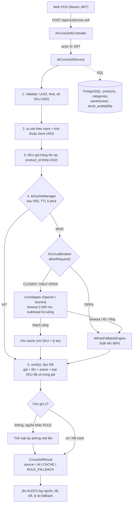

# DS2 — Phần mềm Tăng trưởng Sprint 2: AI Recommendation Engine (Cross-selling, Cache, Luật dự phòng)

| Thuộc tính | Giá trị |
| --- | --- |
| Mã sản phẩm bàn giao | **DS2** (phần Phân hệ AI) |
| Tên tài liệu / sản phẩm | Phần mềm tăng trưởng Sprint 2 (demo được) — **TSK-02-07 AI Recommendation Engine (cross-selling, cache, luật dự phòng)** |
| Mã công việc | **S2-08** (Giai đoạn 5. Lập trình — Sprint 2) |
| Người thực hiện chính | **Nguyễn Tiến Vũ — Data / AI Lead** |
| Hỗ trợ | **Trần Trung Kiên** (Architect / DBA); phối hợp **Vũ Duy Thái** (POS/API), **Nguyễn Quang Huy** (PO/BA), **Phạm Đại Phát** (QA, S2-10) |
| Căn cứ đầu vào | [D55 Thiết kế AI: prompt, RAG, cache, luật dự phòng](../../Sprint%200/AI/D55-thiet-ke-ai-prompt-rag-cache-fallback.md)<br>[D52 v2 Hợp đồng tích hợp AI–POS](D52-hop-dong-tich-hop-ai-pos-sprint2.md)<br>[DS1 Khung dịch vụ AI](../../Sprint%201/AI/DS1-phan-mem-tang-truong-ai-sprint1.md)<br>[DS2 DB — hỗ trợ S2-08](../DB/DS2-thiet-ke-va-ban-giao-DB.md) |
| Kỳ Sprint | Sprint 2 (11/10/2026 – 24/10/2026), hạn S2-08: 16/10/2026 |
| Cột mốc nghiệm thu | **Quality Gate M4 – AI Cross-selling & Consultation Live (24/10/2026)** |
| Tiêu chí minh chứng theo workbook | **Log nguồn LLM / cache / luật; độ trễ < 3 giây** (mẫu: video/ảnh demo; PR đã merge; PO ký Review) |
| Trạng thái | **Code + kiểm thử tự động + log/độ trễ: ĐÃ CÓ.** Video demo, PR merge, chữ ký PO: **CHƯA CÓ** (xem mục 11). Chưa chạy với PostgreSQL và nhà cung cấp LLM thật (xem mục 10). |
| Minh chứng chính | [`ds2-ai-source-log.log`](evidence/ds2-ai-source-log.log) · [`ds2-ai-latency-benchmark.json`](evidence/ds2-ai-latency-benchmark.json) · [`ds2-ai-demo-scenarios.json`](evidence/ds2-ai-demo-scenarios.json) · [`ds2-ai-engine-summary.json`](evidence/ds2-ai-engine-summary.json) |

---

## 1. Mục tiêu và mức đạt so với D55

Sprint 1 (DS1) dựng khung AI; Sprint 2 biến khung đó thành **engine gợi ý bán kèm dùng được tại POS**: không tin dữ liệu do AI sinh, có cache, có luật dự phòng, tự ngắt khi LLM hỏng, và ghi log nguồn/độ trễ để chứng minh.

Bảng đối chiếu trung thực với D55 (✔ đã làm và có kiểm thử · ◐ làm một phần · ✘ chưa làm):

| Hạng mục D55 | Mức | Hiện trạng trong code Sprint 2 |
| --- | :---: | --- |
| §2 Nguyên tắc: AI chỉ tư vấn; giá/tồn là nguồn DB (AC-08-3, BR-09) | ✔ | Adapter/luật chỉ trả `(sku, reason)`. `product_id`, `name`, `list_price`, `available_quantity` luôn đọc từ DB mỗi request |
| §2 / FR-08 AC-08-1: chỉ gợi ý SKU hợp lệ, đang bán | ✔ | Truy vấn lọc `is_active = TRUE` và `stock_availability.available > 0` đúng kho |
| §3.3 Post-validator: loại SKU ảo giác / hết tồn | ✔ | Bước `verify()` loại SKU không có trong DB, hết hàng, hoặc đã có trong giỏ |
| §3.3 Parse JSON + JSON Schema đầu ra LLM | ✘ | Adapter là mock trả thẳng đối tượng Java; chưa có prompt thật/JSON Schema |
| §3.1–3.2, §4 Prompt, RAG hai giai đoạn, embedding | ✘ | Không thuộc phạm vi hoàn thành Sprint 2 (cần LLM thật + pgvector) |
| §5 Cache-Aside, TTL 5 phút cross-sell | ◐ | Cache **in-memory** TTL 5 phút. Chưa có Redis L2, chưa có sự kiện `StockChanged`/`CatalogUpdated` |
| §5.2 Cache key chuẩn hóa | ◐ | Có `rulesVersion`, `modelVersion`, `warehouseId`, SKU, `locale`, `limit`; **thiếu `catalogFingerprint`** (chưa có cơ chế băm danh mục) |
| §5.4 Fail-open khi lỗi cache | ◐ | Cache in-memory không có lỗi kết nối; chưa áp dụng cho Redis vì chưa có Redis |
| §6 Luật dự phòng xác định, không phụ thuộc LLM | ◐ | Có ma trận luật theo SKU (điện thoại / tivi / mặc định) + kiểm DB. **Chưa** dùng ma trận 6 ngành hàng theo `category` và chưa nối hàm DB `get_cross_sell_fallback_rules` |
| §7 Circuit Breaker (cửa sổ 20, ngưỡng 50 %, mở 15 s, half-open 5) | ✔ | Lớp `AiCircuitBreaker` tự động, có test đồng hồ giả |
| BR-09 Timeout cứng 2.500 ms → fallback (AC-08-2) | ✔ | Thực thi bằng `Future.get(2500 ms)`, đo được ≈ 2.502–2.516 ms |
| NFR-03 p95 < 3 s dưới 50 request đồng thời | ✔* | Đo p95 = **2.510 ms** (\*với LLM mô phỏng, DB stub — xem mục 10) |
| §8.1 Ghi `ai_recommendations` bất đồng bộ | ✘ | Chưa ghi DB; chỉ có log kiểm toán `[AI-AUDIT]` |
| §8.2 Dashboard Acceptance Rate / Source Breakdown | ✘ | Chưa làm; log `[AI-AUDIT]` là nguồn dữ liệu để dựng sau |
| NFR-05 Không PII/secret trong prompt, cache key, log | ✔ | Log và cache key chỉ có UUID kho, SKU, nguồn, độ trễ; không có tên/SĐT/token |
| D52 v2: JWT, `ai.use` + store scope, kho thuộc store | ✔ | Xem mục 6 |

---

## 2. Kiến trúc thực tế của engine



### Danh mục mã nguồn Sprint 2 (gói `com.smartelectronicsupermarket.ai`)

| Lớp | Gói | Vai trò | Thay đổi trong S2-08 |
| --- | --- | --- | --- |
| `AiCrossSellController` | `controller` | Endpoint `/cross-sell`, `/status`, `/simulate` | JWT bắt buộc (trừ `/status`); lấy actor từ token |
| `AiExceptionHandler` | `controller` | Mã lỗi D52: `INVALID_ARGUMENT`, `FORBIDDEN_SCOPE`, `SKU_NOT_FOUND` | Mới |
| `AiCrossSellService` | `service` | Điều phối toàn bộ pipeline | Viết lại: authz, DB verify, breaker, audit log, bulkhead |
| `AiCircuitBreaker` | `service` | Circuit breaker theo D55 §7 | Mới |
| `AiCacheManager` | `service` | Cache in-memory TTL 5 phút | Lưu `CrossSellCandidate` (SKU + lý do), không lưu giá/tồn |
| `AiRuleFallbackEngine` | `service` | Luật dự phòng | Chỉ sinh SKU ứng viên; kết quả vẫn qua `verify()` |
| `JdbcAiCrossSellDataAccess` | `data` | Truy vấn kho thuộc store, SKU, tồn khả dụng | Mới |
| `OpenAiAdapter`, `GeminiAdapter` | `adapter` | Bộ chuyển đổi LLM (hiện là mock xác định) | Trả `CrossSellCandidate`, bỏ giá/UUID/tồn tự tạo |
| `CrossSellCandidate`, `CrossSellItem`, `CrossSellRequest`, `CrossSellResult` | `dto` | DTO | `CrossSellItem` bỏ mọi giá trị mặc định tự sinh; `warehouse_id` bắt buộc |

---

## 3. Luồng xử lý và quy tắc chính

### 3.1. Thứ tự kiểm tra (fail-closed)

1. **Xác thực** — thiếu/sai JWT → `401`.
2. **Hình dạng yêu cầu** — `store_id`/`warehouse_id`/`product_id` không phải UUID, thiếu SKU, `limit > 10`, > 50 SKU → `400 INVALID_ARGUMENT`.
3. **Quyền** — `sasms.has_permission(actor, 'ai.use', store_id)` sai → `403 FORBIDDEN_SCOPE`.
4. **Kho thuộc store** — `warehouses.store_id = store_id`, sai → `403 FORBIDDEN_SCOPE`.
5. **SKU giỏ hàng** tồn tại; nếu có `product_id` thì phải khớp SKU → `422 SKU_NOT_FOUND`.
6. Chỉ sau đó mới đến cache / LLM / luật.

### 3.2. Cache (D55 §5)

- Khóa: `ai:crosssell:v1:<rulesVersion>:<modelVersion>:<warehouseId>:<SKU giỏ đã sắp xếp>:vi:<limit>`
  ví dụ `ai:crosssell:v1:v1.0:gpt-4o-mini-2024-07-18:00000000-0000-0000-0000-000000000201:PHONE-IP16-128:vi:4`.
- TTL **5 phút**. Chỉ cache kết quả nguồn `AI`; kết quả luật dự phòng **không** được cache để phục hồi nhanh khi LLM sống lại.
- Cache chỉ giữ `(sku, reason)`. Giá và tồn được đọc lại từ DB ở **mọi** request kể cả khi `source = CACHE` (có test `secondCallServesCachedCandidatesButStillVerifiesAgainstDatabase`), nên cache không làm hiển thị giá/tồn cũ.
- Cache tách theo kho nên không rò tồn kho giữa các siêu thị (BR-11).

### 3.3. Luật dự phòng (D55 §6) và các lý do fallback

Luật dự phòng được kích hoạt khi: timeout 2.500 ms, LLM lỗi, LLM trả rỗng, circuit breaker mở, hoặc mọi gợi ý của LLM đều không còn hàng. Nó **không gọi mạng**, chỉ sinh SKU ứng viên (điện thoại → ốp/cáp/bảo hành; tivi → giá treo/HDMI; còn lại → phụ kiện cơ bản), sau đó DB quyết định cái nào được hiển thị.

Giá trị `fallback_reason` trong log kiểm toán: `NONE`, `LLM_TIMEOUT_EXCEEDED_2500MS`, `LLM_ERROR`, `LLM_EMPTY_RESULT`, `LLM_INTERRUPTED`, `LLM_BULKHEAD_FULL`, `CIRCUIT_OPEN`, `AI_CANDIDATES_UNAVAILABLE`.

Nếu cả LLM lẫn luật đều không có sản phẩm còn hàng thì trả `200` với `suggestions: []` (POS ẩn widget) — không bao giờ trả 5xx làm gián đoạn thanh toán (AC-08-2).

### 3.4. Circuit Breaker (D55 §7)

| Tham số | Cài đặt trong code | Kiểm thử |
| --- | --- | --- |
| Cửa sổ trượt | 20 lời gọi | `doesNotOpenBeforeWindowIsFull` |
| Ngưỡng mở | ≥ 50 % lỗi/timeout khi cửa sổ đầy | `opensWhenWindowOf20HasAtLeast50PercentFailures`, `staysClosedBelowFiftyPercent…` |
| Thời gian mở | 15 giây | `halfOpensAfter15SecondsAndPermitsOnlyFiveProbes` |
| Half-open | tối đa 5 lời gọi thăm dò | cùng test trên |
| Đóng lại | 5/5 thăm dò thành công | `closesAfterFiveSuccessfulProbes` |
| Mở lại | **bất kỳ** thăm dò nào lỗi | `anyProbeFailureReopensImmediately` |

Ghi chú diễn giải: D55 §7.2 vừa nói "≥ 80 % thành công thì đóng" vừa nói "ít nhất 1 lỗi thì mở lại". Với 5 thăm dò, hai câu này chỉ nhất quán khi coi *bất kỳ lỗi nào = mở lại*, nên code chọn 5/5. Cần Kiên/Vũ xác nhận khi cập nhật D55.

Khi breaker mở, request được trả từ luật dự phòng trong thời gian ≈ 1 ms, không gọi LLM (test `breakerOpensAfterRepeatedFailuresAndStopsCallingLlm`: `tookMs < 100`).

### 3.5. Bulkhead

Lời gọi LLM chạy trong `ThreadPoolExecutor` riêng (tối đa 64 luồng, hàng đợi `SynchronousQueue`). Khi quá tải thì `RejectedExecutionException` được coi là lỗi LLM và chuyển sang luật dự phòng thay vì chặn luồng xử lý HTTP hay ăn hết `ForkJoinPool.commonPool`.

---

## 4. Đặc tả API (khớp D52 v2)

`POST /api/v1/ai/cross-sell` — `Authorization: Bearer <JWT>`

```json
{
  "store_id": "00000000-0000-0000-0000-000000000101",
  "warehouse_id": "00000000-0000-0000-0000-000000000201",
  "items": [{ "product_id": "00000000-0000-0000-0000-000000000702", "sku": "PHONE-IP16-128" }],
  "limit": 4
}
```

Phản hồi `200` (các trường `product_id`, `name`, `list_price`, `available_quantity`, `is_serialized` đến từ DB):

```json
{
  "source": "AI",
  "took_ms": 1052,
  "suggestions": [
    {
      "product_id": "e1a2b3c4-d5e6-4f8a-9b0c-1d2e3f4a5b6c",
      "sku": "ACC-CASE-IP16",
      "name": "<tên từ products.name>",
      "list_price": 450000.00,
      "available_quantity": 15,
      "is_serialized": false,
      "reason": "Ốp lưng chống sốc tương thích PHONE-IP16-128"
    }
  ]
}
```

| HTTP | `code` | Khi nào |
| --- | --- | --- |
| 200 | — | Thành công; `suggestions: []` khi hết hàng; `source` ∈ `AI`, `CACHE`, `RULE_FALLBACK` |
| 400 | `INVALID_ARGUMENT` | Thiếu/sai định dạng tham số |
| 401 | `UNAUTHORIZED` | Không có / sai JWT |
| 403 | `FORBIDDEN_SCOPE` | Thiếu `ai.use` tại store hoặc kho không thuộc store |
| 422 | `SKU_NOT_FOUND` | SKU giỏ hàng không có trong CSDL / `product_id` lệch SKU |

`GET /api/v1/ai/status` vẫn công khai (health). `POST /api/v1/ai/simulate` yêu cầu JWT và quyền `ai.use` **toàn cục**, chỉ trả SKU + lý do.

`is_serialized` suy ra theo tên `category` (D52 §2.1): `SMARTPHONE`, `LAPTOP`, `TELEVISION`, `WASHING_MACHINE`, `REFRIGERATOR`, `AIR_CONDITIONER` → `true`; còn lại `false`.

---

## 5. Hướng dẫn trình diễn (Demo Guide)

### 5.1. Demo tự động — chạy được ngay, không cần DB hay khóa API

Yêu cầu: JDK 25 (như `pom.xml`), repo đã checkout nhánh có code S2-08.

```powershell
cd backend
$env:SASMS_AI_EVIDENCE_DIR = "..\Sprint 2\AI\evidence"
.\mvnw.cmd test                                   # toàn bộ test (≈ 2–3 phút)
.\mvnw.cmd test -Dtest=AiSprint2EvidenceTest      # chỉ sinh lại log + benchmark (≈ 10 giây)
cd ..
python "Sprint 2\AI\scripts\generate_ds2_summary.py"   # gom số liệu từ báo cáo surefire
```

Kết quả sinh ra trong `Sprint 2/AI/evidence/`. Không có số nào được nhập tay: `generate_ds2_summary.py` đọc `backend/target/surefire-reports/*.xml`.

### 5.2. Kịch bản demo 10 bước (kết quả thực đo)

Nguồn: [`ds2-ai-demo-scenarios.json`](evidence/ds2-ai-demo-scenarios.json) — **10/10 PASS**.

| # | Kịch bản | Kết quả mong đợi | Kết quả đo | Độ trễ (ms) |
| --- | --- | --- | --- | ---: |
| DEMO-01 | Gợi ý mới qua LLM (cache miss) | `AI` | `AI` | ≈ 1.050 |
| DEMO-02 | Cùng giỏ hàng lần 2 | `CACHE` | `CACHE` | < 1 |
| DEMO-03 | LLM treo > 2,5 s | `RULE_FALLBACK` | `RULE_FALLBACK` | ≈ 2.502 |
| DEMO-04 | LLM trả lỗi 503 | `RULE_FALLBACK` | `RULE_FALLBACK` | < 1.000 |
| DEMO-05 | Gợi ý LLM hết hàng → luật dự phòng lấy từ DB | `RULE_FALLBACK` | `RULE_FALLBACK` | ≈ 1.100 |
| DEMO-05B | Hết hàng, không luật phù hợp | `200` + `[]` | `AI:0` | ≈ 760 |
| DEMO-06 | Circuit breaker OPEN | `RULE_FALLBACK` ngay | `RULE_FALLBACK` | ≈ 1 |
| DEMO-07 | Thu ngân thiếu `ai.use` tại store | `403` | `FORBIDDEN_SCOPE` | < 1 |
| DEMO-08 | Kho không thuộc store | `403` | `FORBIDDEN_SCOPE` | < 1 |
| DEMO-09 | SKU không tồn tại | `422` | `SKU_NOT_FOUND` | < 1 |

(Độ trễ chính xác từng lần nằm trong file JSON; bảng làm tròn.)

### 5.3. Demo trực tiếp qua HTTP (cần dựng môi trường — **CHƯA chạy trong phiên này**)

Điều kiện: PostgreSQL 16 đã nạp `database/` (baseline + V001/V002 + `database/sprint2`), biến `SASMS_DB_*`, cấu hình JWT (`sasms.jwt.*`), tài khoản thu ngân được gán `ai.use` tại store, kho thuộc store đó. Khi đó:

```powershell
curl.exe -X POST http://localhost:8080/api/v1/ai/cross-sell `
  -H "Authorization: Bearer $env:TOKEN" -H "Content-Type: application/json" `
  -d '{"store_id":"<STORE_UUID>","warehouse_id":"<WH_UUID>","sku_ids":["<SKU_ĐANG_CÓ>"],"limit":4}'
```

Tại thời điểm viết, Docker daemon không chạy nên bước này chưa được thực hiện; không được coi là đã nghiệm thu.

---

## 6. Bảo mật và xác minh dữ liệu (D52 v2)

| Yêu cầu | Cách thực hiện | Kiểm thử |
| --- | --- | --- |
| Endpoint AI yêu cầu JWT | Bỏ `permitAll` cho `/api/v1/ai/**` trong `SecurityConfiguration`; chỉ `GET /api/v1/ai/status` công khai | `SecurityFailClosedIntegrationTest.aiEndpointsRequireJwtExceptStatus` |
| `ai.use` + store scope | `PermissionChecker.hasPermission(actor, "ai.use", storeId)` → hàm SQL `sasms.has_permission` | `missingAiUseForStoreReturns403ForbiddenScopeWithoutTouchingData` |
| Kho thuộc store | `warehouses.id = ? AND store_id = ?` | `warehouseOutsideStoreReturns403ForbiddenScope`, `JdbcAiCrossSellDataAccessTest` |
| Giá/tồn/UUID từ DB | `products.list_price`, `stock_availability.available`, `products.id`; AI chỉ đưa SKU + lý do | `returnsProductIdPriceAndStockFromDatabaseNotFromAdapter` |
| Không dùng dữ liệu tự tạo | `CrossSellItem` không còn giá trị mặc định; adapter/luật không còn giá cứng | `candidatesMissingFromDatabaseAreDroppedAndEmptyListIs200` |
| Không PII/secret trong log | `[AI-AUDIT]` chỉ chứa nguồn, độ trễ, số gợi ý, lý do fallback, provider, trạng thái breaker | Xem [`ds2-ai-source-log.log`](evidence/ds2-ai-source-log.log) |

---

## 7. Minh chứng 1 — Log nguồn LLM / cache / luật

File: [`Sprint 2/AI/evidence/ds2-ai-source-log.log`](evidence/ds2-ai-source-log.log) — mỗi request một dòng `[AI-AUDIT]` do **chính `AiCrossSellService` ghi** (bắt bằng appender Logback trong test, không viết tay). Trích:

```log
[AI-AUDIT] source=AI latency_ms=1049 suggestions=2 fallback_reason=NONE provider=OPENAI breaker=CLOSED
[AI-AUDIT] source=CACHE latency_ms=0 suggestions=2 fallback_reason=NONE provider=OPENAI breaker=CLOSED
[AI-AUDIT] source=RULE_FALLBACK latency_ms=2500 suggestions=3 fallback_reason=LLM_TIMEOUT_EXCEEDED_2500MS provider=OPENAI breaker=CLOSED
[AI-AUDIT] source=RULE_FALLBACK latency_ms=732 suggestions=3 fallback_reason=LLM_ERROR provider=OPENAI breaker=CLOSED
[AI-AUDIT] source=RULE_FALLBACK latency_ms=1 suggestions=3 fallback_reason=CIRCUIT_OPEN provider=OPENAI breaker=OPEN
```

Các dòng trên được trích nguyên văn từ file log (Phần A — kịch bản demo; Phần B có thêm 100 dòng của benchmark, tổng 107 dòng `[AI-AUDIT]`).

## 8. Minh chứng 2 — Độ trễ < 3 giây dưới 50 request đồng thời

File: [`ds2-ai-latency-benchmark.json`](evidence/ds2-ai-latency-benchmark.json). Tải: **100 request, 50 luồng đồng thời**; 90 request trên 5 giỏ hàng (LLM mô phỏng 700–1.400 ms), 10 request trên 10 giỏ hàng riêng mà LLM treo 5 giây (buộc timeout).

| Chỉ số | Kết quả đo (lần chạy tạo summary) | Chỉ tiêu | Đánh giá |
| --- | ---: | ---: | :---: |
| Số request | 100 | 100 | ĐẠT |
| Đồng thời | 50 | 50 (NFR-03) | ĐẠT |
| Min | 0 ms | — | — |
| Trung bình | 738,1 ms | — | — |
| p50 | 1.053 ms | — | — |
| p90 | 1.066 ms | — | — |
| **p95** | **2.510 ms** | **< 3.000 ms** | **ĐẠT** |
| p99 | 2.513 ms | — | — |
| Max | 2.516 ms | < 3.000 ms | ĐẠT |
| Phân bổ nguồn | AI 46 · CACHE 44 · RULE_FALLBACK 10 | CACHE > 60 % (mục tiêu vận hành D55) | **Chưa đạt mục tiêu vận hành** (xem ghi chú) |
| Lý do fallback | 10 × `LLM_TIMEOUT_EXCEEDED_2500MS` | — | Khớp tải thiết kế |
| Phản hồi rỗng | 0 | — | — |

Ghi chú diễn giải:
- p95 phản ánh đúng thiết kế: 10 % request chạm timeout cứng 2.500 ms rồi fallback ngay (+ ≈ 2–16 ms), nên p95 ≈ 2,5 s < 3 s. Con số này **bị chi phối bởi ngưỡng timeout**, không phải tốc độ LLM thật.
- Tỷ lệ CACHE 44 % thấp hơn mục tiêu vận hành 60 % vì: tải chỉ 100 request trên 5 giỏ, và **chưa có request coalescing** — khi 50 request đầu cùng "miss" thì cả nhóm cùng gọi LLM (46 lần gọi AI cho 5 SKU). Đề xuất cải tiến: gộp request cùng khóa (single-flight).
- Mỗi lần chạy lại cho số khác nhau vài ms (và hơi khác phân bổ AI/CACHE); file JSON luôn là kết quả của lần chạy gần nhất.

## 9. Minh chứng 3 — Kết quả kiểm thử tự động

File: [`ds2-ai-engine-summary.json`](evidence/ds2-ai-engine-summary.json), sinh từ báo cáo surefire.

| Bộ kiểm thử | Số test | Kết quả |
| --- | ---: | :---: |
| `AiCrossSellControllerTest` (JWT/actor, 400/403/422, DB-verified, cache, fallback, `is_serialized`, simulate) | 13 | PASS |
| `AiCircuitBreakerTest` | 7 | PASS |
| `AiCrossSellServiceResilienceTest` (timeout ≈ 2,5 s, lỗi LLM, breaker, cache theo kho, fallback từ DB) | 5 | PASS |
| `JdbcAiCrossSellDataAccessTest` (cấu trúc SQL) | 2 | PASS |
| `SecurityFailClosedIntegrationTest` (có thêm AI endpoint 401) | 7 | PASS |
| `AiSprint2EvidenceTest` (sinh minh chứng + p95 < 3 s) | 1 | PASS |
| **Toàn bộ backend** | **172 chạy · 164 PASS · 0 FAIL · 8 SKIPPED** | **BUILD SUCCESS** |

8 test bị bỏ qua là test cần PostgreSQL (`Sprint1PostgreSqlIntegrationTest` 7, `PostgreSqlConnectionSmokeTest` 1).

---

## 10. Giới hạn và điều chưa được kiểm chứng (cần đọc trước khi nghiệm thu)

1. **Chưa chạy với PostgreSQL.** Docker daemon không chạy trong phiên thực hiện. SQL trong `JdbcAiCrossSellDataAccess` (đặc biệt việc truyền mảng SKU dưới dạng literal `text[]`) mới được kiểm cấu trúc, **chưa được thực thi trên PG 16**. DB trong benchmark là stub trong bộ nhớ.
2. **LLM là mock xác định.** `OpenAiAdapter`/`GeminiAdapter` không gọi API nhà cung cấp; "độ trễ LLM" trong benchmark là độ trễ **mô phỏng** (700–1.400 ms, 5 s khi treo). Benchmark đo engine (cache, timeout, breaker, fallback, xác minh), **không** đo độ trễ OpenAI/Gemini thật.
3. **Chưa có prompt thật, JSON Schema, RAG, embedding** (D55 §3–4) và **chưa có Redis L2** (D55 §5).
4. **Cache key thiếu `catalogFingerprint`**; chưa có invalidation theo sự kiện kho/danh mục (chỉ TTL 5 phút).
5. **Luật dự phòng chưa theo ma trận 6 ngành hàng** (D55 §6.1) và chưa gọi `sasms.get_cross_sell_fallback_rules`. DS2 DB nêu rõ hàm này là heuristic, chưa có luật tương thích được PO/BA duyệt.
6. **`stock_availability` chỉ đếm thiết bị có Serial** (view từ `devices`). Gói bảo hành/dịch vụ không có thiết bị sẽ không bao giờ được gợi ý cho tới khi có nguồn tồn khác.
7. **`is_serialized` phụ thuộc tên `category`** đúng như D52 §2.1. Nếu CSDL dùng tên tiếng Việt (vd. "Tivi DEMO") thì mọi sản phẩm sẽ là `false`. Cần Kiên/Huy thống nhất mã ngành hàng.
8. **Chưa ghi `ai_recommendations`** và chưa có dashboard Acceptance Rate (FR-15/BR-10).
9. **Chưa có request coalescing** (xem mục 8) và chưa kiểm thử E2E với giao diện POS dùng JWT thật.

## 11. Minh chứng Sprint 2 đi kèm — trạng thái thực tế

| Minh chứng theo workbook | Trạng thái | Ghi chú |
| --- | :---: | --- |
| **Log nguồn LLM / cache / luật** | ✔ ĐÃ CÓ | `evidence/ds2-ai-source-log.log` |
| **Độ trễ < 3 giây** | ✔ ĐÃ CÓ (có điều kiện) | p95 2.510 ms, tải 50 đồng thời, LLM mô phỏng — mục 8 và 10 |
| Kiểm thử tự động | ✔ ĐÃ CÓ | 164 PASS / 0 FAIL / 8 SKIPPED |
| Kịch bản demo + kết quả | ✔ ĐÃ CÓ | `evidence/ds2-ai-demo-scenarios.json` (10/10) |
| Hợp đồng API & báo cáo kiểm thử D52 v2 | ✔ ĐÃ CÓ | [D52](D52-hop-dong-tich-hop-ai-pos-sprint2.md), [báo cáo](D52-bao-cao-kiem-thu-hop-dong-api.md) (cần cập nhật sau khi code D52 v2 đã nối DB) |
| **Video / ảnh demo** | ✘ CHƯA CÓ | Cần quay trên môi trường có PG + JWT (mục 5.3) |
| **PR đã merge** | ✘ CHƯA CÓ | Thay đổi nằm trên nhánh `Vu_AI`, chưa commit/PR tại thời điểm viết |
| **PO ký Review** | ✘ CHƯA CÓ | Mẫu biên bản bên dưới để trống |
| Test case AI (D73, S2-10) | Phụ thuộc QA | Phạm Đại Phát chủ trì; DS2 cung cấp 10 kịch bản làm đầu vào |

### Biên bản ký duyệt Sprint 2 Review (mẫu — **chưa ký**)

```text
BIÊN BẢN ĐÁNH GIÁ SẢN PHẨM TĂNG TRƯỞNG SPRINT 2 (DS2) — PHẦN AI (S2-08)

Thời gian đánh giá : ____ /10/2026 (Sprint 2 Review, cột mốc M4 24/10/2026)
Hạng mục           : TSK-02-07 AI Recommendation Engine (cross-selling, cache, luật dự phòng)

[ ] Log nguồn LLM/cache/luật đã xem        [ ] Độ trễ < 3 giây đã xem
[ ] Demo POS gợi ý bán kèm (video/ảnh)     [ ] PR đã merge: #____
[ ] Đã đọc mục 10 (giới hạn, chưa kiểm chứng)

Kết luận của Product Owner: ____________________________________________

Product Owner (Nguyễn Quang Huy)   : ____________  Ngày: ______
Data / AI Lead (Nguyễn Tiến Vũ)     : ____________  Ngày: ______
Architect / DBA (Trần Trung Kiên)   : ____________  Ngày: ______
```

---

## 12. Bàn giao và việc tiếp theo

| Người nhận | Việc cần làm |
| --- | --- |
| Trần Trung Kiên | Chạy `JdbcAiCrossSellDataAccess` trên PG 16 thật; xác nhận quyền `sasms_app` đọc `products`, `categories`, `warehouses`, `stock_availability`; thống nhất mã ngành hàng cho `is_serialized`; nguồn tồn cho dịch vụ/bảo hành |
| Vũ Duy Thái | Gọi `/cross-sell` với JWT thật từ POS; kiểm lại giá/tồn khi bấm `[+ Thêm]`; hiển thị badge `source` |
| Phạm Đại Phát | Dùng 10 kịch bản mục 5.2 làm khung D73 (đã có luồng lỗi/dự phòng); đo lại p95 trên Staging |
| Nguyễn Quang Huy | Duyệt ma trận luật bán kèm và ngưỡng CACHE > 60 %; ký Review |
| Nguyễn Tiến Vũ (S3) | Prompt/JSON Schema thật + adapter gọi API thật; Redis L2; single-flight; ghi `ai_recommendations`; ma trận 6 ngành hàng |
