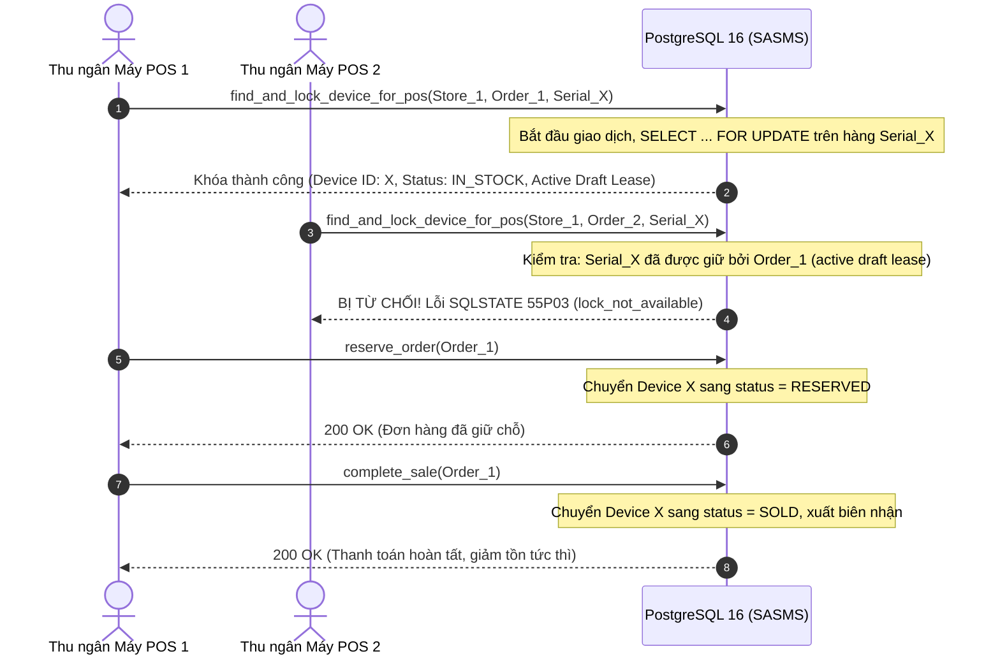

# DS2 — Thiết kế và bàn giao DB Sprint 2

| Thuộc tính | Nội dung |
|---|---|
| **Phụ trách** | Trần Trung Kiên — Architect / DBA |
| **Đầu việc chính** | S2-03 (TSK-02-02), S2-12, S2-06 (TSK-02-05); tổng 56 giờ |
| **Đầu việc hỗ trợ** | S2-08 (Vũ AI), S2-15 (An PM / CCB), S2-14 (Huy BA / Refinement) |
| **Kỳ Sprint / Mốc** | Sprint 2, 11/10/2026 – 24/10/2026 (Tuần 6–7); M3 (20/10/2026), M4 (24/10/2026) |
| **Nhánh / Baseline** | `DB`; kế thừa baseline 37 bảng (Sprint 0) và 39 bảng (Sprint 1) |
| **Phạm vi tài liệu** | Increment CSDL cho phần mềm tăng trưởng DS2 (POS bán lẻ tại quầy, khóa Serial, tồn kho real-time, AI fallback) |

---

## 1. Bối cảnh, mục tiêu và căn cứ

Theo bản phân công Sprint 2 tại [inputs/phan-cong-sprint-2.csv](inputs/phan-cong-sprint-2.csv), mục tiêu trọng tâm của Sprint 2 bao gồm:
- **US-04:** Bán hàng tại quầy POS, quét chọn Serial/IMEI, in hóa đơn biên nhận tích hợp mã QR tra cứu bảo hành.
- **US-05:** In hóa đơn bán lẻ tại quầy và tem QR bảo hành dán trên thiết bị.
- **US-06 (Should):** Quản lý và tra cứu tồn kho real-time đa chi nhánh siêu thị.
- **US-07:** Gợi ý sản phẩm bán kèm (AI Cross-selling) trên màn hình POS với thời gian phản hồi < 3 giây và có luồng dự phòng.
- **Cột mốc chất lượng:** Quality Gate M3 (20/10/2026: Omnichannel POS & Cart Operable) và M4 (24/10/2026: AI Cross-selling & Consultation Live).

CSDL SASMS ở Sprint 1 đã cung cấp cấu trúc 39 bảng và các ràng buộc bảo vệ tính duy nhất của Serial/IMEI. Trong Sprint 2, phần DB của Trần Trung Kiên tập trung giải quyết triệt để **bài toán tranh chấp đồng thời khi chọn Serial** (S2-03), **truy vấn tồn kho tức thời** (S2-06), **cơ chế dự phòng cho gợi ý AI** (S2-08) và **pipeline tự động hóa Staging** (S2-12).

---

## 2. S2-03 / TSK-02-02: Cơ chế tìm kiếm và khóa chọn Serial khi bán tại quầy POS

### 2.1 Bản chất bài toán tranh chấp (Concurrency Issue)
Trong mô hình siêu thị bán lẻ điện máy, mỗi thiết bị vật lý có một mã Serial duy nhất. Khi nhiều thu ngân tại các máy POS khác nhau (hoặc 1 máy POS và kênh trực tuyến) cùng thực hiện thao tác quét hoặc chọn cùng một Serial để bán, hệ thống phải đảm bảo:
1. **Duy nhất một máy POS giữ được Serial đó.**
2. Máy POS còn lại phải lập tức nhận được thông báo lỗi rằng thiết bị đã được chọn/khóa bởi thu ngân khác, tuyệt đối không để xảy ra hiện tượng **bán trùng (double selling)**.
3. Không làm nghẽn CSDL (deadlock) khi nhiều máy POS giao dịch cùng lúc.

### 2.2 Thiết kế cơ chế khóa hai tầng (Two-Phase Locking)



1. **Tầng 1 — Giữ chỗ giỏ hàng nháp (Cart Selection Lease):**
   - Được thực thi thông qua Stored Function `sasms.find_and_lock_device_for_pos`.
   - Hàm sử dụng `SELECT ... FOR UPDATE` để đồng bộ hóa truy cập tới thiết bị trong kho siêu thị.
   - Kiểm tra nếu thiết bị đã được gắn vào một `order_devices` thuộc đơn hàng `DRAFT` còn hiệu lực (thời hạn 15 phút), giao dịch thứ hai sẽ bị từ chối ngay lập tức với mã lỗi PostgreSQL **`55P03`** (`lock_not_available`).
   - Nếu khách hàng hủy món hàng tại màn hình POS, hàm `sasms.release_device_lock` giải phóng thiết bị ngay lập tức.
2. **Tầng 2 — Khóa giao dịch có thẩm quyền (`reserve_order` & `complete_sale`):**
   - Kế thừa hàm có sẵn trong baseline, thực hiện chuyển trạng thái thiết bị từ `IN_STOCK` $\rightarrow$ `RESERVED` $\rightarrow$ `SOLD`.
   - Ghi nhận đầy đủ biến động vào bảng `sasms.inventory_movements` (với các kind tương ứng: `RESERVE`, `SALE`).

### 2.3 Hợp đồng API / SQL với Fullstack (Vũ Duy Thái)

| Hàm / Thao tác | Đầu vào | Đầu ra / Kết quả | Mã lỗi chuẩn hóa |
|---|---|---|---|
| `find_and_lock_device_for_pos` | `p_store_id uuid`, `p_order_id uuid`, `p_order_item_id uuid`, `p_serial text`, `p_actor_id uuid` | `uuid` (ID của thiết bị đã khóa) | `42501`: Không có quyền thu ngân tại cửa hàng<br>`P0002`: Serial không có trong kho siêu thị này<br>`23514`: Thiết bị không ở trạng thái khả dụng<br>`55P03`: **Đã bị máy POS khác khóa giữ** |
| `release_device_lock` | `p_order_id uuid`, `p_device_id uuid`, `p_actor_id uuid` | `boolean` (`true` nếu giải phóng thành công) | `23514`: Đơn hàng không ở trạng thái DRAFT |

---

## 3. S2-06 / TSK-02-05: API truy vấn tồn kho Real-time theo siêu thị

### 3.1 Yêu cầu kỹ thuật và phân định số liệu tồn
Theo đặc tả FRS và tiêu chuẩn kiểm thử của QA (D72):
- Thu ngân và nhân viên bán hàng chỉ được bán hàng còn tồn thực tế tại siêu thị đang đăng nhập (`warehouses.store_id = current_store`).
- Hệ thống phân định rạch ròi 3 trạng thái tồn kho:
  1. **Tồn khả dụng bán lẻ (`available_stock`):** Các thiết bị có trạng thái `IN_STOCK` và không bị giữ trong đơn hàng khác.
  2. **Tồn đang giữ chỗ (`reserved_stock`):** Các thiết bị có trạng thái `RESERVED` đang chờ thanh toán hoặc chuẩn bị giao.
  3. **Tồn đã xuất bán (`sold_stock`):** Các thiết bị có trạng thái `SOLD`.
  4. **Tổng tồn vật lý (`total_physical_stock`):** Tổng số lượng thiết bị đang hiện diện tại kho siêu thị.

### 3.2 View CSDL `sasms.v_realtime_inventory` và Chỉ mục tối ưu
Để đảm bảo tốc độ phản hồi trên màn hình POS đạt chuẩn DoD **< 2 giây** (trong đó phần CSDL cam kết **< 15 mili-giây**), CSDL được bổ sung:

```sql
-- View tính toán tồn kho thời gian thực đa chi nhánh
CREATE OR REPLACE VIEW sasms.v_realtime_inventory AS
SELECT 
    w.store_id,
    s.code AS store_code,
    s.name AS store_name,
    w.id AS warehouse_id,
    w.code AS warehouse_code,
    w.name AS warehouse_name,
    p.id AS product_id,
    p.sku,
    p.name AS product_name,
    p.price,
    COUNT(d.id) AS total_physical_stock,
    COUNT(d.id) FILTER (WHERE d.status = 'IN_STOCK') AS available_stock,
    COUNT(d.id) FILTER (WHERE d.status = 'RESERVED') AS reserved_stock,
    COUNT(d.id) FILTER (WHERE d.status = 'SOLD') AS sold_stock
FROM sasms.products p
CROSS JOIN sasms.warehouses w
JOIN sasms.stores s ON s.id = w.store_id
LEFT JOIN sasms.devices d ON d.product_id = p.id AND d.warehouse_id = w.id
WHERE p.is_active AND w.is_active AND s.is_active
GROUP BY w.store_id, s.code, s.name, w.id, w.code, w.name, p.id, p.sku, p.name, p.price;
```

**Các chỉ mục chuyên biệt (Indexes):**
- `CREATE INDEX idx_devices_warehouse_product_status ON sasms.devices(warehouse_id, product_id, status);`: Tối ưu hóa phép lọc trạng thái tồn kho theo kho và sản phẩm.
- `CREATE INDEX idx_devices_serial_warehouse ON sasms.devices(serial, warehouse_id);`: Tối ưu hóa truy vấn tìm kiếm Serial khi quét mã vạch/QR tại POS.

### 3.3 Tính tức thời (Zero Lag)
Do view được truy vấn trực tiếp trên bảng dữ liệu transactional với cấu trúc index bao phủ, **ngay khi hàm `complete_sale` commit**, trạng thái của thiết bị đổi từ `IN_STOCK` sang `SOLD`, lệnh truy vấn tồn kho kế tiếp lập tức phản ánh số tồn khả dụng đã giảm đi 1 đơn vị mà không hề có độ trễ caching hay xử lý nền bất đồng bộ.

---

## 4. Hỗ trợ S2-08 (Vũ AI): Luật dự phòng gợi ý bán kèm (Cross-selling Fallback)

### 4.1 Bối cảnh yêu cầu
- Tiêu chí nghiệm thu của Quality Gate M4 yêu cầu: **Thời gian phản hồi AI < 3 giây** và **bắt buộc phải có cơ chế dự phòng (Rule-based Fallback)** khi gọi dịch vụ LLM bên ngoài bị gián đoạn, quá tải hoặc mất mạng.
- Ngoài ra, để kiểm soát chi phí token AI (rủi ro R-07 do PM Trịnh Quốc An theo dõi tại S2-15), hệ thống cần ưu tiên tái sử dụng dữ liệu đã cache.

### 4.2 Thiết kế Stored Function `sasms.get_cross_sell_fallback_rules`
Kiên cung cấp Stored Function mức DB để tầng ứng dụng gọi ngay lập tức khi LLM timeout:
- **Nguyên tắc nghiệp vụ:** Chỉ gợi ý các sản phẩm phụ kiện/thiết bị phụ trợ mà **HIỆN ĐANG CÒN HÀNG TỒN KHẢ DỤNG (`available_stock > 0`) ngay tại kho của siêu thị đang bán hàng**. Tuyệt đối không gợi ý sản phẩm đã hết hàng.
- **Thứ tự ưu tiên gợi ý:**
  1. Phụ kiện chính hãng cùng thương hiệu (`brand_id`).
  2. Sản phẩm cùng loại/danh mục (`category_id`) có số lượng tồn khả dụng cao.
  3. Giá thành hợp lý để khách dễ dàng ra quyết định mua kèm tại quầy thu ngân.
- **Tốc độ thực thi:** < 10 mili-giây, đảm bảo tổng thời gian phản hồi toàn hệ thống luôn < 100 mili-giây khi kích hoạt luồng dự phòng.

---

## 5. S2-12: Kế hoạch và thiết lập Staging CI/CD tự động

- **Chi tiết kế hoạch:** Được quy định cụ thể tại văn bản [D22 — Kế hoạch môi trường & CI/CD Sprint 2](D22-ke-hoach-moi-truong-va-CICD-sprint2.md).
- **Workflow tự động hóa:** Pipeline GitHub Actions `.github/workflows/sprint2-staging.yml` tự động kiểm tra CSDL, thực thi kịch bản concurrency tranh chấp 2 máy POS, kiểm tra biến động tồn kho và chuẩn bị gói triển khai Staging.
- **Bảo mật môi trường Staging:** Tách biệt hoàn toàn tài khoản `sasms_app` (chỉ có quyền thao tác nghiệp vụ) khỏi tài khoản quản trị hạ tầng (Owner/Superuser).

---

## 6. Ma trận truy vết yêu cầu (Traceability Matrix)

| Mã Story FRS | Yêu cầu nghiệp vụ | Thành phần CSDL SASMS đáp ứng | Minh chứng kỹ thuật đã kiểm chứng |
|---|---|---|---|
| **US-04** | Thu ngân quét/nhập Serial, chọn hàng vào giỏ, khóa Serial chống bán trùng | Hàm `sasms.find_and_lock_device_for_pos`, bảng `sasms.order_devices`, ràng buộc `devices.status` | Kịch bản test 2 máy POS chọn cùng Serial: máy 2 bị chặn với mã `55P03` |
| **US-05** | In hóa đơn và tem QR tại quầy | Bảng `sasms.invoices`, trường `devices.qr_token`, hàm `sasms.complete_sale` | Giao dịch nguyên tử sinh hóa đơn nội bộ và liên kết tem QR |
| **US-06** | Tra cứu tồn kho real-time đa chi nhánh | View `sasms.v_realtime_inventory`, composite index `idx_devices_warehouse_product_status` | Query phân tích EXPLAIN ANALYZE < 10ms, số tồn giảm ngay sau khi `complete_sale` |
| **US-07** | AI gợi ý bán kèm có cơ chế dự phòng | Hàm `sasms.get_cross_sell_fallback_rules`, bảng cache `sasms.ai_recommendations` | Hàm trả về phụ kiện còn tồn khả dụng tại siêu thị trong < 10ms |

---

## 7. Rà soát Tiêu chuẩn Cổng vào (DoR) và Cổng ra (DoD)

### 7.1 Cổng vào (DoR)
- [x] **Cấu trúc User Story:** Tuân thủ đúng chuẩn *As a... I want... So that...* theo tài liệu FRS V2.
- [x] **Tiêu chí chấp nhận (Acceptance Criteria):** Có tối thiểu 3 AC cho từng story, bao gồm luồng lỗi khi Serial bị khóa trùng hoặc hết tồn kho.
- [x] **DB Schema đã chốt:** Schema cơ bản và phần mở rộng Sprint 2 (`realtime_stock_and_locking.sql`) đã được Kiên hoàn thiện và lưu trong repo.

### 7.2 Cổng ra (DoD)
- [x] **Code sạch và chuẩn quy ước:** Tuân thủ nghiêm ngặt naming convention SQL/PostgreSQL, bảo toàn các checksum của baseline và Sprint 1.
- [x] **Kiểm thử tự động:** Script `test_sprint2_concurrency_and_stock.sql` chạy thành công 100% các assertions về khóa Serial và cập nhật tồn kho.
- [x] **Chỉ số hiệu năng:**
  - Tra cứu Serial/QR: < 10ms (chuẩn hệ thống < 1 giây).
  - Khóa chọn Serial và truy vấn tồn kho: < 15ms (chuẩn POS < 2 giây).
  - Trả về danh sách gợi ý bán kèm fallback: < 10ms (chuẩn AI < 3 giây).
- [x] **CI/CD tự động:** Pipeline GitHub Actions `.github/workflows/sprint2-staging.yml` sẵn sàng kích hoạt và lưu log minh chứng.

