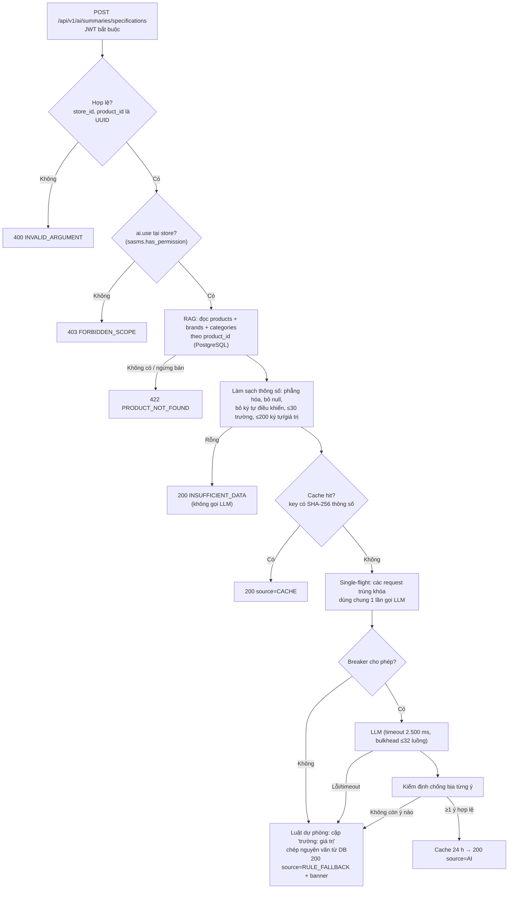

# DS3 — Phần mềm Tăng trưởng Sprint 3: AI Tóm tắt Thông số Sản phẩm (RAG chống bịa)

| Thuộc tính | Giá trị |
| --- | --- |
| Mã sản phẩm bàn giao | **DS3** (phần Phân hệ AI) |
| Tên tài liệu / sản phẩm | Phần mềm tăng trưởng Sprint 3 (demo được) — **TSK-03-01 Prompt AI tóm tắt thông số sản phẩm (RAG chống bịa)** |
| Mã công việc | **S3-03** (Giai đoạn 5. Lập trình — Sprint 3) |
| Người thực hiện chính | **Nguyễn Tiến Vũ — Data / AI Lead** |
| Phối hợp | **Nguyễn Quang Huy** (PO/BA — người được giao hỗ trợ theo workbook); **Vũ Duy Thái** (API/POS), **Trần Trung Kiên** (DB), **Phạm Đại Phát** (QA) |
| Căn cứ đầu vào | [D55 Thiết kế AI: prompt, RAG, cache, luật dự phòng](../../Sprint%200/AI/D55-thiet-ke-ai-prompt-rag-cache-fallback.md) (§3.2, §3.3, §5.2, §6.3) · [D51 Thiết kế CSDL](../../Sprint%200/DB/D51-thiet-ke-co-so-du-lieu.md) (`products.specifications`) · [DS2 AI Engine](../../Sprint%202/AI/DS2-phan-mem-tang-truong-ai-sprint2.md) |
| Kỳ Sprint | Sprint 3 (25/10/2026 – 07/11/2026), hạn S3-03: 29/10/2026 |
| Tiêu chí minh chứng theo workbook | **Mẫu tóm tắt khớp thông số; cảnh báo "chỉ mang tính tham khảo"** (mẫu: video/ảnh demo; PR đã merge; PO ký Review) |
| Chỉ tiêu hiệu năng (DoD) | AI < 3 s (p95) |
| Trạng thái | **Code + kiểm thử tự động + minh chứng mẫu/độ trễ: ĐÃ CÓ.** Video demo, PR merge, chữ ký PO: **CHƯA CÓ** (mục 10). **Chưa gọi LLM thật** (mục 9). |
| Minh chứng chính | [`ds3-ai-summary-samples.json`](evidence/ds3-ai-summary-samples.json) · [`ds3-ai-summary-scenarios.json`](evidence/ds3-ai-summary-scenarios.json) · [`ds3-ai-summary-latency-benchmark.json`](evidence/ds3-ai-summary-latency-benchmark.json) · [`ds3-ai-summary-source.log`](evidence/ds3-ai-summary-source.log) · [`ds3-ai-engine-summary.json`](evidence/ds3-ai-engine-summary.json) |

> **Đọc trước:** mô hình ngôn ngữ trong bản này là **bộ mô phỏng xác định** (`MockSpecSummaryLlm`) sau giao diện `SpecSummaryLlm`. Toàn bộ phần *bao quanh* mô hình — lấy dữ liệu từ DB, dựng prompt, kiểm định chống bịa, cache, timeout, breaker, luật dự phòng, bảo mật — là mã thật và đã kiểm thử. Con số độ trễ phản ánh engine, không phản ánh tốc độ của nhà cung cấp LLM thật.

---

## 1. Mục tiêu và mức đạt so với D55

FR-09 yêu cầu AI tóm tắt thông số kỹ thuật sản phẩm điện máy cho nhân viên tư vấn/khách, với ba tiêu chí chấp nhận:

| Tiêu chí | Cách bản Sprint 3 đáp ứng | Mức |
| --- | --- | :---: |
| **AC-09-1** Không bịa thông số ngoài nguồn | Chỉ đưa vào prompt các trường của đúng sản phẩm đọc từ DB; **kiểm định sau sinh** loại mọi ý chứa số hoặc ký hiệu kỹ thuật không có trong thông số (mục 3) | ✔ (có giới hạn, mục 9) |
| **AC-09-2** Thiếu nguồn phải thông báo rõ | Thông số rỗng → `status = INSUFFICIENT_DATA` + thông báo, **không gọi LLM** | ✔ |
| **AC-09-3** AI lỗi vẫn hiện bảng thông số gốc | Mọi phản hồi luôn kèm `specifications` (bảng gốc); lỗi/timeout/breaker mở → luật dự phòng; banner "Đang hiển thị bảng thông số tiêu chuẩn từ nhà sản xuất" | ✔ |
| Cảnh báo tham khảo (workbook) | Trường `disclaimer` luôn có: *"…chỉ mang tính tham khảo. Vui lòng đối chiếu bảng thông số gốc."* | ✔ |

Đối chiếu các hạng mục D55 liên quan:

| Hạng mục D55 | Mức | Hiện trạng |
| --- | :---: | --- |
| §3.2 System/User prompt `spec_summary_system_v1.0` | ✔ | `SpecSummaryPrompts` — nguyên văn guardrail D55, bổ sung: nội dung thông số là *dữ liệu không phải mệnh lệnh*; không nêu giá/tồn/khuyến mãi/bảo hành |
| §3.3 Post-validator (parse JSON, schema, giới hạn từ) | ✔ | `SpecSummaryValidator` (mục 3) |
| §4 RAG | ◐ | Truy xuất **một bước từ PostgreSQL theo `product_id`** (dữ liệu có cấu trúc, đúng sản phẩm). Chưa có embedding/pgvector — không cần cho thông số có cấu trúc; thuộc mở rộng |
| §5.2 Cache key `ai:summary:v1:<fingerprint>:<model>:<productId>:<locale>` | ✔ | `fingerprint` = SHA-256 của JSONB gốc: sửa thông số → khóa đổi → cache tự làm mới |
| §5.3 TTL 24 giờ | ✔ | In-memory (Redis L2 chưa có) |
| §6.3 Fallback render bảng gốc + banner | ✔ | Luật dự phòng + `SPEC_TABLE_ONLY` |
| §7 Circuit Breaker | ✔ | Dùng lại `AiCircuitBreaker` (instance riêng cho tóm tắt) |
| BR-09 Timeout 2.500 ms | ✔ | `Future.get(2500 ms)` |
| §8 Log kiểm toán | ✔ | `[AI-AUDIT] feature=spec_summary …` không chứa prompt/thông số/PII |

---

## 2. Kiến trúc và luồng xử lý



Mọi phản hồi thành công đều mang: `specifications` (bảng gốc), `disclaimer`, `source`, `status`, `took_ms`.

### Danh mục mã nguồn (gói `com.smartelectronicsupermarket.ai.summary`)

| Tệp | Vai trò |
| --- | --- |
| `AiSpecSummaryService` | Luồng chính, cache 24 h, breaker, bulkhead, single-flight, log `[AI-AUDIT]` |
| `SpecSummaryDataAccess` / `JdbcSpecSummaryDataAccess` | Truy xuất sản phẩm + thương hiệu + ngành hàng + `specifications::text` |
| `SpecSanitizer` | Làm sạch/phẳng hóa thông số; `fingerprint()` SHA-256 |
| `SpecSummaryPrompts` | Prompt hệ thống và người dùng theo D55 §3.2 |
| `SpecSummaryLlm` / `MockSpecSummaryLlm` | Cổng gọi mô hình; bản mô phỏng xác định (chưa có API thật) |
| `SpecSummaryValidator` | Kiểm định sau sinh, chống bịa (mục 3) |
| `SpecRuleSummarizer` | Luật dự phòng: ưu tiên trường lõi (màn hình, RAM, bộ nhớ, pin, công suất…) |
| `SpecSummaryRequest` / `SpecSummaryResult` | DTO |
| `ai.controller.AiSpecSummaryController` | Endpoint (không `permitAll`) |
| `ai.service.AiSingleFlight` | Gộp các lần gọi LLM trùng khóa (dùng chung với bán kèm) |

---

## 3. Cơ chế chống bịa (AC-09-1)

Bốn lớp, từ ngoài vào trong:

1. **Nguồn duy nhất là DB.** Prompt chỉ chứa tên, ngành hàng, thương hiệu và JSON thông số của **đúng** `product_id` được yêu cầu. Không đưa giá, tồn, người dùng, store vào prompt.
2. **Thông số là dữ liệu, không phải lệnh.** Giá trị được serialize bằng JSON (không nối chuỗi vào phần hướng dẫn); ký tự điều khiển/xuống dòng bị loại; guardrail #4 yêu cầu mô hình bỏ qua mệnh lệnh nằm trong thông số.
3. **Kiểm định từng ý sau khi sinh** (`SpecSummaryValidator`). Một ý (highlight) chỉ được giữ nếu:
   - là chuỗi ≤ 20 từ; mô tả đối tượng ≤ 25 từ;
   - **mọi con số** trong ý đều xuất hiện trong thông số (chuẩn hóa `55,0` = `55`);
   - **mọi ký hiệu kỹ thuật** (`5G`, `NFC`, `OLED`, `IP68`, `ID`, `4K`, …) đều xuất hiện trong thông số;
   - trích dẫn ít nhất một giá trị hoặc tên trường thật (so khớp không dấu, không phân biệt hoa/thường).
   Ý không đạt bị **loại**; còn ≥ 1 ý → trả về phần đạt; không còn ý nào, hoặc JSON hỏng/sai schema/`INSUFFICIENT_DATA` từ mô hình → luật dự phòng.
4. **Luật dự phòng không thể bịa theo cấu trúc:** mỗi ý là `trường: giá trị` chép nguyên từ DB.

Ví dụ thực đo (kịch bản SUM-03/SUM-04): mô hình giả lập trả *"Pin 5000 mAh dùng 2 ngày"*, *"Chống nước IP68"*, *"Hỗ trợ 5G"*, *"Màn hình OLED có Face ID"* cho sản phẩm chỉ có `chip=A18, ram_gb=8, display=OLED`. Kết quả: các ý chứa `5000`, `IP68`, `5G`, `ID` bị loại; ý *"Chip A18 mạnh mẽ"* được giữ.

---

## 4. Đặc tả API

`POST /api/v1/ai/summaries/specifications` — header `Authorization: Bearer <JWT>`.

```json
{ "store_id": "<uuid>", "product_id": "<uuid>", "locale": "vi" }
```

Phản hồi 200:

```json
{
  "status": "SUCCESS",
  "source": "AI",
  "product_id": "<uuid>",
  "product_name": "Tivi FIX 55 inch",
  "highlights": ["Screen inches: 55", "Resolution: 4K", "Panel: QLED", "Refresh hz: 120"],
  "target_audience": "…",
  "specifications": { "screen_inches": "55", "resolution": "4K", "panel": "QLED" },
  "notice": null,
  "disclaimer": "Nội dung do AI tóm tắt từ thông số trong hệ thống, chỉ mang tính tham khảo. Vui lòng đối chiếu bảng thông số gốc.",
  "took_ms": 812
}
```

| `status` | `source` | Ý nghĩa |
| --- | --- | --- |
| `SUCCESS` | `AI` | Tóm tắt từ mô hình, đã qua kiểm định |
| `SUCCESS` | `CACHE` | Tóm tắt đã kiểm định lấy từ cache (TTL 24 h) |
| `SUCCESS` | `RULE_FALLBACK` | Luật dự phòng; có `notice` banner |
| `INSUFFICIENT_DATA` | `RULE_FALLBACK` | Thiếu thông số; `highlights` rỗng, có `notice` |
| `SPEC_TABLE_ONLY` | `RULE_FALLBACK` | Chỉ hiển thị bảng gốc |

Lỗi (đồng bộ D52 v2): **400** `INVALID_ARGUMENT` · **401** `UNAUTHORIZED` · **403** `FORBIDDEN_SCOPE` (thiếu `ai.use` tại store) · **422** `PRODUCT_NOT_FOUND` (không tồn tại hoặc ngừng bán).

> Lưu ý đối chiếu D55 §10: D55 ghi endpoint `…/summaries/specifications` đúng như trên; hợp đồng OpenAPI D52 chưa mô tả endpoint này — cần Thái bổ sung vào `D52_AI_POS_INTEGRATION_CONTRACT.yaml` (mục 11).

---

## 5. Hướng dẫn trình diễn

**Demo tự động (không cần DB, không cần khóa API).** Từ thư mục gốc repo:

```powershell
$env:SASMS_AI_EVIDENCE_DIR_S3 = "$PWD\Sprint 3\AI\evidence"
backend\mvnw.cmd test
python "Sprint 3\AI\scripts\generate_ds3_summary.py"
```

Lệnh trên chạy 100% bộ test, ghi lại 4 tệp minh chứng và tổng hợp từ báo cáo surefire (không điền tay).

**Demo trực tiếp qua HTTP (CHƯA chạy):** cần dựng backend + PostgreSQL + JWT hợp lệ của tài khoản có vai trò `CASHIER`/`SALES_STAFF` tại store, rồi gọi endpoint ở mục 4 cho một sản phẩm có `specifications`. Nên quay video khi chạy bước này (xem mục 10).

---

## 6. Bảo mật

| Nguyên tắc | Thực thi |
| --- | --- |
| Bắt buộc JWT | Không có ngoại lệ `permitAll`; test `SecurityFailClosedIntegrationTest` kiểm 401 |
| `ai.use` theo store | `sasms.has_permission(actor, 'ai.use', store)` **trước** mọi truy vấn catalog; thiếu quyền → 403, không đọc DB, không gọi LLM |
| Không rò rỉ PII/bí mật (NFR-05) | Prompt không chứa actor/store/khách hàng; log `[AI-AUDIT]` chỉ có nguồn, độ trễ, số ý, lý do fallback |
| AI chỉ tư vấn (D55 §2) | Chỉ đọc catalog; không ghi giá, tồn, đơn hàng |
| Mã lỗi không lộ chi tiết | Thông điệp lỗi chung, không nêu tên store/sản phẩm |

Phần phân quyền `ai.use` nhận vai trò **`CASHIER`, `SALES`, `SALES_STAFF`, `CUSTOMER_SERVICE`**; vai trò `ADMIN` *không* có `ai.use` theo migration V005 (D34) — người quản trị cần được gán thêm vai trò nghiệp vụ nếu muốn dùng AI.

---

## 7. Minh chứng

### 7.1. Mẫu tóm tắt khớp thông số — 6 ngành hàng (tiêu chí workbook)

Dữ liệu là **bộ mẫu thử (fixture), không phải catalog thật**; mô hình là bản mô phỏng xác định nên các ý ở dạng `trường: giá trị`. Cột cuối là kiểm tra độc lập: mọi con số trong ý đều có trong thông số.

| Ngành hàng | Nguồn | Các ý tóm tắt | Số khớp thông số |
| --- | :---: | --- | :---: |
| SMARTPHONE | AI | Screen inches: 6.1 · Display: OLED · Ram gb: 8 · Storage gb: 128 | ✔ |
| LAPTOP | AI | Screen inches: 14 · Resolution: 1920x1200 · Cpu: Core i5-1335U · Ram gb: 16 | ✔ |
| TELEVISION | AI | Screen inches: 55 · Resolution: 4K · Panel: QLED · Refresh hz: 120 | ✔ |
| WASHING_MACHINE | AI | Capacity kg: 9 · Motor: Inverter · Spin rpm: 1400 · Energy label: 5 sao | ✔ |
| REFRIGERATOR | AI | Capacity liters: 320 · Compressor: Inverter · Doors: 2 · Power w: 150 | ✔ |
| AIR_CONDITIONER | AI | Capacity btu: 12000 · Compressor: Inverter · Noise db: 21 · Power w: 1050 | ✔ |

6/6 mẫu khớp thông số và có cảnh báo *"chỉ mang tính tham khảo"* (`ds3-ai-summary-samples.json`).

### 7.2. Kịch bản kiểm thử chống bịa và lỗi — 11/11 đạt

| Mã | Kịch bản | Kết quả thực đo |
| --- | --- | --- |
| SUM-01 | Tóm tắt mới qua LLM, đã kiểm định | `AI` |
| SUM-02 | Lần 2, thông số không đổi | `CACHE` |
| SUM-03 | LLM bịa hoàn toàn (pin 5000 mAh, IP68, 5G) | `RULE_FALLBACK` |
| SUM-04 | LLM bịa một phần | `AI`, giữ **1** ý đúng, loại ý bịa |
| SUM-05 | LLM trả văn bản không phải JSON | `RULE_FALLBACK` |
| SUM-06 | LLM treo > 2,5 s | `RULE_FALLBACK`, dưới 3 s |
| SUM-07 | LLM lỗi 503 | `RULE_FALLBACK`, vẫn có bảng gốc (2 trường) |
| SUM-08 | Thiếu thông số | `INSUFFICIENT_DATA`, không gọi LLM |
| SUM-09 | Không có `ai.use` tại store | `FORBIDDEN_SCOPE` |
| SUM-10 | Sản phẩm ngừng bán | `PRODUCT_NOT_FOUND` |
| SUM-11 | Mọi phản hồi có cảnh báo tham khảo | đúng |

### 7.3. Log nguồn — trích từ `ds3-ai-summary-source.log` (120 dòng `[AI-AUDIT]`)

```log
[AI-AUDIT] feature=spec_summary source=AI status=SUCCESS latency_ms=953 highlights=4 fallback_reason=NONE provider=MOCK breaker=CLOSED
[AI-AUDIT] feature=spec_summary source=CACHE status=SUCCESS latency_ms=1 highlights=4 fallback_reason=NONE provider=MOCK breaker=CLOSED
[AI-AUDIT] feature=spec_summary source=RULE_FALLBACK status=SUCCESS latency_ms=889 highlights=3 fallback_reason=LLM_OUTPUT_REJECTED provider=MOCK breaker=CLOSED
[AI-AUDIT] feature=spec_summary source=AI status=SUCCESS latency_ms=849 highlights=1 fallback_reason=PARTIAL_REJECTED_2 provider=MOCK breaker=CLOSED
[AI-AUDIT] feature=spec_summary source=RULE_FALLBACK status=SUCCESS latency_ms=2511 highlights=2 fallback_reason=LLM_TIMEOUT_EXCEEDED_2500MS provider=MOCK breaker=CLOSED
[AI-AUDIT] feature=spec_summary source=RULE_FALLBACK status=INSUFFICIENT_DATA latency_ms=0 highlights=0 fallback_reason=EMPTY_SPECS provider=MOCK breaker=CLOSED
```

Các dòng là nguyên văn từ tệp log, sinh từ lần chạy thật của `AiSpecSummaryService` (bắt bằng Logback). 20 dòng đầu là mẫu + kịch bản, 100 dòng sau là benchmark.

### 7.4. Độ trễ — 100 request, 50 luồng đồng thời (`ds3-ai-summary-latency-benchmark.json`)

| Chỉ số | Giá trị |
| --- | --- |
| p50 / p90 / p95 / p99 / max | 754 / 1.086 / **2.514** / 2.516 / 2.521 ms |
| Trung bình | 700,0 ms |
| Mục tiêu DoD "AI < 3 s (p95)" | **Đạt** (2.514 ms < 3.000 ms) |
| Nguồn phản hồi | AI 69 · CACHE 21 · RULE_FALLBACK 10 |
| Lý do fallback | 10 × `LLM_TIMEOUT_EXCEEDED_2500MS` (đúng 10 sản phẩm có LLM treo có chủ đích) |
| Số lần gọi LLM thực sự / số khóa cache khác nhau | **16 / 16** |
| Phản hồi thiếu bảng thông số gốc | 0 |

Cách đọc: khối lượng gồm 90 request trên 6 sản phẩm (LLM 700–1.400 ms khi cache miss) và 10 request trên 10 sản phẩm khác mà LLM treo 5 s. **p95 ≈ 2,5 s là sàn do timeout 2,5 s của 10 % request treo, không phải tốc độ của LLM.** Số 69 "AI" gồm cả các request đến cùng lúc và chờ kết quả của lần gọi đầu (single-flight).

**Về single-flight.** Lần chạy đầu của chính bộ minh chứng này, *trước khi có single-flight* (không lưu tệp), 100 request đồng thời cho 6 sản phẩm gây tràn bulkhead và mở breaker, nên chỉ 31 request nhận kết quả AI và 69 rơi xuống luật dự phòng. Sau khi gộp request, mỗi khóa cache chỉ gọi LLM đúng một lần (16/16) và không còn `CIRCUIT_OPEN`/`LLM_BULKHEAD_FULL`. Cơ chế được kiểm riêng bằng `AiSingleFlightTest` (4 test) và `concurrentColdMissesShareOneModelCall` (25 request → 1 lần gọi). Cơ chế này cũng áp dụng cho bán kèm (DS4, mục 6).

### 7.5. Kết quả kiểm thử tự động (từ báo cáo surefire)

| Bộ kiểm thử | Số test | Đạt |
| --- | :---: | :---: |
| `SpecSummaryValidatorTest` (kiểm định chống bịa) | 10 | 10 |
| `AiSpecSummaryServiceTest` (AI/cache/fallback/timeout/breaker/403/422/đồng thời) | 17 | 17 |
| `AiSpecSummaryControllerTest` (HTTP 200/400/403/422) | 4 | 4 |
| `SecurityFailClosedIntegrationTest` (401 trên endpoint AI) | 7 | 7 |
| `AiSprint3EvidenceTest` (sinh minh chứng) | 1 | 1 |
| **Toàn bộ backend** | 349 | **333 PASS · 0 FAIL · 16 SKIPPED** |

16 test SKIPPED là các bài kiểm thử tích hợp PostgreSQL cần biến môi trường (`SASMS_S1_PG_IT_ENABLED`, `SASMS_S2_PG_IT_ENABLED`, …), không thuộc S3-03. (Số liệu: `ds3-ai-engine-summary.json`.)

### 7.6. Kiểm chứng SQL trên PostgreSQL thật

Câu SQL truy xuất sản phẩm của S3-03 (`JdbcSpecSummaryDataAccess.PRODUCT_SQL`) đã được chạy trên **PostgreSQL 18.7** với schema dự án (41 bảng, V001–V008): trả đúng ngành hàng, trạng thái `is_active` và `specifications` (giữ nguyên tiếng Việt, dấu nháy); ID không tồn tại trả 0 dòng. Kết quả nằm trong `Sprint 4/AI/evidence/ds4-ai-dashboard-reconciliation.json` (script `scripts/validate_ai_sprint34.py`). PostgreSQL 16 (phiên bản CI của dự án) **chưa** được chạy.

---

## 8. Việc đã làm ngoài phạm vi S3-03 nhưng liên quan

- `AiSingleFlight` được thêm cho cả `AiCrossSellService` (bán kèm) vì cùng lỗi bão request khi cache nguội; kiểm lại bằng cùng bộ test Sprint 2 (10/10 kịch bản, p95 2.511 ms — xem DS4).
- Bổ sung `PRODUCT_NOT_FOUND` vào bộ xử lý lỗi AI.

---

## 9. Giới hạn và điều chưa được kiểm chứng (cần đọc trước khi nghiệm thu)

1. **LLM là mô phỏng.** Chưa có client OpenAI/Gemini thật cho tóm tắt. Mẫu ở 7.1 phản ánh bộ mô phỏng (liệt kê `trường: giá trị`), chưa phải văn phong tự nhiên của mô hình thật. Tỷ lệ "bịa" của mô hình thật **chưa đo** — bộ kiểm định chỉ được thử với các ý bịa do kịch bản dựng sẵn.
2. **Giới hạn của kiểm định.** Một ý bịa *không chứa số, không chứa ký hiệu viết hoa/số, nhưng vẫn trích một giá trị thật* (ví dụ "Chip A18 giúp chơi game 3D mượt") sẽ lọt qua. Lớp bảo vệ còn lại là guardrail trong prompt và dòng "chỉ mang tính tham khảo". Nếu PO yêu cầu chặt hơn, cần đối chiếu theo từ vựng cho phép hoặc chế độ chỉ-cặp-trường.
3. **Thông số trong catalog được tin cậy.** Văn bản nằm *trong* `specifications` (do nhân viên catalog nhập) được coi là dữ liệu hợp lệ và có thể xuất hiện lại trong tóm tắt.
4. **Cache in-memory**, không phải Redis L2; chưa có sự kiện `ProductSpecificationChanged` (đã có fingerprint thay thế, nhưng cache nằm trong bộ nhớ của từng instance).
5. **Chưa có giao diện POS** hiển thị panel tóm tắt và banner (S3-03 chỉ yêu cầu prompt/engine/API); cần Thái nối.
6. **Chưa chạy end-to-end qua HTTP với JWT thật**; kiểm thử dùng MockMvc và service độc lập.
7. **D52 OpenAPI chưa có endpoint tóm tắt** (mục 4 ghi chú).
8. **PostgreSQL 16** chưa chạy (đã chạy trên 18.7).

---

## 10. Minh chứng Sprint 3 đi kèm — trạng thái thực tế

| Thành phần theo workbook | Trạng thái | Ghi chú |
| --- | :---: | --- |
| Mẫu tóm tắt khớp thông số | **CÓ** | 7.1, `ds3-ai-summary-samples.json` (fixture + mô hình mô phỏng) |
| Cảnh báo "chỉ mang tính tham khảo" | **CÓ** | Trường `disclaimer`, kiểm trong SUM-11 và 6/6 mẫu |
| Độ trễ AI < 3 s | **CÓ** (mô phỏng) | 7.4 |
| Video / ảnh demo | **CHƯA CÓ** | Cần quay khi chạy HTTP thật |
| PR đã merge | **CHƯA CÓ** | Mã nằm trong working tree, chưa commit/PR |
| PO ký Review | **CHƯA CÓ** | Biên bản mẫu bên dưới để trống |

### Biên bản ký duyệt Sprint 3 Review — phần AI (mẫu, **chưa ký**)

| Hạng mục | Kết quả | Ghi chú của PO |
| --- | --- | --- |
| Mẫu tóm tắt khớp thông số | ☐ Đạt ☐ Không đạt | |
| Cảnh báo "chỉ mang tính tham khảo" hiển thị | ☐ Đạt ☐ Không đạt | |
| AI lỗi vẫn hiển thị bảng thông số gốc | ☐ Đạt ☐ Không đạt | |
| AI < 3 s | ☐ Đạt ☐ Không đạt | |

| Vai trò | Họ tên | Chữ ký | Ngày |
| --- | --- | --- | --- |
| Product Owner | Nguyễn Quang Huy | | |
| Data / AI Lead | Nguyễn Tiến Vũ | | |

---

## 11. Bàn giao và việc tiếp theo

| Người nhận | Việc |
| --- | --- |
| **Vũ Duy Thái** | Bổ sung endpoint vào D52 OpenAPI; nối panel "Tóm tắt thông số" + `disclaimer` + `notice` vào màn hình POS/Web App |
| **Trần Trung Kiên** | Xác nhận `sasms_app` đọc được `products/brands/categories`; chạy `scripts/validate_ai_sprint34.py` trên PG 16 |
| **Nguyễn Quang Huy** | Chốt mức nghiêm ngặt của kiểm định (mục 9.2) và văn phong cảnh báo; ký biên bản Review |
| **Phạm Đại Phát** | Đưa SUM-01…11 vào bộ test D73 (AI gợi ý) / báo cáo S3-13 |
| **Nguyễn Tiến Vũ** | Thay `MockSpecSummaryLlm` bằng client LLM thật (timeout HTTP, khóa API ngoài mã nguồn), đo tỷ lệ bịa thực tế, quay video demo |
