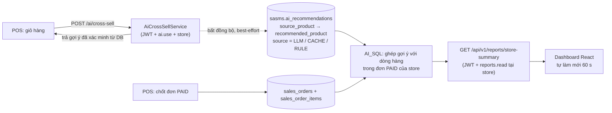

# DS4 — Phần mềm Tăng trưởng Sprint 4: BI Analytics Dashboard (Doanh thu, Kho, Hiệu quả AI)

| Thuộc tính | Giá trị |
| --- | --- |
| Mã sản phẩm bàn giao | **DS4** (phần Phân hệ AI / BI) |
| Tên tài liệu / sản phẩm | Phần mềm tăng trưởng Sprint 4 (bản phát hành) — **TSK-04-02 BI Analytics Dashboard doanh thu, kho, hiệu quả AI** |
| Mã công việc | **S4-03** (Giai đoạn 5. Lập trình — Sprint 4), hạn 12/11/2026 |
| Người thực hiện chính | **Nguyễn Tiến Vũ — Data / AI Lead** (hỗ trợ theo workbook: **Trần Trung Kiên**) |
| Việc hỗ trợ cùng Sprint | S4-06 (sửa lỗi P1/P2 — Thái), S4-07 (tối ưu AI < 3 s — Kiên), S4-11 (báo cáo hiệu năng — Phát): xem mục 9 |
| Căn cứ đầu vào | [D51 Thiết kế CSDL](../../Sprint%200/DB/D51-thiet-ke-co-so-du-lieu.md) · [D55 §8 Dashboard vận hành AI (FR-15, BR-10)](../../Sprint%200/AI/D55-thiet-ke-ai-prompt-rag-cache-fallback.md) · [Từ điển dữ liệu Sprint 4](../../database/sprint4/data-dictionary.md) · [DS2 AI Engine](../../Sprint%202/AI/DS2-phan-mem-tang-truong-ai-sprint2.md) · [DS3 Tóm tắt thông số](../../Sprint%203/AI/DS3-phan-mem-tang-truong-ai-sprint3.md) |
| Kỳ Sprint | Sprint 4 (08/11/2026 – 20/11/2026); DS4 hạn 18/11/2026; Review 20/11/2026 |
| Tiêu chí minh chứng theo workbook | **Ảnh Dashboard; số liệu khớp dữ liệu nguồn; làm mới ≤ 1 phút** (mẫu: log deploy Production; PO ký Review) |
| Trạng thái | **Code + đối soát số liệu trên PostgreSQL thật + kiểm thử tự động: ĐÃ CÓ.** **Ảnh Dashboard, log deploy Production, PR merge, chữ ký PO: CHƯA CÓ** (mục 10). |
| Minh chứng chính | [`ds4-ai-dashboard-reconciliation.json`](evidence/ds4-ai-dashboard-reconciliation.json) · [`ds4-ai-crosssell-latency-benchmark.json`](evidence/ds4-ai-crosssell-latency-benchmark.json) · [`ds4-ai-crosssell-demo-scenarios.json`](evidence/ds4-ai-crosssell-demo-scenarios.json) · [`ds4-ai-crosssell-source.log`](evidence/ds4-ai-crosssell-source.log) · [`ds4-ai-engine-summary.json`](evidence/ds4-ai-engine-summary.json) |

> **Điều cần biết ngay.** Hệ thống **chưa ghi nhận lượt hiển thị hay lượt chấp nhận gợi ý** của AI. Vì vậy dashboard **không** tính "tỷ lệ chấp nhận" (hiển thị `N/A`) mà hiển thị **doanh thu có gợi ý AI — một ước lượng quy gán** (mục 4). Đây là quyết định có chủ đích để không đưa ra số liệu giả; muốn có tỷ lệ chấp nhận thật cần thêm sự kiện ở POS (mục 11).

---

## 1. Mục tiêu và mức đạt

| Yêu cầu | Căn cứ | Mức | Hiện trạng |
| --- | --- | :---: | --- |
| Dashboard doanh thu | Workbook S4-03 | ✔ | Đã có từ trước (`/api/v1/reports/store-summary`); S4-03 **đối soát** với dữ liệu nguồn (mục 6) |
| Dashboard kho | Workbook S4-03 | ✔ | Thiết bị sẵn bán theo store, đếm nhập/bán/trả trong kỳ |
| Dashboard hiệu quả AI | D55 §8.2, FR-15, BR-10 | ◐ | Doanh thu quy gán + phân bổ nguồn (LLM/CACHE/RULE) + tỷ trọng; **tỷ lệ chấp nhận = N/A** |
| Biên: chia cho 0 → `N/A` | AC-15-3 | ✔ | `revenue_share_percent = null` khi doanh thu gộp = 0 (có test) |
| Số liệu khớp dữ liệu nguồn | Workbook | ✔ (PG 18.7) | 35/35 phép đối soát trên PostgreSQL thật (mục 6); chưa chạy PG 16 |
| Làm mới ≤ 1 phút | Workbook | ✔ | Tự gọi lại API mỗi 60 s + truy vấn trực tiếp, không cache (mục 7) |
| Ảnh Dashboard | Workbook | ✘ | Chưa chụp (mục 10) |
| AI < 3 s (p95) | DoD Sprint 4 | ✔ (mô phỏng) | p95 2.510 ms sau thay đổi engine (mục 8) |

---

## 2. Hiện trạng trước S4-03 và những gì đã thay đổi

**Phát hiện khi khảo sát (đều kiểm chứng trên mã nguồn):**

1. `StoreDashboardResponse` có `ai_acceptance_rate` cố định `null` và `"N/A_NO_ACCEPTANCE_EVENTS"` — không có số liệu AI nào.
2. **Không có đoạn mã nào ghi bảng `sasms.ai_recommendations`** (D55 §8.1 mới chỉ là thiết kế). Có dashboard cũng không có dữ liệu để đo.
3. Role runtime `sasms_app` chỉ có `SELECT` trên `ai_recommendations`.
4. Feature flag `sasms.features.store-dashboard-api.enabled` **mặc định `false`**.

**Thay đổi trong S4-03:**

| Hạng mục | Tệp chính | Nội dung |
| --- | --- | --- |
| Ghi `ai_recommendations` bất đồng bộ | `AiRecommendationRecorder`, `JdbcAiRecommendationRecorder`, `AiCrossSellService.recordAsync` | Mỗi gợi ý đã xác minh ghi các dòng *(sản phẩm trong giỏ → sản phẩm gợi ý)* với `source` ∈ LLM/CACHE/RULE. Một luồng ghi, hàng đợi 256; **lỗi ghi chỉ log, không bao giờ làm hỏng phản hồi POS** |
| Quyền ghi | `database/runtime-roles.sql` | `GRANT INSERT (…6 cột…) ON sasms.ai_recommendations TO sasms_app` — chỉ INSERT, không UPDATE/DELETE |
| Chỉ số hiệu quả AI | `JdbcStoreDashboardDataAccess.AI_SQL`, `AiEffectivenessRecord`, `StoreDashboardResponse.ai_effectiveness` | Quy gán doanh thu theo đơn PAID của đúng store (mục 4) |
| Giao diện | `StoreDashboardPage.jsx`, `dashboardView.js` | Khối "Hiệu quả AI gợi ý bán kèm", tự làm mới 60 s, hiển thị "cập nhật lúc / x giây trước" |
| Chống bão request LLM | `AiSingleFlight` | Dùng chung một lần gọi LLM cho các request trùng khóa (mục 8) |

---

## 3. Kiến trúc dữ liệu



Phạm vi store của chỉ số AI được lấy **từ đơn hàng** (`sales_orders.store_id`), không từ tham số của client, vì `ai_recommendations` không có cột store.

---

## 4. Định nghĩa chỉ số hiệu quả AI

Một **dòng hàng** của đơn `PAID` (trong store, `paid_at` ∈ [from, to) nửa mở) được tính là *có gợi ý AI* khi thỏa **tất cả**:

1. Tồn tại bản ghi `ai_recommendations` với `recommended_product_id` = sản phẩm của dòng hàng đó;
2. `source_product_id` là sản phẩm của **một dòng hàng khác** trong cùng đơn;
3. `created_at` của gợi ý nằm trong khoảng **từ lúc mở đơn đến lúc thanh toán** (`o.created_at ≤ r.created_at ≤ o.paid_at`).

Nếu có nhiều gợi ý khớp, lấy gợi ý **sớm nhất** → mỗi dòng hàng được đếm đúng một lần và gán đúng một nguồn.

| Trường API (`ai_effectiveness`) | Ý nghĩa |
| --- | --- |
| `attributed_order_count`, `attributed_item_count` | Số đơn / số dòng hàng có gợi ý AI |
| `attributed_revenue` | Tổng `line_total` các dòng đó |
| `revenue_share_percent` | `attributed_revenue / gross_paid_revenue × 100` (2 chữ số); `null` (→ `N/A`) nếu doanh thu gộp = 0 |
| `source_breakdown` | Số dòng theo nguồn gợi ý sớm nhất: `LLM`, `CACHE`, `RULE` |
| `state` | `ATTRIBUTION_ESTIMATE` hoặc `NO_ATTRIBUTED_SALES` |
| `ai_acceptance_rate` (cấp trên) | **luôn `null`** → giao diện hiển thị `N/A` |

**Đây là ước lượng, không phải xác nhận.** Hệ thống không biết nhân viên có *nhìn thấy* hay *bấm* gợi ý; chỉ biết món đó được gợi ý trước khi đơn thanh toán và sau đó có trong đơn. Nhân viên có thể đã thêm món đó vì lý do khác. Tài liệu và giao diện đều ghi rõ điều này.

---

## 5. Đặc tả API

`GET /api/v1/reports/store-summary?store_id=<uuid>&from=<ISO-8601>&to=<ISO-8601>` — JWT bắt buộc, quyền `reports.read` tại store.

```json
{
  "store_id": "<uuid>", "from": "2026-11-01T00:00:00Z", "to": "2026-12-01T00:00:00Z",
  "generated_at": "2026-11-20T03:12:45Z",
  "gross_paid_revenue": 62390000.00, "paid_order_count": 4,
  "available_device_count": 7,
  "received_movement_count": 0, "sold_movement_count": 0, "returned_movement_count": 0,
  "ai_acceptance_rate": null, "ai_acceptance_state": "N/A_NO_ACCEPTANCE_EVENTS",
  "top_products": [ { "product_id": "<uuid>", "sku": "DSAI-CASE", "name": "…", "quantity": 4, "amount": 1800000.00 } ],
  "ai_effectiveness": {
    "state": "ATTRIBUTION_ESTIMATE",
    "attributed_order_count": 2, "attributed_item_count": 3,
    "attributed_revenue": 1490000.00, "revenue_share_percent": 2.39,
    "source_breakdown": { "LLM": 1, "CACHE": 1, "RULE": 1 }
  }
}
```

Các giá trị ở ví dụ lấy từ fixture đối soát (mục 6). Lỗi: 400 (khoảng thời gian sai), 401, 403 (thiếu `reports.read` tại store), 404 (khi flag tắt).

**Cấu hình bắt buộc để dùng:** bật `sasms.features.store-dashboard-api.enabled=true` (mặc định đang `false`, giao diện sẽ báo *"Dashboard đang tắt chờ duyệt hợp đồng"*). Vai trò có `reports.read` theo seed hiện tại: **`STORE_MANAGER`**.

---

## 6. Minh chứng 1 — Số liệu khớp dữ liệu nguồn (PostgreSQL thật)

**Phương pháp.** Script `scripts/validate_ai_sprint34.py` trích **nguyên văn các câu SQL từ mã Java** (không sao chép tay, tránh lệch), dựng một fixture nhỏ có đáp án tính tay trong **một transaction rồi `ROLLBACK`** (kiểm tra sau chạy: 0 dòng còn sót), chạy các truy vấn dưới role `sasms_app`, so với giá trị kỳ vọng. Môi trường: **PostgreSQL 18.7**, schema dự án 41 bảng (V001–V008), cluster tạm cô lập. Kết quả: **35/35 đạt** (`ds4-ai-dashboard-reconciliation.json`).

Fixture: 2 store, 7 đơn (4 PAID trong kỳ của store A; 1 DRAFT; 1 PAID tháng sau; 1 PAID của store B), 8 gợi ý, tồn kho theo từng kho.

| Nhóm | Phép kiểm | Kỳ vọng = thực tế |
| --- | --- | --- |
| **Doanh thu** | Doanh thu PAID gộp store A trong kỳ | 62.390.000 (O1+O2+O3+O4; loại DRAFT, tháng khác, store khác) |
| | Số đơn PAID store A | 4 |
| | Sản phẩm bán nhiều nhất | CASE 4 · PHONE 3 · CHARGER 1 |
| **Kho** | Thiết bị sẵn bán store A | 7 (chỉ `IN_STOCK` đúng kho) |
| | Bộ đếm nhập/bán/trả trong kỳ | 0 / 0 / 0 (fixture không tạo chuyển động kho) |
| **Hiệu quả AI** | Đơn / dòng hàng có gợi ý (store A) | 2 / 3 |
| | Doanh thu quy gán | 1.490.000 (= 450.000 + 450.000 + 590.000) |
| | Phân bổ nguồn LLM/CACHE/RULE | 1 / 1 / 1 — dòng có 2 gợi ý (CACHE rồi LLM) chỉ đếm một lần, gán **CACHE** (sớm nhất) |
| | Loại đúng các ca không quy gán | gợi ý tạo **trước** khi mở đơn; sản phẩm nguồn không có trong đơn; đơn DRAFT; ngoài kỳ |
| | Cách ly store | Store B: 1 đơn / 1 dòng / 450.000, không lẫn vào store A |
| **Quyền & phạm vi** | `ai.use` theo store (3 người × 2 store + kiểm tra toàn cục) | cashier A chỉ store A; cashier B chỉ store B; vai trò gán toàn cục dùng được cả hai; vai trò theo store **không** thỏa kiểm tra toàn cục |
| | `reports.read` | thu ngân không có |
| | `ADMIN` đơn lẻ | **không** có `ai.use` (V005/D34) |
| **Gợi ý bán kèm (SQL S2-08, lần đầu chạy trên PG thật)** | Kho thuộc store | kho A ∈ store A đúng; kho B ∉ store A |
| | Tồn theo kho | kho A: CASE = 3 (không phải 12); kho B: CASE = 9 |
| | Lọc sản phẩm | chỉ SKU đang bán và còn hàng; loại hết hàng, ngừng bán |
| | Giá | = `products.list_price` |
| | Tiêm SQL qua SKU | trả 0 dòng, không lỗi |
| **Tóm tắt thông số (SQL S3-03)** | Đọc sản phẩm/ngành hàng/thông số | đúng; JSON tiếng Việt và dấu nháy nguyên vẹn |
| **Ghi nhận AI** | `sasms_app` INSERT `ai_recommendations` | thành công |
| | `sasms_app` UPDATE `ai_recommendations` | **bị từ chối** (`insufficient_privilege`) |

**Script có bắt được lỗi thật:** khi tạm bỏ điều kiện `r.created_at >= o.created_at` khỏi `AI_SQL`, 4 phép kiểm lập tức thất bại (đơn 3 thay vì 2, dòng 4 thay vì 3, doanh thu 1.940.000 thay vì 1.490.000, nguồn `[3,0,1]`); mã nguồn đã khôi phục sau thử nghiệm.

**Phát hiện phụ trong lúc đối soát (cần Kiên/PO biết):** theo V005 (D34), `ADMIN` chỉ còn `iam.manage` và `audit.read`; `ai.use` thuộc `CASHIER`, `SALES`, `SALES_STAFF`, `CUSTOMER_SERVICE`; `reports.read` thuộc `STORE_MANAGER`. Hệ quả: `POST /api/v1/ai/simulate` (yêu cầu `ai.use` **toàn cục**) chỉ dùng được nếu một vai trò nghiệp vụ được gán với `store_id = NULL`.

---

## 7. Minh chứng 2 — Làm mới ≤ 1 phút

| Thành phần | Cơ chế | Kiểm chứng |
| --- | --- | --- |
| Backend | Mỗi lần gọi chạy truy vấn trực tiếp trên PostgreSQL; **không có cache** ở tầng báo cáo; trả `generated_at` | Mã nguồn `StoreDashboardService` / `JdbcStoreDashboardDataAccess` |
| Giao diện | Sau lần tải đầu, `setInterval` gọi lại API mỗi **60.000 ms** (bỏ qua khi tab bị ẩn); hiển thị "Cập nhật lúc … (x giây trước)"; khi làm mới thất bại giữ số liệu cũ và báo rõ | Hằng số `REFRESH_INTERVAL_MS = 60_000`, test `refresh interval satisfies the one-minute criterion` |
| Độ cũ tối đa | ≤ 60 s + thời gian truy vấn | Suy ra từ cơ chế |

**Thời gian truy vấn phía DB** (đo thật bởi Kiên, S4-04/S4-07, PostgreSQL, 1.500 mẫu, 50 client, 100.000 thiết bị / 50.000 đơn; nguồn `database/evidence/sprint4/summary.json`; phạm vi do chính tài liệu đó nêu: *chỉ SQL, không phải SLA đầu-cuối*):

| Truy vấn | Trước V008 (p95) | Sau V008 (p95) |
| --- | ---: | ---: |
| `bi_summary` (tổng hợp dashboard) | 342,392 ms | **1,860 ms** |
| `ai_stock` (kiểm tồn gợi ý AI) | 1,965 ms | **0,249 ms** |

Chưa đo đầu-cuối HTTP + trình duyệt. Hai truy vấn mới của S4-03 (`AI_SQL` và ghi `ai_recommendations`) **chưa được benchmark ở quy mô lớn**; trên fixture nhỏ chúng chạy đúng nhưng thời gian không có ý nghĩa. `AI_SQL` dựa vào chỉ mục `ix_ai_product_expiry (source_product_id, expires_at)` và khóa chính của `sales_order_items`; nếu `ai_recommendations` lớn, Kiên nên đo và cân nhắc chỉ mục `(recommended_product_id, created_at)`.

---

## 8. Minh chứng 3 — AI < 3 giây sau thay đổi engine

S4-03 sửa `AiCrossSellService` (ghi `ai_recommendations`, single-flight), nên benchmark bán kèm của Sprint 2 được **chạy lại** để chứng minh không thoái lui (100 request, 50 luồng; LLM mô phỏng 700–1.400 ms, 10 request có LLM treo 5 s; `ds4-ai-crosssell-latency-benchmark.json`):

| Chỉ số | Sprint 2 (DS2) | Sau S4-03 |
| --- | ---: | ---: |
| p50 / p90 | 1.053 / 1.066 ms | 1.003 / 1.074 ms |
| **p95** | 2.510 ms | **2.510 ms** (< 3.000) |
| p99 / max | 2.513 / 2.516 ms | 2.513 / 2.513 ms |
| Nguồn AI / CACHE / RULE | 46 / 44 / 10 | 57 / 33 / 10 |
| Số lần gọi LLM thực sự | *không đo* | **15** (= 15 khóa cache khác nhau) |
| 10 kịch bản demo | 10/10 | 10/10 |

**Cách đọc đúng:**

- **p95 không đổi** vì nó bị chặn dưới bởi timeout 2,5 s của 10 % request có LLM treo — đây là hành vi mong muốn, không phải tốc độ LLM.
- Tỷ lệ `CACHE` giảm 44 → 33 **không phải thoái lui**: các request đến cùng lúc nay chờ kết quả của lần gọi đầu (tính là `AI`) thay vì mỗi request tự gọi LLM rồi sau đó mới trúng cache. **Chỉ số `CACHE %` không còn phản ánh đúng hiệu quả; chỉ số đúng là số lần gọi LLM** — nay bằng số khóa khác nhau (15/15).
- Trước single-flight, với bộ minh chứng của DS3 (cùng cấu trúc tải), 100 request đồng thời cho 6 sản phẩm làm tràn bulkhead và mở breaker, chỉ 31 request nhận kết quả AI; sau đó 0 request bị `CIRCUIT_OPEN`/`LLM_BULKHEAD_FULL` (xem DS3 §7.4). Lần chạy "trước" không được lưu tệp.

---

## 9. Đóng góp cho các việc hỗ trợ cùng Sprint

| Việc | Chủ trì | Phần của Data/AI Lead |
| --- | --- | --- |
| **S4-07** Tối ưu AI < 3 s | Kiên | `AiSingleFlight` (mục 8); số đo p95 trước/sau của engine; ghi nhận rõ giới hạn của mô phỏng. Báo cáo số đo SQL thuộc Kiên |
| **S4-11** Báo cáo hiệu năng (D79) | Phát | Cung cấp bảng ở mục 8 và `ds3-ai-summary-latency-benchmark.json`; lưu ý p95 AI ≈ 2,5 s là sàn timeout với LLM mô phỏng — **số p95 của LLM thật phải đo lại** |
| **S4-06** Sửa lỗi P1/P2 | Thái | Lỗi phát hiện từ phía AI trong Sprint này: log `store_id` thô do client gửi (đã loại, tránh chèn log); bão request LLM khi cache nguội (đã sửa); `ai_recommendations` không bao giờ được ghi (đã sửa). Chưa có sổ lỗi D80 chính thức để ghi mã lỗi |

---

## 10. Minh chứng Sprint 4 đi kèm — trạng thái thực tế

| Thành phần theo workbook | Trạng thái | Ghi chú |
| --- | :---: | --- |
| Số liệu khớp dữ liệu nguồn | **CÓ** (PG 18.7) | Mục 6 |
| Làm mới ≤ 1 phút | **CÓ** (cơ chế + test) | Mục 7; chưa đo đầu-cuối trình duyệt |
| **Ảnh Dashboard** | **CHƯA CÓ** | Cần chạy backend + frontend với flag bật và dữ liệu thật; không dùng ảnh dựng giả |
| Log deploy Production | **CHƯA CÓ** | Thuộc S4-08 (Kiên) |
| PR đã merge | **CHƯA CÓ** | Mã nằm trong working tree |
| PO ký Review | **CHƯA CÓ** | Biên bản mẫu bên dưới để trống |

**Cách chụp ảnh Dashboard (khi đã có môi trường):** (1) bật `SASMS_FEATURES_STORE_DASHBOARD_API_ENABLED=true`; (2) áp dụng `database/runtime-roles.sql` mới; (3) đăng nhập tài khoản `STORE_MANAGER` của store; (4) chạy vài lượt bán kèm tại POS để có dữ liệu `ai_recommendations`, chốt đơn PAID; (5) mở trang Dashboard, chọn kỳ, chụp toàn bộ khối "Hiệu quả AI" và dòng "Cập nhật lúc"; (6) chạy `scripts/validate_ai_sprint34.py` trên DB cách ly và đính kèm kết quả để chứng minh số liệu khớp.

### Biên bản ký duyệt Sprint 4 Review — phần AI/BI (mẫu, **chưa ký**)

| Hạng mục | Kết quả | Ghi chú của PO |
| --- | --- | --- |
| Dashboard hiển thị doanh thu, kho | ☐ Đạt ☐ Không đạt | |
| Khối hiệu quả AI, chấp nhận nhãn "ước lượng" | ☐ Đạt ☐ Không đạt | |
| Số liệu khớp dữ liệu nguồn | ☐ Đạt ☐ Không đạt | |
| Làm mới ≤ 1 phút | ☐ Đạt ☐ Không đạt | |
| AI < 3 s | ☐ Đạt ☐ Không đạt | |

| Vai trò | Họ tên | Chữ ký | Ngày |
| --- | --- | --- | --- |
| Product Owner | Nguyễn Quang Huy | | |
| Data / AI Lead | Nguyễn Tiến Vũ | | |

---

## 11. Giới hạn và điều chưa được kiểm chứng

1. **Không có sự kiện hiển thị/chấp nhận.** Tỷ lệ chấp nhận (D55 §8.2 mục 1) **không tính được**; thay bằng doanh thu quy gán (ước lượng, mục 4). Cần thêm bảng/sự kiện `ai_recommendation_events` (hiển thị, thêm vào giỏ) và tích hợp POS để có chỉ số thật — **thay đổi schema thuộc Kiên, ngoài phạm vi S4-03**.
2. **Phân bổ nguồn chỉ tính trên dòng đã bán** (không phải trên mọi gợi ý đã sinh), vì `ai_recommendations` không có cột store nên không thể lọc theo store cho gợi ý chưa chuyển đổi mà không lộ dữ liệu liên store.
3. **`score` là điểm xếp hạng** (1,0 giảm dần 0,1/vị trí, tối thiểu 0,1), **không phải độ tin cậy của mô hình**; cột `NOT NULL` buộc phải có giá trị.
4. **`expires_at` = 60 phút** (hằng số `EXPIRY_MINUTES`) chỉ là hạn lưu vết; điều kiện quy gán dùng `created_at`, không dùng `expires_at`.
5. **Mỗi lần gọi bán kèm ghi tối đa 100 dòng** (giỏ × gợi ý), có thể ghi lặp khi giỏ đổi; truy vấn quy gán xử lý trùng nhưng bảng sẽ lớn dần — cần chính sách dọn dữ liệu cũ (Kiên).
6. **Khoảng quy gán dựa trên `sales_orders.created_at`**: nếu POS chỉ tạo đơn lúc chốt, gợi ý tạo trước thời điểm đó sẽ không được quy gán. Cần xác nhận với Thái cách POS tạo đơn DRAFT.
7. **Môi trường kiểm chứng SQL là PostgreSQL 18.7** trên cluster tạm, không phải 16 (CI dùng 16). Script đã sẵn để chạy trên CI.
8. **LLM vẫn là mô phỏng**; p95 AI không phản ánh nhà cung cấp thật.
9. **Dashboard mặc định tắt** (flag) và chỉ `STORE_MANAGER` có `reports.read`; ngoài `ai.use`/`reports.read` còn phụ thuộc cách gán vai trò (mục 6, phát hiện phụ).
10. Chưa kiểm thử giao diện bằng trình duyệt thật; 63 test Node + `vite build` đều đạt nhưng chưa có test render component.

---

## 12. Kết quả kiểm thử tự động

| Bộ kiểm thử | Pass | Ghi chú |
| --- | :---: | --- |
| `AiSingleFlightTest` | 4/4 | Gộp request, khóa độc lập, follower timeout, leader lỗi |
| `AiRecommendationRecordingTest` | 5/5 | Nguồn LLM/CACHE/RULE, lỗi ghi không hại POS, không ghi khi rỗng |
| `JdbcAiRecommendationRecorderTest` | 1/1 | Cột INSERT khớp danh sách GRANT |
| `StoreDashboardServiceTest` | 6/6 | Tỷ trọng 12,50 %; doanh thu 0 → `N/A`; chặn trước truy vấn khi thiếu quyền |
| `JdbcStoreDashboardDataAccessTest` | 3/3 | Cấu trúc `AI_SQL`: PAID, store từ đơn, LATERAL…LIMIT 1, 3 tham số |
| `StoreDashboardControllerTest` | 2/2 | |
| `AiCrossSellServiceResilienceTest` / `AiCrossSellControllerTest` / `AiSprint2EvidenceTest` | 5 + 13 + 1 | Hồi quy bán kèm |
| Frontend (`npm test`) | 63/63 | Gồm `dashboardView.test.js` (4); `vite build` thành công |
| **Toàn bộ backend** | **333 PASS · 0 FAIL · 16 SKIPPED** | 16 là test tích hợp PG cần biến môi trường |
| **Đối soát PostgreSQL** | **35/35** | `ds4-ai-dashboard-reconciliation.json` |

---

## 13. Bàn giao và việc tiếp theo

| Người nhận | Việc |
| --- | --- |
| **Trần Trung Kiên** | Duyệt `GRANT INSERT` vào `runtime-roles.sql`; chạy `scripts/validate_ai_sprint34.py` trên PG 16 (CI); đo `AI_SQL`/INSERT ở quy mô lớn, cân nhắc chỉ mục và chính sách dọn `ai_recommendations`; quyết định có thêm bảng sự kiện hiển thị/chấp nhận |
| **Vũ Duy Thái** | Bật flag dashboard ở Staging/Production; xác nhận POS tạo đơn DRAFT trước khi gọi bán kèm (giới hạn 6); (tùy chọn) gửi sự kiện thêm-vào-giỏ từ gợi ý |
| **Nguyễn Quang Huy** | Chấp nhận nhãn "ước lượng" thay cho tỷ lệ chấp nhận; chốt vai trò được xem dashboard; ký biên bản |
| **Phạm Đại Phát** | Đưa các kịch bản mục 6/8 vào D73/D79 và báo cáo E2E; ghi lỗi vào D80 |
| **Nguyễn Tiến Vũ** | Chụp ảnh Dashboard khi có môi trường; đo p95 với LLM thật; commit/PR |
