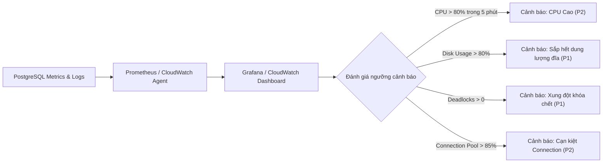

# D101 — Tài liệu vận hành (Runbook), sao lưu và bảo trì CSDL

| Thuộc tính | Nội dung |
|---|---|
| **Đầu việc** | S4-17 — Tài liệu vận hành (Runbook), quy trình sao lưu và bảo trì (16 giờ) |
| **Phụ trách chính** | Trần Trung Kiên — Architect / DBA |
| **Phối hợp hỗ trợ** | Vũ Duy Thái (Fullstack Lead) |
| **Kỳ ban hành / Hạn** | Sprint 4; Hạn hoàn thành: **19/11/2026** |
| **Phạm vi áp dụng** | Vận hành môi trường Production, Staging và quy trình bảo trì dài hạn sau Go-Live |

---

## 1. Mục tiêu và Nguyên tắc vận hành

Tài liệu D101 đóng vai trò là Sổ tay vận hành (Runbook) chính thức của hệ thống SASMS, hướng dẫn chi tiết quy trình quản trị CSDL PostgreSQL 16, chiến lược sao lưu khôi phục thảm họa, và các thủ tục bảo trì định kỳ sau khi hệ thống Go-Live.

### Nguyên tắc bất biến:
1. **Không can thiệp dữ liệu thủ công trên Production:** Mọi thay đổi schema phải thực hiện qua migration có checksum và mã băm quản trị.
2. **Không dùng tài khoản Superuser/Owner:** Backend và các tác vụ nghiệp vụ bắt buộc kết nối qua tài khoản thuộc nhóm **`sasms_app`**.
3. **Mã hóa và phân tách lưu trữ:** Các bản sao lưu CSDL phải được lưu trữ trên vùng lưu trữ tách biệt hoàn toàn với máy chủ CSDL (ví dụ: Amazon S3 bucket có mã hóa SSE-KMS).

---

## 2. Chiến lược Sao lưu (Backup Strategy) và Khôi phục thảm họa

### 2.1 Ma trận sao lưu CSDL Production

| Hình thức sao lưu | Tần suất thực hiện | Công cụ / Phương thức | Điểm đến lưu trữ | Thời gian lưu giữ (Retention) | Mục tiêu đáp ứng |
|---|---|---|---|---|---|
| **Base Backup (Full Physical)** | Hằng ngày lúc 01:00 sáng | `pg_basebackup` / AWS RDS Automated Snapshot | S3 Glacier Instant Retrieval | 30 ngày | Phục hồi toàn diện thảm họa máy chủ |
| **Continuous Archiving (WAL)** | Liên tục (mỗi khi đầy file WAL 16MB hoặc 5 phút) | `archive_command` / WAL-G | S3 Standard (Private Bucket) | 7 ngày gần nhất | **Đáp ứng RPO < 15 phút** (Point-in-Time Recovery - PITR) |
| **Logical Dump** | Trước mỗi đợt deploy / Thay đổi schema | `pg_dump -Fc` (Custom format) qua `scripts/db_ops.py` | Local Storage an toàn & S3 Release Backups | 90 ngày | Phục hồi bảng đơn lẻ hoặc đối soát dữ liệu |

### 2.2 Quy trình khôi phục Point-in-Time Recovery (PITR)
Khi xảy ra sự cố thao tác nhầm hoặc lỗi logic gây hỏng dữ liệu:
1. Xác định thời điểm xảy ra sự cố chính xác ($T_{error}$).
2. Cấp phát một máy chủ CSDL mới cô lập trong Private VPC.
3. Khôi phục Base Backup gần nhất trước thời điểm $T_{error}$.
4. Replay các tệp WAL liên tục đến thời điểm $T_{error} - 1 \text{ giây}$.
5. Kiểm tra tính nhất quán của dữ liệu đối soát; sau đó chuyển hướng kết nối của ứng dụng sang CSDL mới.
6. **Thời gian phục hồi cam kết (RTO):** $\le 4 \text{ giờ}$.

---

## 3. Quy trình Bảo trì và Giám sát CSDL định kỳ

### 3.1 Thủ tục bảo trì định kỳ

| Tác vụ bảo trì | Tần suất | Lệnh / Thủ tục thực hiện | Mục đích |
|---|---|---|---|
| **Vacuum & Analyze** | Hằng ngày (ngoài giờ cao điểm 02:00) | `VACUUM (ANALYZE, VERBOSE) sasms.devices;`<br>`VACUUM (ANALYZE, VERBOSE) sasms.sales_orders;` | Thu hồi không gian đệm chết (Dead Tuples), cập nhật thống kê cho bộ tối ưu truy vấn (Planner Statistics) |
| **Reindex định kỳ** | Hằng tháng (Chủ Nhật tuần đầu tiên) | `REINDEX TABLE CONCURRENTLY sasms.devices;`<br>`REINDEX TABLE CONCURRENTLY sasms.sales_orders;` | Khử phân mảnh cây B-Tree của các chỉ mục tải cao mà không làm khóa bảng |
| **Dọn dẹp Outbox & Log** | Hằng tuần | Xóa các bản ghi `sasms.outbox_events` có trạng thái `PUBLISHED` quá 30 ngày | Kiểm soát dung lượng ổ cứng, duy trì tốc độ scan outbox |

### 3.2 Giám sát hiệu năng và Ngưỡng cảnh báo (Monitoring & Alerting)



- **Ngưỡng CPU:** Cảnh báo khi mức sử dụng CPU của PostgreSQL vượt quá **80%** liên tục trong 5 phút $\rightarrow$ DBA kiểm tra ngay các câu lệnh query chậm (Slow Queries).
- **Ngưỡng Dung lượng đĩa (Disk Storage):**
  - Đạt **70%**: Gửi thông báo nhắc nhở dọn dẹp log và tệp sao lưu cũ.
  - Đạt **85%**: Kích hoạt quy trình khẩn cấp mở rộng dung lượng đĩa tự động (Auto-scaling Volume).
- **Giám sát kết nối (Connections):**
  - Tổng số kết nối tối đa: 200 connections.
  - Ứng dụng Backend dùng HikariCP với pool size cố định 20 connections/instance.
  - Cảnh báo khi số kết nối đồng thời vượt quá **85%** tổng giới hạn.

---

## 4. Xử lý Sự cố Khẩn cấp (Troubleshooting Runbook)

1. **Sự cố 1: Treo khóa CSDL (Lock Contention / Long-running Transactions):**
   - *Nhận diện:* Truy vấn chạy quá 10 giây; ứng dụng báo lỗi timeout.
   - *Lệnh kiểm tra:*
     ```sql
     SELECT pid, age(clock_timestamp(), query_start), usename, query, state
     FROM pg_stat_activity
     WHERE state != 'idle' AND age(clock_timestamp(), query_start) > interval '10 seconds'
     ORDER BY age(clock_timestamp(), query_start) DESC;
     ```
   - *Xử lý:* Chấm dứt tiến trình gây nghẽn bằng `SELECT pg_cancel_backend(pid);` hoặc `SELECT pg_terminate_backend(pid);`.
2. **Sự cố 2: Đột biến dung lượng WAL:**
   - *Nhận diện:* Ổ cứng chứa WAL tăng nhanh bất thường.
   - *Nguyên nhân:* Tiến trình `archive_command` gặp sự cố không đẩy được WAL lên S3, hoặc có transaction mở quá dài (Replication Slot treo).
   - *Xử lý:* Kiểm tra kết nối tới S3 bucket; giải phóng replication slot không hoạt động qua `pg_drop_replication_slot()`.

