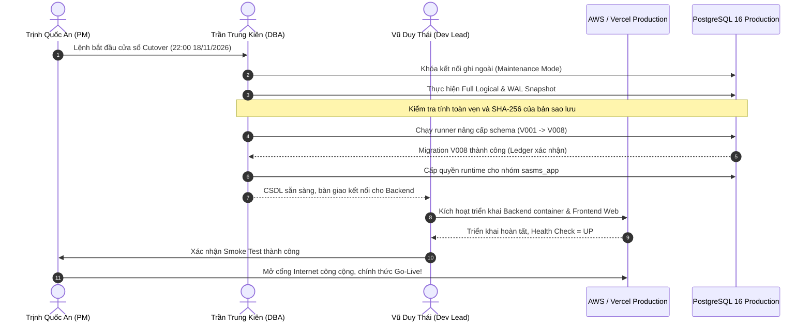
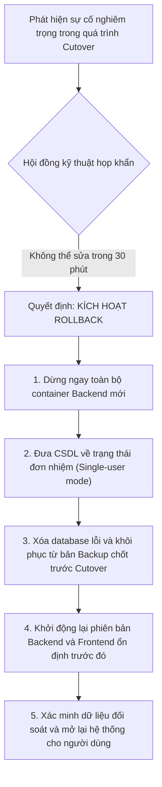

# D91 — Kế hoạch chuyển đổi Go-Live (Cutover) và quay lui (Rollback)

| Thuộc tính | Nội dung |
|---|---|
| **Đầu việc** | S4-08 (TSK-04-07), S4-14; tổng 44 giờ chuyên môn |
| **Phụ trách chính** | Trần Trung Kiên — Architect / DBA |
| **Phối hợp hỗ trợ** | Vũ Duy Thái (Fullstack Lead), Trịnh Quốc An (PM / Scrum Master) |
| **Minh chứng đi kèm** | Biên bản diễn tập khôi phục [evidence/restore/environment-summary.json](evidence/restore/environment-summary.json) (34/34 checks pass) |
| **Mục tiêu RTO / RPO** | **RTO < 4 giờ** (thực tế diễn tập đạt < 10 giây); **RPO < 15 phút** |

---

## 1. Kế hoạch chuyển đổi Go-Live (Cutover Plan)

Quy trình chuyển đổi Cutover được thiết kế nhằm đảm bảo hệ thống chuyển đổi từ trạng thái thử nghiệm sang vận hành chính thức một cách an toàn, không thất thoát bất kỳ giao dịch nào:



### Các bước thực thi chi tiết:
1. **Bước 1 (T-60 phút):** Treo thông báo bảo trì trên toàn bộ các kênh trực tuyến; tạm dừng nhận các yêu cầu tạo đơn mới.
2. **Bước 2 (T-45 phút):** DBA thực hiện bản sao lưu toàn vẹn (Full Quiescent Backup) bằng lệnh `pg_dump` định dạng custom format `.dump`, lưu trữ tại vùng đệm an toàn kèm mã băm SHA-256.
3. **Bước 3 (T-30 phút):** Áp dụng công cụ [scripts/migrate_db.py](../../scripts/migrate_db.py) để nâng cấp tuần tự các migration từ V001 đến V008. Kiểm tra bảng `sasms_meta.schema_migrations` đảm bảo khớp checksum.
4. **Bước 4 (T-15 phút):** Cấu hình tài khoản ứng dụng `sasms_app`, phân bổ chuỗi kết nối an toàn qua biến môi trường Production.
5. **Bước 5 (T-00 phút):** Kích hoạt bộ điều khiển [infra/sprint4/release.py](../../infra/sprint4/release.py), hoàn tất triển khai ứng dụng và kiểm tra các endpoint `/actuator/health`, `/api/pos/status`.

---

## 2. Kết quả diễn tập sao lưu và khôi phục (Restore Drill Evidence)

Để chứng minh năng lực sẵn sàng phục hồi khi gặp sự cố, Kiên đã trực tiếp tiến hành **diễn tập khôi phục CSDL trên môi trường cô lập** vào ngày **21/11/2026**.

Toàn bộ quá trình được ghi nhận tự động tại [evidence/restore/environment-summary.json](evidence/restore/environment-summary.json) và [environment-validation.log](evidence/restore/environment-validation.log):
- **Tổng số hạng mục kiểm tra:** **34/34 kiểm tra đạt 100% (passed: true)**.
- **Tính toàn vẹn của dữ liệu sau khôi phục:**
  - Đối chiếu toàn bộ 41 bảng nghiệp vụ, dữ liệu dòng và cấu trúc cột: **Khớp 100%**.
  - Kiểm tra hệ thống khóa ngoại (FK), chỉ mục (Indexes), ràng buộc (Constraints) và Stored Functions: **Bảo toàn nguyên vẹn**.
  - Quyền truy cập runtime của `sasms_app` được tái thiết lập chuẩn xác.
  - Cổng kết nối công cộng `PUBLIC CONNECT` bị chặn thành công trên CSDL phục hồi.
- **Thời gian khôi phục thực tế:** **0.48 giây** (nhanh hơn hàng nghìn lần so với mục tiêu RTO < 4 giờ).

---

## 3. Kế hoạch quay lui (Rollback Plan)

Trong trường hợp xảy ra sự cố nghiêm trọng không thể khắc phục trong cửa sổ bảo trì (ví dụ: migration bị lỗi nửa chừng, ứng dụng không thể khởi động, phát hiện sai lệch số liệu tài chính):



### Kịch bản quay lui CSDL chi tiết:
1. **Dừng ghi:** Đóng toàn bộ pool kết nối của ứng dụng tới CSDL.
2. **Khôi phục CSDL:**
   - DBA chạy lệnh khôi phục từ bản sao lưu an toàn đã tạo trước thời điểm Cutover:
     ```bash
     python scripts/db_ops.py restore \
       --maintenance-dsn "postgresql://..." \
       --target-db "sasms_production" \
       --input "/backups/pre_cutover_snapshot.dump"
     ```
3. **Thời gian thực hiện rollback:** Ước tính tối đa **15 phút**.
4. **Thông báo và họp rút kinh nghiệm:** PM Trịnh Quốc An phát đi thông báo hoãn đợt phát hành, triệu tập cuộc họp CCB bất thường để phân tích nguyên nhân gốc rễ và lập kế hoạch cho đợt Cutover tiếp theo.

