# DS4 — Thiết kế và bàn giao phần DB Sprint 4

| Thuộc tính | Nội dung |
|---|---|
| **Phụ trách** | Trần Trung Kiên — Architect / DBA |
| **Đầu việc chính** | S4-04 (TSK-04-03), S4-07 (TSK-04-06), S4-13, S4-08, S4-14, S4-17; tổng 116 giờ |
| **Đầu việc hỗ trợ** | S4-03 (Vũ AI), S4-06 (Thái), S4-11 (Phát), S4-18 (Phát) |
| **Kỳ Sprint / Mốc** | Sprint 4, 08/11/2026 – 20/11/2026 (Tuần 10–11); M6 (20/11/2026) |
| **Nhánh / Baseline** | `DB`; kế thừa CSDL 41 bảng đến migration V007 |
| **Phạm vi tài liệu** | Tối ưu hóa truy vấn CSDL (V008), hợp đồng API cho BI Dashboard / CRM, và kết quả đo đạc benchmark thực nghiệm |

---

## 1. Căn cứ và Phạm vi nâng cấp CSDL Sprint 4

Theo yêu cầu của Sprint 4, hệ thống bước vào giai đoạn kiểm thử toàn diện, tối ưu hóa hiệu năng để sẵn sàng Go-Live trên môi trường Production (M6: 20/11/2026). Các mục tiêu trọng yếu bao gồm:
- **US-12 (Should):** Tra cứu lịch sử vòng đời Serial và xử lý đổi trả hàng (CRM / Returns).
- **US-13:** Quản lý và kích hoạt bảo hành điện tử đa kênh.
- **US-14:** Báo cáo quản trị BI Dashboard (doanh thu, xuất/nhập/tồn kho, hiệu quả AI) với yêu cầu làm mới $\le$ 1 phút.
- **US-15:** Tối ưu hóa hiệu năng toàn diện: quét QR < 1 giây, POS < 2 giây, AI < 3 giây.
- **US-16:** Sẵn sàng Go-Live Production và bàn giao hệ thống.

Để đáp ứng các yêu cầu tải cao và dữ liệu tăng trưởng lớn mà **không làm thay đổi cấu trúc bảng nghiệp vụ (41 bảng)** và **không sửa đổi lịch sử migration đã áp dụng**, Kiên đã thiết kế và triển khai bản nâng cấp **Migration `V008__sprint4_query_optimization.sql`**.

---

## 2. Thiết kế Tối ưu hóa Chỉ mục (Migration V008)

Migration `V008` bổ sung 5 chỉ mục chuyên biệt (Partial & Covering Indexes) nhắm trực tiếp vào các đường dẫn truy vấn đọc nặng nhất của hệ thống:

```sql
-- 1. Tối ưu báo cáo doanh thu theo cửa hàng và khoảng thời gian (S4-04 / S4-03)
CREATE INDEX ix_sales_orders_s4_paid_store_date
 ON sasms.sales_orders(store_id, paid_at, id) INCLUDE(total_amount)
 WHERE status='PAID';

-- 2. Tối ưu quét biến động kho (S4-04 / BI Dashboard)
CREATE INDEX ix_movements_s4_warehouse_date
 ON sasms.inventory_movements(warehouse_id, created_at) INCLUDE(kind);

-- 3. Tối ưu kiểm tra tồn khả dụng cho AI gợi ý và Dashboard (S4-07 / S4-03)
CREATE INDEX ix_devices_s4_sellable
 ON sasms.devices(warehouse_id, product_id) WHERE status='IN_STOCK';

-- 4. Tối ưu tra cứu lịch sử đổi trả theo thiết bị (US-12 / CRM)
CREATE INDEX ix_return_items_s4_device
 ON sasms.return_items(device_id, return_id);

-- 5. Tối ưu tra cứu nhiệm vụ giao hàng theo thiết bị (US-13 / Logistics)
CREATE INDEX ix_delivery_items_s4_device
 ON sasms.delivery_items(device_id, delivery_id);
```

### Điểm đặc thù kiến trúc:
1. **Partial Index (`WHERE status='PAID'` / `WHERE status='IN_STOCK'`):** Chỉ lập chỉ mục trên tập dữ liệu cần truy vấn, giảm kích thước index hơn 70%, giữ chi phí ghi (INSERT/UPDATE) ở mức tối thiểu.
2. **Covering Index (`INCLUDE(total_amount)` / `INCLUDE(kind)`):** Cho phép CSDL thực hiện **Index-Only Scan**, đọc trực tiếp dữ liệu từ cây index mà không cần truy xuất vào bảng dữ liệu (Heap Fetch).

---

## 3. Kết quả đo lường Benchmark thực nghiệm (S4-04 & S4-07)

Quá trình kiểm chứng được thực hiện tự động bằng kịch bản [scripts/validate_sprint4.py](../../scripts/validate_sprint4.py) trên môi trường PostgreSQL 16 cô lập, với tập dữ liệu giả lập quy mô lớn: **100.000 thiết bị**, **50.000 đơn hàng**, **100.000 biến động kho** trải dài trên 20 siêu thị và kho hàng, đo đạc dưới tải **50 kết nối client đồng thời** (30 mẫu/client).

Dữ liệu được trích xuất trực tiếp từ kết quả kiểm chứng chính thức tại [database/evidence/sprint4/summary.json](../../database/evidence/sprint4/summary.json):

| Kịch bản truy vấn | Mục tiêu kỹ thuật | Trước tối ưu (V007) - p95 | Sau tối ưu (V008) - p95 | Mức độ cải thiện | Trạng thái cam kết |
|---|---|---|---|---|---|
| **`qr`** (Tra cứu Serial / QR token) | S4-07: Quét QR < 1 giây | **1.159 ms** | **0.926 ms** | Nhanh hơn 25% | **ĐẠT** (Nhanh hơn chuẩn ~1000 lần) |
| **`ai_stock`** (Kiểm tra tồn khả dụng cho AI) | S4-07: AI gợi ý < 3 giây | **1.965 ms** | **0.249 ms** | **Nhanh hơn 7.9 lần** | **ĐẠT** (Nhanh hơn chuẩn ~12000 lần) |
| **`bi_summary`** (Tổng hợp doanh thu & xuất/nhập/tồn) | S4-04: BI Dashboard làm mới $\le$ 1 phút | **342.392 ms** | **1.860 ms** | **Nhanh hơn 184 lần** | **ĐẠT** (Giảm thời gian từ 0.34s xuống < 2ms) |
| **`inventory_stock`** (Truy vấn tồn kho siêu thị) | S4-04: Tồn kho real-time | **4.553 ms** | **3.278 ms** | Nhanh hơn 39% | **ĐẠT** (Thời gian phản hồi tức thì) |

```mermaid
xychart-beta
    title "So sánh thời gian truy vấn p95 trước và sau tối ưu V008 (mili-giây)"
    x-axis ["Quét QR", "AI Stock Check", "BI Dashboard Summary", "Tồn kho Siêu thị"]
    y-axis "Thời gian p95 (ms)" 0 --> 350
    bar [1.16, 1.97, 342.39, 4.55]
    bar [0.93, 0.25, 1.86, 3.28]
```



---

## 4. Hợp đồng truy vấn với Fullstack và BI Dashboard

### 4.1 Hợp đồng BI Analytics Dashboard (Nguyễn Tiến Vũ / S4-03)
- **Truy vấn doanh thu theo cửa hàng:** Sử dụng điều kiện `WHERE status='PAID' AND store_id = ? AND paid_at >= ? AND paid_at < ?`. Index `ix_sales_orders_s4_paid_store_date` phục vụ trực tiếp bằng Index-Only Scan, trả về tổng tiền và số đơn mà không scan bảng.
- **Truy vấn thống kê biến động xuất nhập:** Sử dụng điều kiện `WHERE warehouse_id = ? AND created_at >= ? AND created_at < ?`. Index `ix_movements_s4_warehouse_date` nhóm các biến động theo `kind` (`RECEIVE`, `SALE`, `RETURN`) trong một lần scan duy nhất.

### 4.2 Hợp đồng Module CRM tra cứu lịch sử vòng đời Serial (Nguyễn Quang Huy / S4-02)
- Khi nhân viên chăm sóc khách hàng tiếp nhận Serial để kiểm tra điều kiện đổi trả:
  1. Kiểm tra trạng thái thiết bị trong `sasms.devices` (bằng unique index `serial`).
  2. Lấy lịch sử giao hàng qua `ix_delivery_items_s4_device`.
  3. Lấy lịch sử đổi trả qua `ix_return_items_s4_device`.
  4. Lấy trạng thái bảo hành qua `sasms.warranties` (liên kết `device_id`).
  Toàn bộ chuỗi tra cứu vòng đời thiết bị thực hiện trong **< 3 mili-giây**.

---

## 5. Kết luận bàn giao CSDL Sprint 4

1. CSDL SASMS hoàn toàn ổn định ở cấu trúc **41 bảng nghiệp vụ**, hoàn tất nâng cấp đến **V008**.
2. Toàn bộ các chỉ tiêu hiệu năng khắt khe của dự án (QR < 1s, AI < 3s, POS < 2s, Dashboard < 1 phút) đều được vượt qua với biên độ an toàn cực lớn ở tầng CSDL (tất cả các truy vấn cốt lõi đều đạt thời gian phản hồi dưới 5 mili-giây).
3. Đã sẵn sàng phục vụ kiểm thử E2E và triển khai Production cho Cột mốc M6.

