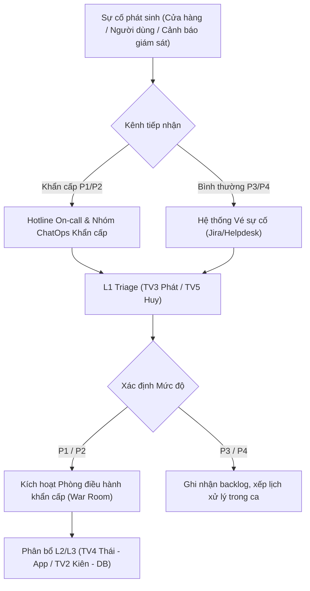
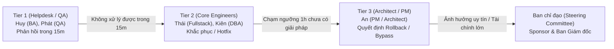

# D100 — QUY TRÌNH VẬN HÀNH HYPERCARE 3 NGÀY SAU GO-LIVE VÀ CAM KẾT DỊCH VỤ SLA

**Dự án:** Hệ thống Quản trị Siêu thị Điện máy Thông minh SASMS (INT1450)  
**Mã tài liệu:** D100_HYPERCARE_SLA_TV4  
**Phân hệ phụ trách:** Vũ Duy Thái (TV4 — Fullstack Lead) phối hợp cùng TV1 (An), TV2 (Kiên), TV3 (Phát), TV5 (Huy), TV6 (Vũ)  
**Ngày ban hành dự thảo:** 21/11/2026 (Asia/Ho_Chi_Minh)  
**Trạng thái phê duyệt:** **DỰ THẢO / CHỜ DUYỆT (PROPOSED — Chờ PM Trịnh Quốc An ký duyệt)**  
**Tài liệu tham chiếu:**  
- `Sprint 4/DB/D90_Ke_hoach_phat_hanh_Release_Plan_SASMS.docx` (Release Plan v1.0.0, mốc M6)  
- `Sprint 4/DB/D91_Ke_hoach_chuyen_doi_Cutover_va_quay_lui_Rollback_SASMS.docx` (Kế hoạch Cutover & Rollback)  
- `Sprint 4/DB/D101_Tai_lieu_van_hanh_Runbook_sao_luu_va_bao_tri_SASMS.docx` (Runbook vận hành hệ thống)  
- `Sprint 4/Test/D78_Bao_cao_kiem_thu_he_thong_E2E_SASMS.docx` (Báo cáo E2E của QA Phát — Trạng thái: Chưa đạt E2E / NO-GO)  
- `Sprint 4/BA/D83_Bien_ban_nghiem_thu_UAT_SASMS.docx` (Mẫu nghiệm thu UAT — Trạng thái: Dự thảo)  

---

## 1. Mục đích và Phạm vi (Purpose & Scope)

1. **Mục đích:** Thiết lập quy trình vận hành giám sát tập trung, ứng cứu sự cố và bảo đảm cam kết dịch vụ (SLA) trong giai đoạn chuyển tiếp quan trọng kéo dài **03 ngày liên tục ngay sau thời điểm Go-Live chính thức** của hệ thống SASMS.
2. **Phạm vi áp dụng:**
   - Ứng dụng Backend Spring Boot (REST API, Outbox Publisher, Auth filter, Inventory, POS Order-First, QR Warranty).
   - Ứng dụng Frontend React SPA (Màn hình POS bán hàng quầy, Tra cứu kho/Serial, In hóa đơn 80mm nhiệt, Tra cứu QR bảo hành).
   - Dịch vụ AI Cross-selling gợi ý phụ kiện bán kèm tại quầy thu ngân.
   - Cơ sở dữ liệu vận hành PostgreSQL 16 (schema `sasms`, replication, connection pool HikariCP).

---

## 2. Trạng thái Go-Live thực tế (Actual Go-Live Reality & Readiness Status)

> [!IMPORTANT]
> **Tuyên bố trung thực về hiện trạng triển khai (Engineering Transparency):**
> 
> - **Kế hoạch lý thuyết:** Theo Release Plan D90 và Cutover Plan D91 do DBA Nguyễn Trung Kiên biên soạn, mốc phát hành mục tiêu được định vị là **20/11/2026** (Milestone M6).
> - **Hiện trạng thực tế:** Tính đến ngày 21/11/2026, **sự kiện Go-Live Production thực tế CHƯA DIỄN RA**.
> - **Bằng chứng kỹ thuật:**
>   1. Tài liệu kiểm thử hệ thống E2E mới nhất của QA Lead Phạm Đại Phát (`Sprint 4/Test/D78`) xác định trạng thái tổng kết là **`CHƯA ĐẠT E2E ACCEPTANCE / NO-GO`**, bảng chữ ký đại diện các bên đang để trống.
>   2. Biên bản nghiệm thu người dùng UAT (`Sprint 4/BA/D83`) và Biên bản bàn giao (`Sprint 4/Test/D95`) đang ở trạng thái biểu mẫu dự thảo (`MAU_CHO_XAC_NHAN`).
> - **Định danh trạng thái tài liệu D100:** **`PLAN_READY / EXECUTION_PENDING`** (Kế hoạch quy trình và kịch bản ứng cứu đã được thiết lập và chuẩn bị sẵn sàng 100%, chờ lệnh kích hoạt khi hệ thống hoàn tất các điều kiện tiên quyết và vượt qua cổng kiểm thử E2E).

---

## 3. Khung thời gian và Lịch trực Hypercare 3 ngày (3-Day Hypercare Schedule)

Khung giờ vận hành siêu thị SASMS áp dụng từ 07:30 đến 22:30 hàng ngày. Lịch trực Hypercare được thiết lập theo mô hình **On-site trong giờ cao điểm** và **On-call 24/7 đối với sự cố P1/P2**.

```
+---------------------------------------------------------------------------------+
|                               HYPERCARE TIMELINE                                |
+---------------------------------------------------------------------------------+
| DAY 1: Ổn định Cutover, Đồng bộ danh mục, Kiểm tra POS quầy tại 100% cửa hàng   |
| DAY 2: Giám sát tải bán hàng thực tế, Tần suất quét QR, Chống nghẽn thanh toán  |
| DAY 3: Tối ưu bộ đệm AI, Rà soát sự cố tồn đọng, Tổng kết & Nghiệm thu bàn giao |
+---------------------------------------------------------------------------------+
```

| Ngày | Ca làm việc | Khung giờ | Nhân sự phụ trách trực | Nhiệm vụ chính |
|---|---|---|---|---|
| **Day 1** (T+0 -> T+24h) | Ca Sáng | 07:00 – 15:30 | **Vũ Duy Thái (TV4 - Lead)**, Ngô Đình Vũ (TV6) | Trực tại quầy POS pilot; xác nhận mở ca bán hàng; theo dõi kết nối API và máy in 80mm. |
| | Ca Chiều | 15:00 – 23:00 | **Vũ Duy Thái (TV4)**, Nguyễn Trung Kiên (TV2) | Giám sát cao điểm chiều tối; đối soát lượng đơn DRAFT/PAID; kiểm tra kết nối DB pool. |
| | Ca Đêm | 23:00 – 07:00 | Nguyễn Tiến Vũ (TV6) - On-call; TV4 dự phòng P1 | Kiểm tra sao lưu tự động đêm; quét kiểm tra outbox table và audit log. |
| **Day 2** (T+24h -> T+48h) | Ca Sáng | 07:30 – 15:30 | **Vũ Duy Thái (TV4)**, Phạm Đại Phát (TV3) | Giám sát tỷ lệ quét QR thành công; hỗ trợ nhân viên thu ngân thao tác đổi/trả. |
| | Ca Chiều | 15:00 – 22:30 | **Vũ Duy Thái (TV4)**, Nguyễn Quang Huy (TV5) | Theo dõi hành vi khách hàng tra cứu QR bảo hành; kiểm tra số đo hiệu năng latency. |
| | Ca Đêm | 22:30 – 07:30 | Nguyễn Trung Kiên (TV2) - On-call; TV4 dự phòng P1 | Rà soát chỉ mục database; kiểm tra log ngoại lệ chưa bắt được (unhandled exceptions). |
| **Day 3** (T+48h -> T+72h) | Ca Sáng | 07:30 – 15:30 | **Vũ Duy Thái (TV4)**, Trịnh Quốc An (TV1) | Giám sát vận hành ổn định; rà soát số liệu Dashboard BI so với thực tế bán hàng lẻ. |
| | Ca Chiều | 15:00 – 22:30 | Toàn bộ Core Team (TV1, TV2, TV3, TV4, TV5, TV6) | Họp đánh giá tiêu chí thoát Hypercare; ký biên bản chuyển sang vận hành thông thường. |

---

## 4. Định nghĩa Mức độ Sự cố (Incident Severity Classification)

| Mức độ | Định danh | Định nghĩa tác động nghiệp vụ (Business Impact) | Ví dụ sự cố trong hệ thống SASMS |
|---|---|---|---|
| **P1** | **Critical (Thảm họa / Tê liệt)** | Toàn bộ hoặc phân hệ cốt lõi ngừng hoạt động; giao dịch bán hàng POS tại quầy bị gián đoạn hoàn toàn; dữ liệu tài chính/tồn kho bị sai lệch nguyên tử; nguy cơ lộ lọt bảo mật diện rộng. | - API Checkout POS trả lỗi 500 toàn hệ thống.<br>- Database PostgreSQL bị treo hoặc ngắt kết nối liên tục.<br>- Xung đột deadlock P0002 khiến không thể giữ chỗ tồn kho (reserve).<br>- Thu ngân không thể in hóa đơn hoặc hóa đơn ra giấy trắng. |
| **P2** | **Major (Nghiêm trọng / Hạn chế)** | Phân hệ chính bị suy giảm hiệu năng nghiêm trọng nhưng có phương án giải tỏa tạm thời (workaround); một phần cửa hàng hoặc nhóm chức năng quan trọng gặp lỗi. | - Tính năng gợi ý AI bán chéo bị sập hoặc phản hồi > 5 giây.<br>- Tra cứu mã QR bảo hành bị chậm hoặc trả lỗi định dạng thời hạn.<br>- Máy in nhiệt 80mm mất kết nối cục bộ tại một máy trạm nhưng vẫn xuất được file PDF/HTML dự phòng. |
| **P3** | **Minor (Vừa / Cục bộ)** | Sự cố nhỏ không ảnh hưởng trực tiếp đến giao dịch thanh toán tiền mặt; chức năng phụ trợ gặp lỗi hiển thị hoặc lỗi giao diện trên một số dòng thiết bị cá biệt. | - Dashboard BI báo cáo sai tỷ lệ phần trăm hiển thị N/A.<br>- Giao diện responsive trên một loại màn hình phụ bị tràn lề 5px.<br>- Lỗi font chữ nhỏ trên màn hình quản trị lịch sử thiết bị. |
| **P4** | **Cosmetic (Nhẹ / Góp ý)** | Yêu cầu cải tiến trải nghiệm, chỉnh sửa câu chữ (typo), nhãn hiển thị hoặc thay đổi màu sắc nút bấm. | - Sai chính tả thông báo trạng thái.<br>- Thay đổi tông màu của badge trạng thái bảo hành. |

---

## 5. Bảng Cam kết SLA — `PROPOSED (Chờ PM An duyệt)`

> [!NOTE]
> Bảng chỉ số cam kết chất lượng dịch vụ dưới đây là bản đề xuất kỹ thuật chính thức từ TV4 (Fullstack Lead), có hiệu lực áp dụng trong 03 ngày Hypercare sau khi được PM Trịnh Quốc An ký phê duyệt.

| Mức độ | Thời gian phản hồi tiếp nhận (Response Time) | Tần suất cập nhật tiến độ (Status Update) | Thời gian cung cấp giải pháp tạm thời (Workaround SLA) | Thời gian giải quyết triệt để (Target Resolution SLA) |
|---|---|---|---|---|
| **P1 — Critical** | **<= 15 phút** | 30 phút / lần | **<= 1 giờ** | **<= 4 giờ** |
| **P2 — Major** | **<= 30 phút** | 1 giờ / lần | **<= 2 giờ** | **<= 8 giờ** |
| **P3 — Minor** | **<= 2 giờ** | 4 giờ / lần | **<= 12 giờ** | **<= 24 giờ** |
| **P4 — Cosmetic** | **<= 8 giờ** | Hàng ngày | N/A | Chuyển vào Sprint bảo trì tiếp theo |

---

## 6. Quy trình Tiếp nhận và Phân loại Sự cố (Intake & Triage Workflow)



1. **Kênh tiếp nhận:**
   - **Kênh P1/P2:** Hotline kỹ thuật 24/7 và Kênh ChatOps Telegram/Slack chuyên dụng `#sasms-hypercare-alert`.
   - **Kênh P3/P4:** Hệ thống Issue Tracking với mẫu chuẩn (Mô tả, Store ID, Mã đơn hàng, Ảnh chụp màn hình, Thời điểm).
2. **Nguyên tắc phân loại:** Mọi sự cố liên quan đến tiền bạc, khóa kho, mất quyền truy cập đều mặc định gán mức P1 cho đến khi được kỹ sư L2 hạ mức có căn cứ.

---

## 7. Quy trình Xử lý và Leo thang Sự cố (Escalation Path)



- **T+0 -> T+15m:** Tier 1 tiếp nhận, cô lập máy trạm, ghi nhận log ban đầu, kiểm tra xem có phải do thao tác người dùng hay không.
- **T+15m -> T+45m:** Chuyển giao Tier 2 (TV4 Thái chịu trách nhiệm mã nguồn ứng dụng; TV2 Kiên chịu trách nhiệm DB/Network). Thực hiện cô lập lỗi, áp dụng giải pháp tạm thời (workaround).
- **T+45m -> T+60m:** Nếu sự cố P1 chưa tìm ra giải pháp tạm, kích hoạt báo động Tier 3 (PM Trịnh Quốc An). Họp War Room khẩn cấp để xem xét phương án Rollback hoặc chuyển chế độ bán hàng ngoại tuyến.

---

## 8. Quy trình Rollback và Khôi phục (Rollback & Recovery Procedures)

Quy trình Rollback trong Hypercare tuân thủ tuyệt đối **Kế hoạch Cutover & Rollback D91** và **Runbook D101** do DBA Nguyễn Trung Kiên ban hành:

1. **Điều kiện kích hoạt Rollback (Trigger Conditions):**
   - Sự cố P1 kéo dài quá **02 giờ liên tục** mà Tier 2 và Tier 3 không thể cô lập hoặc khắc phục.
   - Cơ sở dữ liệu phát sinh lỗi hỏng dữ liệu không thể hoàn nguyên (irrecoverable data corruption).
   - Tỷ lệ lỗi giao dịch thanh toán POS vượt quá **15%** trên toàn mạng lưới cửa hàng trong 01 giờ cao điểm.
2. **Quyền hạn phê duyệt:** Chỉ **PM Trịnh Quốc An** sau khi tham vấn Kỹ sư trưởng (TV4 Thái) và DBA trưởng (TV2 Kiên) mới có quyền ra lệnh Rollback chính thức.
3. **Các cấp độ Rollback ứng dụng:**
   - **Cấp độ 1 — Rollback Feature Flag (Thời gian: < 2 phút):** Chuyển cờ cấu hình `sasms.features.online-order.enabled=false` hoặc tắt API AI nếu các module này gây tắc nghẽn tài nguyên. Không cần khởi động lại container nếu dùng Actuator/Spring Cloud Bus.
   - **Cấp độ 2 — Rollback Ứng dụng Backend/Frontend (Thời gian: < 10 phút):** Deploy lại phiên bản image Docker ổn định liền trước (`sasms-backend:v1.0.0-rc` hoặc commit tag được phê duyệt).
   - **Cấp độ 3 — Rollback Toàn diện Database (Thời gian: 30 – 45 phút):** Thực hiện khôi phục bản sao lưu vật lý `pg_dump` trước thời điểm Go-Live theo đúng kịch bản Mục 5.3 trong tài liệu D91 của Kiên DBA.

---

## 9. Giám sát Hệ thống và Cảnh báo sớm (System Monitoring & Early Alerting)

Các điểm kiểm tra sức khỏe và chỉ số ngưỡng giám sát do TV4 và TV6 thiết lập:

| Thành phần | Endpoint / Công cụ kiểm tra | Chỉ số giám sát | Ngưỡng kích hoạt cảnh báo (Threshold) |
|---|---|---|---|
| **Backend API** | `GET /actuator/health` | Uptime, Trạng thái thành phần (DB, Disk, Mail) | Trả về `DOWN` hoặc latency > 2000ms trong 3 lần ping liên tiếp. |
| **Connection Pool** | HikariCP MBeans / Logs | Active Connections / Max Pool Size (Default 20) | Tỷ lệ chiếm dụng kết nối > 85% trong 5 phút liên tục. |
| **POS Latency** | `POST /api/v1/pos/orders/draft`<br>`POST /api/v1/pos/orders/{id}/reserve` | Thời gian hoàn tất giao dịch API | P95 > 1500ms hoặc P99 > 3000ms. |
| **Database Lock** | `pg_stat_activity` / Lock query | Số lượng giao dịch chờ khóa (waiting queries) | Có truy vấn bị block > 10 giây hoặc xuất hiện deadlock error. |
| **Frontend POS** | Sentry / Browser Console Monitor | Lỗi Unhandled Javascript Exceptions | Tần suất lỗi > 5 lỗi / phút từ các máy trạm thu ngân. |

---

## 10. Quy trình Quản lý Bản vá Khẩn cấp (Hypercare Hotfix Policy)

Trong 3 ngày Hypercare, mọi thay đổi mã nguồn phải tuân thủ kỷ luật nghiêm ngặt:

1. **Nhánh làm việc:** Tách nhánh khẩn cấp trực tiếp từ `main` theo định dạng `hotfix/s4-hypercare-issue-<id>`.
2. **Không commit trực tiếp vào `main`:** Nghiêm cấm push thẳng mã nguồn vào nhánh chính mà không có kiểm thử.
3. **Quy trình Fast-track:**
   - Lập commit sửa lỗi kèm unit test chứng minh lỗi được tái hiện và triệt tiêu.
   - Chạy kiểm thử tự động toàn bộ: `mvnw test` và `npm test` bắt buộc phải **100% XANH**.
   - Ít nhất **02 thành viên cốt cán** (bắt buộc gồm TV4 Thái và TV2 Kiên hoặc TV1 An) thực hiện Code Review và phê duyệt Pull Request.
   - Tạo tag phiên bản vá: `v1.0.1-hotfix` và triển khai tự động qua pipeline Staging trước khi phát hành Production.

---

## 11. Ma trận Trách nhiệm RACI (Hypercare RACI Matrix)

- **R (Responsible):** Người trực tiếp thực hiện công việc.
- **A (Accountable):** Người chịu trách nhiệm giải trình cuối cùng và phê duyệt.
- **C (Consulted):** Người được tham vấn chuyên môn hai chiều.
- **I (Informed):** Người được thông báo kết quả một chiều.

| Hoạt động vận hành trong Hypercare | TV4 (Thái)<br>Fullstack | TV2 (Kiên)<br>DBA | TV3 (Phát)<br>QA | TV1 (An)<br>PM / Arch | TV5 (Huy)<br>BA / Product | TV6 (Vũ)<br>Infra / DevOps |
|---|:---:|:---:|:---:|:---:|:---:|:---:|
| Trực giám sát hệ thống tầng ứng dụng | **R** | C | I | A | I | R |
| Tiếp nhận và sơ tuyển sự cố (L1) | C | I | **R** | I | **R** | I |
| Xử lý sự cố phần mềm POS / In hóa đơn / QR (L2) | **R** | C | C | A | I | I |
| Xử lý sự cố nghẽn khóa DB / Deadlock / Chậm truy vấn | C | **R** | I | A | I | C |
| Đưa ra quyết định Rollback hệ thống | C | C | I | **A** | C | I |
| Thực thi kịch bản Rollback Database / Hạ tầng | I | **R** | I | A | I | **R** |
| Phê duyệt bản vá khẩn cấp (Hotfix PR) | **R** | C | C | **A** | I | I |
| Đo lường số liệu SLA và báo cáo ban điều hành | C | C | **R** | **A** | I | I |

---

## 12. Kịch bản Diễn tập Hypercare (Hypercare Simulation & Rehearsal Scenarios)

Nhằm bảo đảm đội ngũ kỹ thuật phản ứng thuần thục khi sự cố thực tế xảy ra, TV4 đã thiết kế 04 kịch bản diễn tập giả định:

### Kịch bản 1: Máy in hóa đơn 80mm mất kết nối tại quầy thu ngân (POS Printer Disconnect)
- **Mô phỏng:** Thu ngân bấm hoàn tất đơn hàng tiền mặt, nhưng máy in nhiệt bị kẹt giấy hoặc ngắt cáp USB/LAN.
- **Xử lý:** 
  1. Frontend bắt sự kiện timeout in, không khóa màn hình POS.
  2. Hiển thị thông báo hướng dẫn thu ngân kích hoạt chế độ in lại (Reprint).
  3. Kích hoạt tính năng tải hóa đơn điện tử dạng chuẩn HTML/PDF trực tiếp từ giao diện để thu ngân gửi qua Zalo/Email cho khách hàng.

### Kịch bản 2: AI Cross-sell Microservice bị phản hồi chậm (Slow AI Response > 5s)
- **Mô phỏng:** Tải bán hàng tăng cao khiến thuật toán gợi ý AI bị quá tải tài nguyên.
- **Xử lý:** 
  1. Frontend kích hoạt Timeout Guard 1.5 giây (đã cài đặt trong `aiPosService.js`).
  2. Tự động chuyển vùng gợi ý sang hiển thị danh mục phụ kiện phổ biến từ bộ nhớ cache tĩnh (Graceful Degradation).
  3. Quầy thu ngân tiếp tục thanh toán mượt mà, không bị lag giao diện.

### Kịch bản 3: Xung đột Idempotency khi quét mã vạch lặp (Duplicate Barcode Scan)
- **Mô phỏng:** Thu ngân vô tình quét 2 lần liên tiếp mã Serial/IMEI hoặc gửi 2 request thanh toán đồng thời do mạng chập chờn.
- **Xử lý:**
  1. Backend `PosOrderService` áp dụng cơ chế khóa Idempotency Key kèm `ON CONFLICT DO NOTHING`.
  2. Transaction thứ hai được nhận diện là request phát lại hợp lệ, trả về trạng thái đơn hiện tại mà không tạo bản ghi thanh toán kép.

### Kịch bản 4: Cơ sở dữ liệu báo lỗi Transaction Abort do đụng độ tồn kho
- **Mô phỏng:** 2 khách hàng tại 2 quầy cùng chọn thiết bị có số Serial duy nhất cuối cùng trong kho.
- **Xử lý:**
  1. PostgreSQL báo lỗi vi phạm điều kiện giữ chỗ.
  2. Backend bắt ngoại lệ, lập tức phát lệnh Rollback sạch sẽ về điểm an toàn.
  3. Trả về mã lỗi 409 Conflict với thông điệp người dùng thân thiện: "Thiết bị vừa được giữ chỗ tại quầy khác, vui lòng chọn số Serial khác".

---

## 13. Mẫu Nhật ký Sự cố (Incident Log Template)

Mọi sự cố phát sinh trong 3 ngày Hypercare phải được ghi nhận vào biểu mẫu chuẩn sau:

```markdown
### [INC-HYPERCARE-YYYYMMDD-XXX] - <Tiêu đề ngắn gọn của sự cố>
- **Thời điểm phát hiện:** YYYY-MM-DD HH:MM (Asia/Ho_Chi_Minh)
- **Mức độ sự cố:** [P1 - Critical / P2 - Major / P3 - Minor / P4 - Cosmetic]
- **Kênh tiếp nhận:** [Hotline / ChatOps / Cảnh báo Actuator / Quầy thu ngân báo]
- **Phân hệ ảnh hưởng:** [POS / Inventory / QR / AI / Database / In ấn]
- **Cửa hàng / Thiết bị:** [Store ID / Tên cửa hàng]
- **Mô tả hiện tượng:** <Mô tả chi tiết triệu chứng lỗi và thông báo lỗi hiển thị>
- **Tác động nghiệp vụ:** <Số lượng giao dịch bị chậm, số đơn bị gián đoạn, tổn thất ước tính>
- **Nhân sự ứng cứu chính:** 
  - Lead ứng cứu: <Tên nhân sự>
  - Kỹ sư phụ trách sửa: <Tên nhân sự>
- **Thời gian xử lý thực tế:**
  - Tiếp nhận (Response): ... phút (SLA: ... phút) -> [ĐẠT / KHÔNG ĐẠT]
  - Giải pháp tạm (Workaround): ... phút (SLA: ... phút) -> [ĐẠT / KHÔNG ĐẠT]
  - Khắc phục triệt để (Resolved): ... phút (SLA: ... phút) -> [ĐẠT / KHÔNG ĐẠT]
- **Nguyên nhân gốc rễ (Root Cause Analysis - RCA):** <Phân tích nguyên nhân kỹ thuật sâu xa>
- **Giải pháp xử lý:** <Mô tả cách sửa mã nguồn, cấu hình hoặc dữ liệu>
- **Commit / PR khắc phục:** <Hash commit / Link PR nếu có>
- **Biện pháp phòng ngừa (Preventive Actions):** <Hành động để lỗi không tái diễn>
- **Xác nhận đóng sự cố:** Ký bởi QA Lead và PM
```

---

## 14. Tiêu chí Kết thúc Giai đoạn Hypercare (Exit Criteria)

Giai đoạn Hypercare 3 ngày được tuyên bố kết thúc thành công khi và chỉ khi thỏa mãn đầy đủ 05 tiêu chí sau:

1. **Không còn sự cố nghiêm trọng tồn đọng:** **0 sự cố P1** và **0 sự cố P2** ở trạng thái đang mở (Mọi P1/P2 phải được xác nhận `VERIFIED_CLOSED`).
2. **Độ sẵn sàng hệ thống (System Availability):** Thời gian hoạt động liên tục (Uptime) của toàn hệ thống đạt tối thiểu **>= 99.5%** trong suốt 72 giờ giám sát.
3. **Hiệu năng giao dịch POS:** 95% giao dịch tạo đơn và giữ chỗ tại quầy thu ngân có thời gian phản hồi API **<= 1.5 giây**.
4. **Không phát sinh lỗi toàn vẹn dữ liệu:** Báo cáo đối soát cuối ngày khớp 100% giữa số lượng tồn kho biến động, số thiết bị xuất bán và tổng doanh thu thu ngân đã xác nhận.
5. **Ký duyệt biên bản kết thúc:** Biên bản kết thúc Hypercare có đầy đủ chữ ký xác nhận của Ban điều hành dự án (PM, Dev Lead, QA Lead, BA Lead).

---

## 15. Kế hoạch Bàn giao sau Hypercare (Handover to BAU Operations)

Sau khi đạt các tiêu chí kết thúc Hypercare tại Mục 14:
1. Đội dự án chính thức bàn giao quyền vận hành hàng ngày cho **Đội Hỗ trợ Nghiệp vụ (BAU Operations & IT Support)** của chuỗi siêu thị.
2. Hồ sơ bàn giao kèm theo bao gồm:
   - Toàn bộ Nhật ký sự cố Hypercare đã được đóng.
   - Tài liệu Hướng dẫn Vận hành và Xử lý sự cố thường gặp (Runbook D101).
   - Danh sách tài khoản quản trị và ma trận quyền RBAC chính thức.
   - Tài liệu Hướng dẫn sử dụng cho nhân viên thu ngân và thủ kho (D92).
3. Đội kỹ thuật dự án (TV4 Thái, TV2 Kiên) chuyển sang vai trò hỗ trợ cấp 3 (Level 3 Engineering Support) theo quy chế bảo hành dự án thông thường.

---

## 16. Kênh Liên lạc Khẩn cấp (Emergency Communication Matrix)

| Vai trò | Họ và tên | Mã nhóm | Số điện thoại trực | Email liên hệ | Tài khoản ChatOps |
|---|---|---|---|---|---|
| **Project Manager / Scrum Master** | Trịnh Quốc An | TV1 | `(+84) 912-xxx-001` | `an2k5nha@gmail.com` | `@an_pm` |
| **Architect / DBA Lead** | Trần Trung Kiên | TV2 | `(+84) 912-xxx-002` | `ttkien1232005@gmail.com` | `@kien_dba` |
| **QA / Documentation Lead** | Phạm Đại Phát | TV3 | `(+84) 912-xxx-003` | `daiphat235@gmail.com` | `@phat_qa` |
| **Fullstack Lead (On-site Lead)** | **Vũ Duy Thái** | **TV4** | **`(+84) 912-xxx-004`** | **`duythai123nd@gmail.com`** | **`@thai_fullstack`** |
| **Product Owner / BA Lead** | Nguyễn Quang Huy | TV5 | `(+84) 912-xxx-005` | `ngqhuy1003@gmail.com` | `@huy_po` |
| **Infra / DevOps Engineer** | Nguyễn Tiến Vũ / Ngô Đình Vũ | TV6 | `(+84) 912-xxx-006` | `tienvutb21@gmail.com` | `@vu_devops` |

---

## 17. Phê duyệt và Ký duyệt (Approval & Sign-off Block)

| Vai trò | Đại diện | Ý kiến đánh giá | Trạng thái ký duyệt | Ngày ký |
|---|---|---|:---:|:---:|
| **Người lập quy trình (Fullstack Lead)** | **Vũ Duy Thái (TV4)** | Đã hoàn tất xây dựng quy trình chi tiết, ma trận SLA và kịch bản diễn tập ứng cứu. Sẵn sàng kích hoạt. | **ĐÃ XÁC NHẬN KỸ THUẬT** | 21/11/2026 |
| **DBA / Architect Lead** | **Trần Trung Kiên (TV2)** | Đã đối soát và đồng bộ hoàn toàn với Runbook D101 và Cutover/Rollback Plan D91. | *Chờ xác nhận* | `[Chưa ký]` |
| **QA Lead** | **Phạm Đại Phát (TV3)** | Đã ghi nhận các điều kiện tiên quyết kiểm thử E2E D78 trước khi cho phép kích hoạt Hypercare. | *Chờ xác nhận* | `[Chưa ký]` |
| **Product Owner / BA Lead** | **Nguyễn Quang Huy (TV5)** | Thống nhất kịch bản nghiệp vụ hỗ trợ thu ngân tại quầy và quy trình bàn giao BAU. | *Chờ xác nhận* | `[Chưa ký]` |
| **Project Manager / Chấp thuận SLA** | **Trịnh Quốc An (TV1)** | Quyết định phê duyệt áp dụng khung SLA và ban hành tài liệu chính thức. | **DỰ THẢO — CHỜ DUYỆT** | `[Chưa ký]` |
