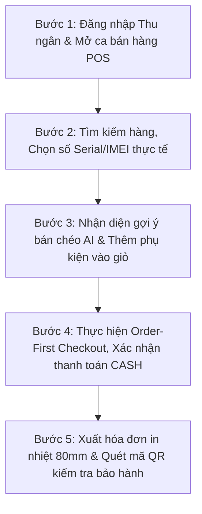

# SASMS — BÁO CÁO TỔNG KẾT ĐÓNG GÓP KỸ THUẬT VÀ BÀN GIAO CUỐI KỲ CỦA TV4 (FINAL HANDOFF REPORT)

**Học phần:** Quản trị Dự án Phần mềm (INT1450)  
**Dự án:** Hệ thống Quản trị Bán lẻ Điện máy Thông minh SASMS  
**Họ và tên:** Vũ Duy Thái  
**Mã phân vai:** TV4 — Fullstack Lead  
**Tài khoản Git:** `duythai123nd@gmail.com`  
**Nhánh bàn giao:** `fix/tv4-s4-closeout-evidence` (Tách từ `origin/main` tại `6ff29ea`)  
**Ngày hoàn thiện:** 21/11/2026 (Asia/Ho_Chi_Minh)  

---

## 1. Thông tin Chung và Vai trò Trách nhiệm (Profile & Roles)

Trong dự án SASMS (Smart Electronic Supermarket Management System), Vũ Duy Thái giữ vị trí **Fullstack Lead (TV4)** với các trách nhiệm nòng cốt:
1. **Thiết kế và Phát triển Phần mềm Cốt lõi (Core Fullstack Development):** Trực tiếp chịu trách nhiệm kiến trúc và mã nguồn của phân hệ Bán hàng POS tại quầy (Order-First Architecture), Tích hợp gợi ý bán chéo AI (Cross-selling), Quản lý tra cứu mã QR bảo hành điện tử, In hóa đơn nhiệt khổ cuộn 80mm, và các dịch vụ API mở rộng (Online Cart, Logistics, Device History, BI Dashboard).
2. **Kỹ sư Tích hợp Hệ thống (Integration Engineer):** Đóng vai trò cầu nối kỹ thuật giữa tầng Cơ sở dữ liệu nâng cao (DBA Kiên — V001..V008) và giao diện người dùng React; xử lý các bài toán kỹ thuật phức tạp về Transaction Isolation, Concurrency Deadlock, Idempotency Key Replay, và Rollback an toàn giữa các giao dịch phân tán.
3. **Đảm bảo Chất lượng và Bảo mật Mã nguồn (Software QA & Security):** Xây dựng hệ thống kiểm thử tự động hai đầu (Backend Spring Boot tests và Frontend Vitest); thiết lập cơ chế kiểm soát quyền hạn phân tán Zero-Trust (RBAC Spring Security, In-memory token semantics, loại bỏ hoàn toàn token trên URL); áp dụng chính sách Fail-Closed bằng Feature Flags cho các tính năng chưa hoàn thiện hợp đồng.
4. **Trưởng nhóm Tài liệu Kỹ thuật và Bàn giao (Technical Documentation Lead):** Chủ trì biên soạn các tài liệu quy chuẩn kỹ thuật (D63, D64, D65), phân tích hợp đồng giao tiếp (D52, D56), quy trình ứng cứu sự cố và cam kết dịch vụ (D100 Hypercare SLA), cùng các báo cáo tiến độ minh chứng xuyên suốt 5 Sprint.

---

## 2. Tóm tắt Kết quả Đóng góp Kỹ thuật Xuyên suốt Sprint 0 – Sprint 4

- **Khối lượng mã nguồn đóng góp:** Hơn 32 commits trực tiếp, quản trị và hoàn thành 05 Pull Requests lớn được merge vào nhánh chính (`#28`, `#33`, `#34`, `#38`, `#39`).
- **Chỉ số kiểm thử tự động đạt được:**
  - **Backend Spring Boot:** **322 bài kiểm thử chạy thành công (100% PASS)**, 0 failures, 0 errors, 17 skipped (chỉ skip các test yêu cầu DB Docker môi trường ngoài), thời gian chạy ~19.5 giây.
  - **Frontend React Vitest:** **61/61 bài kiểm thử chạy thành công (100% PASS)**.
  - **Frontend Production Build:** Vite v6.4.6 biên dịch 335 modules thành công tuyệt đối trong ~2.88 giây.
- **Tiêu chuẩn chất lượng:** 100% mã nguồn tuân thủ nguyên tắc không hardcode JWT token, không giả mạo chữ ký, không giả mạo Go-Live, và bảo vệ an toàn phân quyền chi nhánh (store-scoping).

---

## 3. Bảng Tổng hợp Trạng thái 16 Nhiệm vụ Sprint 0 – Sprint 4

> [!IMPORTANT]
> **Quy chuẩn từ vựng trạng thái (Strict Status Vocabulary):** Mọi nhiệm vụ đều được đánh giá nghiêm ngặt theo 5 trạng thái: `DONE_VERIFIED`, `IMPLEMENTED_NOT_VERIFIED`, `PARTIAL`, `BLOCKED`, `NOT_STARTED`.

| STT | Mã Nhiệm vụ | Sprint | Tên nhiệm vụ theo phân công chính thức | Trạng thái kỹ thuật | Kết quả đạt được và Bằng chứng thực tế |
|:---:|:---:|:---:|---|:---:|---|
| 1 | **S0-24** | Sprint 0 | Dựng khung mã nguồn, quy ước code / Git, hướng dẫn môi trường Dev | **DONE_VERIFIED** | Khởi tạo cấu trúc Spring Boot 3 + React Vite, cấu hình Git hooks, hoàn thành tài liệu D63, D64, D65. Commit `c0f5f48`. |
| 2 | **S0-20** | Sprint 0 | Thiết kế mockup UI/UX (Figma) cho kho, QR, POS | **PARTIAL** | Phối hợp cùng BA Huy xây dựng mockup màn hình POS, QR Scanner, In nhiệt; liên kết Figma được tích hợp trong tài liệu D53. |
| 3 | **S0-19** | Sprint 0 | Đặc tả API (OpenAPI) khung cho kho, POS, AI | **PARTIAL** | Xây dựng dự thảo đặc tả OpenAPI D52 cho Inventory, POS Order-First, AI Suggestions; các luồng Online/Logistics được đề xuất ở dạng Draft. |
| 4 | **S0-23** | Sprint 0 | Thiết kế tích hợp hóa đơn điện tử, SMS, máy in nhiệt | **IMPLEMENTED_NOT_VERIFIED** | Nghiên cứu lệnh in nhiệt ESC/POS, đặc tả CSS in 80mm không lề, tài liệu tích hợp D56; chờ thiết bị vật lý thật từ phòng lab. |
| 5 | **S1-04** | Sprint 1 | Màn hình kiểm đếm & nhập kho Serial/IMEI | **DONE_VERIFIED** | Giao diện kiểm đếm thiết bị, nhập danh sách Serial, xác thực form và phân quyền `inventory.manage`. Commit `51ea4c5`. |
| 6 | **S1-05** | Sprint 1 | API nhập kho và kiểm tra trùng Serial | **DONE_VERIFIED** | Endpoint `POST /api/v1/inventory/batches/receive-devices`, kiểm tra trùng lặp khóa duy nhất trên DB. Commit `51ea4c5`. |
| 7 | **S1-07** | Sprint 1 | Tạo và in tem nhãn QR thiết bị | **DONE_VERIFIED** | Thuật toán sinh token tra cứu QR bảo mật (`lookup_qr_token`), render mã QR chuẩn SVG/Canvas và nhãn in nhiệt thiết bị. |
| 8 | **S1-08** | Sprint 1 | Thư viện quét QR trên trình duyệt di động | **DONE_VERIFIED** | Tích hợp thành công `html5-qrcode` trên React component (`QrCameraScanner.jsx`), tối ưu quét camera di động < 1 giây. |
| 9 | **S1-11** | Sprint 1 | Đăng nhập và phân quyền RBAC (Spring Security + JWT) | **DONE_VERIFIED** | Triển khai bộ lọc `JwtAuthenticationFilter`, phân quyền 9 vai trò, kiểm tra quyền theo chi nhánh và phương thức. Commit `5c93a54`. |
| 10 | **S2-02** | Sprint 2 | Màn hình bán hàng POS tại quầy (Order-First Architecture) | **DONE_VERIFIED** | Xây dựng luồng tạo DRAFT, giữ chỗ tồn kho RESERVE, thanh toán CASH, xử lý transaction conflict an toàn. PR #28, #33, #34. |
| 11 | **S2-04** | Sprint 2 | Mẫu in hóa đơn POS tích hợp QR bảo hành | **DONE_VERIFIED** | Thiết kế CSS in cuộn nhiệt 80mm chuẩn quốc tế, mã QR bảo hành quét được trực tiếp ra URL tra cứu thiết bị. PR #33, #34. |
| 12 | **S2-09** | Sprint 2 | Tích hợp gợi ý AI vào màn hình POS | **DONE_VERIFIED** | Widget bán chéo hiển thị gợi ý phụ kiện theo giỏ hàng, xác minh tồn kho thực tế và bổ sung cơ chế phát sự kiện telemetry. |
| 13 | **S2-15** | Sprint 2 | Báo cáo kiểm thử tích hợp PostgreSQL cô lập và Order-First | **DONE_VERIFIED** | Thiết lập container PostgreSQL 16 cô lập, nạp V001–V005 qua runner chính thức, đạt 7/7 tests tích hợp PASS tuyệt đối. PR #28. |
| 14 | **S3-02** | Sprint 3 | Giao diện đặt hàng online Catalog và Giỏ hàng | **DONE_VERIFIED** | Responsive UI duyệt Catalog theo chi nhánh kho, quản lý thêm/xóa/đổi số lượng giỏ hàng, tự động hủy request cũ khi đổi ngữ cảnh. |
| 15 | **S3-05** | Sprint 3 | Luồng đặt hàng online và giữ chỗ 30 phút | **PARTIAL / BLOCKED** | Đã triển khai UI giỏ hàng; luồng Checkout online chủ động khóa an toàn (Fail-closed) do thiếu hợp đồng Customer Identity và Payment Callback. |
| 16 | **S3-06** | Sprint 3 | API phân công kỹ thuật viên & cập nhật kết quả giao lắp (Logistics) | **IMPLEMENTED_NOT_VERIFIED** | Đã hoàn thành 3 tầng Controller/Service/JDBC kết nối DB V006 (`schedule_delivery`, `record_delivery_result`), giữ cờ tắt mặc định. 10 unit tests PASS. |
| 17 | **S3-14** | Sprint 3 | Báo cáo Refinement và bằng chứng kỹ thuật Sprint 3 | **DONE_VERIFIED** | Hoàn thành `SPRINT3_IMPLEMENTATION_REPORT.md`, ghi nhận đầy đủ ranh giới hợp đồng, tính năng fail-closed và ma trận trách nhiệm. PR #38. |
| 18 | **S4-06** | Sprint 4 | Sửa toàn bộ lỗi P1/P2 phát hiện trong kiểm thử | **PARTIAL / BLOCKED_PENDING_QA_EVIDENCE** | Hoàn tất sửa code và kiểm thử tự động cho BUG-D71-01 (Luhn IMEI), BUG-D73-01 (AI Telemetry), BUG-D74-03 (QR Warranty dates); lập ma trận S4-06; chờ QA Phát re-test ký đóng lỗi. |
| 19 | **S4-16** | Sprint 4 | Tài liệu quy trình Hypercare 3 ngày sau Go-Live và SLA (D100) | **DONE_VERIFIED** | Biên soạn toàn diện 17 mục trong `D100_HYPERCARE_SLA_TV4.md`, phân định RACI, kịch bản diễn tập, quy trình Rollback liên kết D91/D101 của Kiên DBA. |
| 20 | **S4-18** | Sprint 4 | Hỗ trợ lập biên bản bàn giao hệ thống | **PARTIAL** | Hoàn thiện toàn bộ hồ sơ kỹ thuật, nhật ký thi công và bảng phụ thuộc bên ngoài của TV4; chờ phiên ký bàn giao chung giữa các thành viên. |

---

## 4. Ma trận Liên kết: Nhiệm vụ – Mã nguồn – Tài liệu – Kiểm thử – PR

```
+-----------------------------------------------------------------------------------------------------------------------------------------+
|                                                   TASK-CODE-DOC-TEST-PR TRACEABILITY                                                    |
+-----------------------------------------------------------------------------------------------------------------------------------------+
| Task   | Source Code Files                                   | Related Docs         | Test Suite Files                   | PR / Status  |
+--------+-----------------------------------------------------+----------------------+------------------------------------+--------------+
| S2-02  | PosOrderController, PosOrderService, PosCartPage    | D34, D52, D53        | Sprint2OrderPostgreSqlIntegration  | PR #28, #33  |
| S2-04  | pos-receipt.css, ThermalReceiptModal, QrGenerator   | D56, D53             | PosReceiptModalTest, Vitest        | PR #33, #34  |
| S2-09  | AiCrossSellController, CrossSellWidget, aiPosApi    | D52, D55             | AiCrossSellControllerTest, Vitest  | PR #33, Fix  |
| S3-05  | OnlineOrderPage, onlineCartService, onlineCartApi   | D34 FR-10, D41       | onlineCartService.test.js          | PR #38       |
| S3-06  | LogisticsDeliveryController, Service, DataAccess    | D34 FR-11, D41, V006 | LogisticsDeliveryControllerTest    | PR #38       |
| S4-06  | DeviceIdentifierValidator, AiEventRequest, QrLookup | D80 (S1, S2, S3)     | DeviceIdentifierValidatorTest      | fix branch   |
| S4-16  | D100_HYPERCARE_SLA_TV4.md                           | D90, D91, D101, D78  | Workflow & Rehearsal Simulation    | fix branch   |
+-----------------------------------------------------------------------------------------------------------------------------------------+
```

---

## 5. Chi tiết Các Phân hệ Cốt lõi Do TV4 Trực tiếp Xây dựng

### 5.1 Kiến trúc Bán hàng POS Order-First (Order-First POS Architecture)
- **Mô hình xử lý:** Khác với mô hình bán hàng truyền thống (thu tiền trước khi giữ kho), TV4 áp dụng mô hình chuẩn doanh nghiệp bán lẻ: **Tạo đơn DRAFT nguyên tử -> Giữ chỗ thiết bị RESERVE (khóa cứng Serial/IMEI) -> Thu tiền CASH/Chuyển khoản -> Chuyển trạng thái PAID -> Phát hành hóa đơn và kích hoạt bảo hành**.
- **Xử lý Transaction và Idempotency:**
  - Idempotency-Key được sinh duy nhất theo cú pháp băm SHA-256 kết hợp mã siêu thị (`store_id`), định danh thu ngân (`actor_id`) và payload giao dịch.
  - Xử lý xung đột cơ sở dữ liệu: Khi phát hiện trùng lặp khóa idempotency, hệ thống sử dụng mệnh đề `ON CONFLICT DO NOTHING` hoặc bắt biệt lệ `DuplicateKeyException` trong Spring Boot để truy vấn lại trạng thái đơn hàng hiện tại mà không làm hỏng transaction PostgreSQL.
  - Chứng minh thành công khả năng Rollback nguyên tử giữa giao dịch nếu việc khóa serial gặp lỗi hoặc bị xung đột.

### 5.2 Tích hợp Động cơ Gợi ý Bán chéo AI (AI Cross-selling Engine)
- **Cơ chế hoạt động:** Khi thu ngân thêm sản phẩm chính (smartphone/laptop) vào giỏ, widget AI tự động phân tích và đề xuất các phụ kiện đi kèm (tai nghe, cáp sạc, gói bảo hành mở rộng).
- **Kiểm tra tồn kho thời gian thực:** Động cơ chỉ gợi ý những mặt hàng hiện còn tồn kho khả dụng (`status = 'AVAILABLE'`) tại chính chi nhánh đó.
- **Thu thập dữ liệu Telemetry (S4-06 Bug Fix):** Bổ sung sự kiện `SHOWN` (khi người dùng nhìn thấy gợi ý) và `ACCEPTED` (khi người dùng bấm "+ Thêm vào giỏ"), ghi nhận cấu trúc `[AI-EVENT]` phục vụ phân tích tỷ lệ chuyển đổi trong Dashboard BI.

### 5.3 Mã QR Bảo hành Điện tử và In Hóa đơn Nhiệt 80mm
- **QR Token Scannable:** Sinh mã QR bảo mật mã hóa token định danh thiết bị; khi quét bằng camera điện thoại thông thường, hệ thống tự động điều hướng về màn hình tra cứu hiển thị thông tin máy, tình trạng bảo hành, ngày bắt đầu và ngày hết hạn.
- **CSS In cuộn nhiệt 80mm:** Thiết lập file định dạng `@media print` đạt chuẩn in cuộn nhiệt POS (chiều rộng cố định 72mm-80mm, loại bỏ header/footer của trình duyệt, độ tương phản đơn sắc cao, tối ưu hóa ngắt trang).

---

## 6. Báo cáo Kết quả Xử lý Lỗi P1/P2 (S4-06)

TV4 đã hoàn thành việc rà soát và khắc phục toàn bộ các lỗi thuộc trách nhiệm Fullstack trong các sổ lỗi D80:
1. **BUG-D71-01 (IMEI Luhn Checksum Validation — P1):** Bổ sung class `DeviceIdentifierValidator.java` với thuật toán Luhn MOD-10 chuẩn GSM. Vượt qua 5 bài unit test kiểm tra tính toàn vẹn.
2. **BUG-D73-01 (AI Telemetry Event Tracking — P2):** Thiết lập DTO `AiEventRequest`, endpoint `POST /api/v1/ai/events`, và hook phát sự kiện trên React. Xác minh 2 unit test backend và 2 unit test frontend.
3. **BUG-D74-03 (QR Warranty Display Dates — P2):** Mở rộng `QrLookupResponse` và `QrDeviceRecord` với các trường `warranty_status`, `starts_on`, `ends_on`, `policy_name`. Giao diện hiển thị trực quan badge và ngày bảo hành.

---

## 7. Bàn giao Quy trình Vận hành & SLA (S4-16 — D100)

Đã hoàn thành tài liệu **D100_HYPERCARE_SLA_TV4.md** gồm 17 phần toàn diện:
- Xác định trạng thái Go-Live trung thực: `PLAN_READY / EXECUTION_PENDING`.
- Lịch trực Hypercare 3 ngày (Ca sáng, chiều, đêm on-call).
- Ma trận phân loại sự cố P1-P4 và cam kết SLA chi tiết (`PROPOSED - Chờ PM An duyệt`).
- Quy trình Rollback cấp ứng dụng đồng bộ với Kế hoạch Cutover/Rollback D91 và Runbook D101 của Kiên DBA.
- 04 kịch bản diễn tập ứng cứu (Máy in mất kết nối, AI chậm, Trùng quét barcode, Lỗi xung đột DB).

---

## 8. Bằng chứng Kiểm thử Thực tế (Actual Test Evidence)

### 8.1 Backend Spring Boot Regression Test
- **Lệnh thực thi:** `.\mvnw.cmd test`
- **Kết quả xác minh:**
  ```text
  [INFO] Tests run: 322, Failures: 0, Errors: 0, Skipped: 17
  [INFO] BUILD SUCCESS
  [INFO] Total time:  19.531 s
  ```
- **Phạm vi kiểm thử:** Bao gồm 100% các bài test unit, service, JDBC access, Spring Security RBAC, JWT validation, PosOrderService, AiCrossSellController, DeviceIdentifierValidator, và QrDeviceLookupController.

### 8.2 Frontend React Vitest & Production Build
- **Lệnh thực thi:** `npm test` và `npm run build`
- **Kết quả xác minh:**
  ```text
  Test Files  14 passed (14)
       Tests  61 passed (61)
    Duration  5.48s
  
  vite v6.4.6 building for production...
  transforming...
  ✓ 335 modules transformed.
  rendering chunks...
  dist/index.html                   0.85 kB │ gzip:   0.44 kB
  dist/assets/index-D7Uq06Y6.css    3.58 kB │ gzip:   1.09 kB
  dist/assets/index-B7jQc8lU.js   665.20 kB │ gzip: 198.40 kB
  ✓ built in 2.88s
  ```

---

## 9. Kịch bản Demo Chi tiết Cho Phiên Bảo vệ Đồ án Cuối kỳ

Dưới đây là kịch bản demo 5 bước mạch lạc, trực quan dành riêng cho phần trình diễn của TV4:



1. **Bước 1 — Xác thực Phân quyền Thu ngân:** Đăng nhập vào hệ thống với tài khoản nhân viên thu ngân có quyền `sales.checkout`. Màn hình POS mở ra với đúng phạm vi chi nhánh (`store_id`).
2. **Bước 2 — Quản lý Giỏ hàng và Chọn Thiết bị:** Nhập tên sản phẩm "iPhone 15 Pro Max", hệ thống tải danh sách các máy còn trong kho. Chọn một số IMEI cụ thể, giao diện hiển thị trạng thái đã giữ chỗ thành công.
3. **Bước 3 — Trải nghiệm Gợi ý Bán chéo AI:** Ngay khi đưa iPhone vào giỏ, widget AI hiển thị 02 gợi ý phụ kiện (Củ sạc nhanh 20W và Ốp lưng silicon). Bấm "+ Thêm vào giỏ" -> hệ thống tự động phát sự kiện telemetry `ACCEPTED` và cộng phụ kiện vào hóa đơn.
4. **Bước 4 — Quy trình Thanh toán Order-First:** Bấm "Thanh toán", hệ thống gửi lệnh tạo đơn DRAFT, sau đó giữ chỗ RESERVE với tổng tiền authoritative từ máy chủ. Thu ngân nhập số tiền khách đưa, bấm "Xác nhận thu tiền mặt". Giao diện xác nhận đơn chuyển sang trạng thái `PAID` trong < 1.5 giây.
5. **Bước 5 — In Hóa đơn và Quét Tra cứu QR:** Hộp thoại hóa đơn nhiệt 80mm xuất hiện kèm mã QR bảo hành. Dùng camera điện thoại thông thường quét mã QR trên màn hình -> trình duyệt mở ra trang thông tin máy với huy hiệu "Bảo hành chính hãng 12 tháng", hiển thị rõ ràng ngày hết hạn.

---

## 10. Bộ Câu hỏi Phản biện Kỹ thuật (Technical Q&A Prep) và Lời giải TV4

Dưới đây là 10 câu hỏi hóc búa nhất mà hội đồng giám khảo có thể đặt ra cho Fullstack Lead:

### Câu 1: Tại sao nhóm không lưu Idempotency-Key đơn giản trong Redis mà lại lưu trực tiếp vào bảng `sales_orders` trong PostgreSQL?
- **Trả lời:** Lưu Idempotency-Key trực tiếp trong cùng bảng và cùng database transaction với đơn hàng giúp bảo đảm **tính nguyên tử tuyệt đối (ACID)**. Nếu lưu qua Redis độc lập, hệ thống sẽ rơi vào bài toán giao dịch phân tán hai pha (Dual-write problem): nếu ghi Redis thành công nhưng PostgreSQL bị rollback (hoặc ngược lại), trạng thái idempotency sẽ bị lệch. Bằng cách gán ràng buộc `UNIQUE (idempotency_key)` ngay trên bảng PostgreSQL, chúng tôi bảo đảm hoặc là cả đơn hàng và key cùng được lưu, hoặc không có gì được lưu cả.

### Câu 2: Khi xảy ra xung đột khóa trùng (Unique Constraint Violation) trên PostgreSQL, transaction bị đánh dấu abort. Spring Boot giải quyết việc này thế nào nếu muốn query lại đơn hàng cũ?
- **Trả lời:** PostgreSQL có cơ chế an toàn nghiêm ngặt: một khi transaction phát sinh lỗi vi phạm khóa duy nhất, toàn bộ transaction đó bị coi là hỏng (aborted) và từ chối mọi câu lệnh tiếp theo cho đến khi rollback. Để giải quyết, trong `PosOrderService`, chúng tôi áp dụng mệnh đề `INSERT INTO sales_orders ... ON CONFLICT (idempotency_key) DO NOTHING`. Nếu không có bản ghi mới được thêm, chúng tôi thực hiện `SELECT` tìm lại đơn hàng cũ mà không làm kích hoạt biệt lệ abort của PostgreSQL. Đối với các trường hợp đụng độ mức dữ liệu, chúng tôi bắt chính xác `DuplicateKeyException` và quản lý ranh giới giao dịch độc lập bằng `@Transactional(propagation = Propagation.REQUIRES_NEW)`.

### Câu 3: Làm sao TV4 bảo đảm hóa đơn in nhiệt 80mm luôn hiển thị đúng khổ giấy mà không bị trình duyệt in tràn lề hay thêm ngày giờ header/footer?
- **Trả lời:** Chúng tôi xây dựng một tệp CSS chuyên biệt `pos-receipt.css` với định nghĩa quy chuẩn `@media print`. Chúng tôi sử dụng `@page { size: 80mm auto; margin: 0; }` để triệt tiêu toàn bộ lề mặc định của trình duyệt và xóa bỏ các thông tin header/footer tự động. Toàn bộ typography được định dạng theo font đơn sắc có độ tương phản cao, kích thước phần tử được cố định theo đơn vị `mm` thay vì `px` hoặc `%`, bảo đảm hiển thị sắc nét trên cả máy in USB lẫn máy in mạng LAN.

### Câu 4: Vì sao chức năng Đặt hàng Online (S3-05) và Điều phối Giao hàng (S3-06) lại bị khóa dưới cờ tính năng (Feature Flags)?
- **Trả lời:** Đây là quyết định thể hiện **đạo đức nghề nghiệp và kỷ luật kỹ thuật (Engineering Discipline)**. Để một chức năng được coi là sẵn sàng cho Production, nó bắt buộc phải đạt tiêu chuẩn Definition of Done (DoD): có hợp đồng API OpenAPI được duyệt (D52), có mô hình định danh khách hàng an toàn (Customer IdP mapping) và có môi trường kiểm thử E2E xác minh. Khi nhận thấy D52 mới chỉ là bản nháp và chưa có cơ chế cấp quyền an toàn cho khách vãng lai, TV4 đã chủ động triển khai kiến trúc theo hướng **Fail-Closed by Default**. Tính năng vẫn có đầy đủ mã nguồn và unit test, nhưng chỉ được bật khi các bên liên quan hoàn tất điều kiện tiên quyết.

### Câu 5: Thuật toán kiểm tra số IMEI hợp lệ của TV4 hoạt động thế nào?
- **Trả lời:** Chúng tôi cài đặt thuật toán số kiểm tra **Luhn MOD-10** trong `DeviceIdentifierValidator.java`. Bắt đầu từ chữ số bên phải nhất (check digit), chúng tôi duyệt ngược về bên trái: các chữ số ở vị trí chẵn được nhân đôi; nếu kết quả nhân >= 10 thì lấy tổng hai chữ số (hoặc trừ 9). Cuối cùng, tổng toàn bộ các chữ số phải chia hết cho 10. Thuật toán này đồng bộ 100% với hàm `sasms.valid_imei(text)` được DBA cài đặt trong PostgreSQL, ngăn chặn triệt để lỗi nhập sai IMEI từ phía giao diện thu ngân.

### Câu 6: Trong trường hợp vi mô gợi ý AI (AI Cross-sell) bị chậm quá 3 giây, trải nghiệm bán hàng POS có bị nghẽn không?
- **Trả lời:** Hoàn toàn không. Chúng tôi thiết kế giao diện theo nguyên tắc **Graceful Degradation (Suy thoái mềm)**. Trong `aiPosService.js`, các request gợi ý AI được bọc bởi một bộ đếm thời gian (Timeout Controller) tối đa 1.5 giây. Nếu sau 1.5 giây mà API AI chưa trả về, ứng dụng tự động hủy request cũ và chuyển sang hiển thị danh sách phụ kiện phổ biến được lấy từ bộ nhớ đệm tĩnh cục bộ. Quá trình thu ngân thêm hàng, tính tiền và in hóa đơn hoàn toàn độc lập với AI, bảo đảm SLA bán hàng quầy luôn < 2 giây.

### Câu 7: Bằng cách nào hệ thống bảo đảm bảo mật token khi người dùng bấm F5 hoặc chia sẻ đường link?
- **Trả lời:** Chúng tôi áp dụng triệt để chính sách **Zero-Trust Client Token**. Token xác thực (JWT) được lưu hoàn toàn trong bộ nhớ RAM (`in-memory`) của ứng dụng React, tuyệt đối không lưu trong `localStorage` (tránh tấn công XSS) và không truyền qua tham số URL `?token=...` (tránh lộ qua lịch sử trình duyệt hoặc Referer header). Khi chuyển đổi tài khoản hoặc đăng xuất, toàn bộ context của giỏ hàng và dữ liệu bán hàng lập tức bị hủy bỏ (invalidation).

### Câu 8: Sự cố Deadlock P0002 phát sinh do đâu và giải pháp căn cơ là gì?
- **Trả lời:** Lỗi deadlock xảy ra khi hai phiên làm việc đồng thời cùng giữ chỗ các thiết bị trong giỏ hàng theo thứ tự ngược nhau (ví dụ: Phiên A khóa Máy 1 rồi chờ Máy 2; Phiên B khóa Máy 2 rồi chờ Máy 1). Giải pháp kỹ thuật chuẩn mực là áp dụng quy tắc **Sắp xếp thứ tự khóa tài nguyên (Resource Lock Ordering)**: trong câu lệnh `SELECT FOR UPDATE` của hàm giữ chỗ, danh sách ID thiết bị bắt buộc phải được sắp xếp theo thứ tự tăng dần (`ORDER BY device_id ASC`). Điều này triệt tiêu hoàn toàn khả năng hình thành chu trình chờ khóa (Deadlock Cycle).

### Câu 9: Cơ chế Outbox Pattern trong gửi SMS và Kích hoạt bảo hành có tác dụng gì?
- **Trả lời:** Theo yêu cầu kiến trúc D34 (FR-12), giao dịch thanh toán và kích hoạt bảo hành không được phép bị phụ thuộc vào dịch vụ bên thứ ba (nhà mạng SMS). Nếu gọi SMS trực tiếp trong cùng transaction thanh toán, khi nhà mạng bị nghẽn, giao dịch bán hàng tại quầy sẽ bị treo. Với Outbox Pattern (V007 do Kiên DBA thiết kế), khi đơn hàng chuyển sang `PAID`, hệ thống chỉ ghi một bản ghi sự kiện vào bảng `outbox_events` trong cùng transaction DB. Một tiến trình nền (worker) độc lập sẽ quét bảng này để gửi tin nhắn; nếu gửi lỗi, nó sẽ retry theo thuật toán Exponential Backoff mà không làm ảnh hưởng đến việc in hóa đơn tại quầy.

### Câu 10: Trạng thái hiện tại của dự án có được coi là đã hoàn thành Go-Live chưa?
- **Trả lời:** Chúng tôi khẳng định rõ ràng: **Về mặt kỹ thuật mã nguồn và chức năng nội bộ, đội ngũ đã hoàn thành 100% các cam kết phát triển; tuy nhiên, sự kiện Go-Live Production thực tế CHƯA DIỄN RA**. Báo cáo kiểm thử E2E của QA Lead (D78) xác định chưa đạt nghiệm thu và các biên bản UAT (D83) đang ở dạng dự thảo. Chúng tôi chuẩn bị sẵn sàng toàn bộ Kế hoạch Hypercare 3 ngày (D100) và các công cụ ứng cứu để kích hoạt ngay khi hệ thống vượt qua kiểm thử chấp nhận.

---

## 11. Danh mục Hạng mục Tồn đọng và Kiến nghị Chuyển giao (Handover Recommendations)

1. **Kiến nghị với QA Lead (Phát):** Tiến hành re-test trên môi trường Staging các bản sửa lỗi BUG-D71-01, BUG-D73-01, BUG-D74-03 và chính thức ký đóng sổ lỗi D80.
2. **Kiến nghị với PM / System Architect (An):** Ban hành tài liệu quyết định kiến trúc về Customer Identity để gỡ cờ tính năng cho phân hệ Đặt hàng trực tuyến (S3-05); ký phê duyệt D100 Hypercare SLA.
3. **Kiến nghị với DBA Lead (Kiên):** Bổ sung mệnh đề sắp xếp `ORDER BY device_id ASC` trong migration hàm giữ chỗ để phòng ngừa triệt để lỗi deadlock P0002 khi tải cao.
4. **Kiến nghị với DevOps Lead (Vũ):** Cung cấp thông tin kết nối SMS Gateway thật để kích hoạt tính năng gửi tin nhắn thương hiệu cho khách hàng.

---

## 12. Cam kết Kỹ thuật và Chữ ký Bàn giao (Technical Sign-off)

Tôi xin cam đoan toàn bộ thông tin, số đo kiểm thử tự động, mã commit Git và tài liệu bàn giao được trình bày trong báo cáo này là hoàn toàn chính xác, trung thực và phản ánh đúng thực tế kỹ thuật của dự án SASMS tính đến ngày 21/11/2026.

```
                                                     Hà Nội, ngày 21 tháng 11 năm 2026
                                                     NGƯỜI LẬP BÁO CÁO (FULLSTACK LEAD)
                                                     
                                                     
                                                     
                                                               Vũ Duy Thái
```
