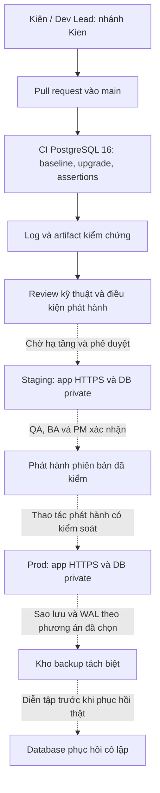

# D22 — Kế hoạch môi trường Dev / Staging / Prod và CI/CD

| Thuộc tính | Nội dung |
|---|---|
| Đầu việc | KD-10 — kế hoạch thiết bị và môi trường; tổng 12 giờ dự kiến cho D21 + D22 theo phân công |
| Phụ trách | Trần Trung Kiên — Architect / DBA; phối hợp Trịnh Quốc An và Vũ Duy Thái |
| Kỳ kế hoạch trong nguồn | Tiền Sprint, 05–18/09/2026; hạn KD-10 là 18/09/2026 |
| Ngày hoàn thiện hồ sơ thực tế | 07/11/2026 — bổ sung hồ sơ còn thiếu, không hồi tố ngày ký hoặc triển khai |
| Phiên bản | 1.0, nhánh `Kien` |
| Trạng thái | Kế hoạch kỹ thuật để review; CI DB có bằng chứng thật; Staging/Prod còn chờ hạ tầng và phê duyệt phát hành |

## 1. Căn cứ và phạm vi

Workbook tiền Sprint do người dùng cung cấp, sheet “Theo người” dòng 24–27, giao Kiên KD-10 với hai đầu ra D21 và D22; sheet “Tài liệu và minh chứng” dòng 27 yêu cầu sơ đồ môi trường và log pipeline thành công. [D09](../PM/D09.docx), WBS 3.0–3.2, xác định kiến trúc, DB/security và CI/CD thuộc phần Kiên phụ trách. [D19](../PM/D19.docx) và [D20](../PM/D20.docx) là nguồn quản lý thay đổi/phạm vi để đối chiếu việc phát hành.

Tài liệu phân biệt ba thời điểm: kế hoạch khởi động tháng 9; những thay đổi được các tài liệu PM mô tả vào tháng 10; trạng thái repo và bằng chứng thực thi kiểm tra ngày 07/11. Một phát biểu “đã phê duyệt” trong nguồn PM không tự phê duyệt D22 hoặc một lần triển khai mới.

Phần đang có trong repo là DB PostgreSQL và công cụ Python: baseline 37 bảng của Sprint 0, hai migration nâng lên 39 bảng nghiệp vụ của Sprint 1, seed mô phỏng, kiểm tra SQL, runtime group role và CI. Repo chưa có mã frontend/backend hoàn chỉnh, host Staging/Prod hoặc secret nhà cung cấp để chứng minh toàn ứng dụng đã được triển khai. Các lựa chọn React/Spring Boot/JDK/Node trong tài liệu PM cần Thái chốt cùng mã nguồn ứng dụng; pipeline DB hiện không giả lập build ứng dụng đó.

## 2. Ma trận môi trường

| Môi trường | Cấu hình và mục đích | Dữ liệu / kết nối | Mức hiện thực |
|---|---|---|---|
| Dev | PostgreSQL 16 local/container; Python 3.10+ và client `psql`; chạy baseline, migration, demo và test DB | Dữ liệu giả; Compose bind `127.0.0.1:5432`; database riêng cho từng lượt validation | Có [Compose](../../docker-compose.yml), [hướng dẫn DB](../../database/README.md) và [nâng cấp Sprint 1](../../database/sprint1/README.md) |
| CI | GitHub-hosted Ubuntu; PostgreSQL 16 service tạm; Python 3.13; job backup/restore pin Ubuntu 24.04 và client 16 | Chỉ fixtures mô phỏng; mật khẩu CI chỉ cho service cô lập của job; hủy cùng runner | Có ba workflow; đối chiếu các run theo đúng SHA ở mục 5 |
| Staging | Đề xuất một môi trường riêng, cùng major PostgreSQL 16 và cùng migration đã kiểm trên CI; app sau HTTPS, DB private | Dữ liệu giả hoặc đã ẩn danh; provider sandbox; secret và credential tách Dev/Prod | Chưa có host, DNS, tài khoản cloud hoặc deployment log trong repo; cần cấu hình và chạy nghiệm thu thật |
| Prod | Đề xuất app HTTPS, DB private, storage/backup tách máy; connection pool và quan sát vận hành | Dữ liệu thật theo quyền; không mở PostgreSQL ra Internet; không dùng credential owner trong app | Thiết kế triển khai, chưa phải môi trường đã cấp phát hoặc phát hành |

Cấu hình khởi điểm để dự toán thử: Dev 2 CPU / 2–4GiB RAM; Staging 2 vCPU / 4GiB RAM / 30GiB dữ liệu; Prod 4 vCPU / 8GiB RAM / 80GiB dữ liệu cùng dung lượng WAL/backup riêng. Đây là giả định sizing cần đo lại trên tải thực, không phải cam kết đạt 100.000 thiết bị, uptime 99,9% hoặc độ trễ API. PM và chủ hệ thống chốt nhà cung cấp, chi phí, vùng lưu trữ và ngân sách trước cấp phát.

[Ma trận cấu hình có phiên bản](../../infra/environment-matrix.json) ghi trạng thái Dev/Staging/Prod và toolchain. [Runbook thao tác](../../infra/README.md) cung cấp lệnh backup, restore và diễn tập tái lập.

Ở đợt kiểm chứng local, một cluster thử PostgreSQL 16.15 từng được chạy trên `127.0.0.1:55416` để tránh đụng cổng Dev. Đây là runtime thử riêng, không phải địa chỉ Staging, không đưa cấu hình trust local vào môi trường dùng dữ liệu thật.

Luồng nét đứt là thiết kế cần hiện thực; sơ đồ không khẳng định Staging/Prod hoặc CD đã hoạt động. Browser chỉ tới API qua HTTPS 443. PostgreSQL 5432 chỉ cho backend, worker và nguồn quản trị được cho phép trong private network; SSH/bastion nếu dùng phải theo danh tính cá nhân và hạn chế nguồn.

## 3. Cấu hình, danh tính và bí mật

| Thành phần | Cấu hình / quyền cần có | Cách quản lý |
|---|---|---|
| Công cụ DB | `DATABASE_URL` hoặc các biến libpq `PGHOST`, `PGPORT`, `PGUSER`, `PGDATABASE`; binary `psql`, `pg_dump`, `pg_restore` phù hợp PG16 | DSN không ghi mật khẩu vào Git/log; dùng password file hoặc secret của môi trường; truyền đường dẫn binary theo `--help` khi ngoài PATH |
| Docker Dev | `POSTGRES_PASSWORD` trong `.env` local; `.env.example` chỉ có giá trị cần thay | `.env` đã được Git bỏ qua; không dùng mật khẩu placeholder cho dữ liệu thật |
| Owner / migrator | Quyền DDL, ledger migration và provisioning group role | Chỉ Kiên/pipeline migration được ủy quyền; tách khỏi app, không dùng chung credential giữa môi trường |
| Backend | LOGIN riêng được DBA cấp group `sasms_app`, không là owner/superuser | Backend xác thực session/JWT và ánh xạ actor; client không giữ credential DB; quyền store/role không lấy từ request body làm bằng chứng |
| Đọc catalog | LOGIN riêng thuộc `sasms_reader` khi có nhu cầu | Chỉ catalog và tổng tồn; không suy ra quyền đọc khách hàng/payment toàn bộ |
| Backup / restore | Credential riêng đủ quyền công cụ và phạm vi database đã định | Hạn chế người đọc backup; mã hóa lưu trữ; phục hồi thật theo runbook và quyền được cấp, không cấp credential này cho app |
| Tích hợp ứng dụng | Secret provider, JWT/session, bucket và callback URL do Thái/Vũ triển khai khi có dịch vụ | Chỉ server/secret manager, tách sandbox/Prod; chưa có các dịch vụ này trong pipeline DB |

[Runtime role Sprint 0](../../database/runtime-roles.sql) và [provision Sprint 1](../../database/sprint1/runtime-roles.sql) tạo group role `NOLOGIN`; không tạo mật khẩu hoặc login nhân viên. `sasms_app` là lớp backend tin cậy có quyền đọc rộng, không phải cơ chế RLS cho từng người dùng. Helper Sprint 1 kiểm active/permission/scope trên các hàm catalog và nhập kho; việc bảo vệ mọi endpoint và các hàm POS ngoài phạm vi đó vẫn cần service thực hiện và kiểm thử.

Không commit password file, dump có dữ liệu thật, `.env` thật, private key hoặc token. Khi cần chuyển dữ liệu Prod sang Staging phải có mục đích được duyệt, ẩn danh PII và loại secret trước chuyển. Ảnh/chứng từ dùng quyền truy cập hạn chế; AI không nhận PII, credential hoặc payload thanh toán thô. Backup cần được bảo vệ như database gốc, không coi file dump là dữ liệu công khai.

## 4. Thiết lập Dev và hợp đồng phiên bản

1. Clone repo, checkout nhánh làm việc; tạo `.env` từ mẫu và thay mật khẩu riêng nếu dùng Docker. Kiểm tra `python --version`, `psql --version` và PostgreSQL server major 16.
2. Dựng Dev theo [hướng dẫn baseline](../../database/README.md). Dùng database mới cho `schema.sql`; không nạp lại baseline trên DB đã có dữ liệu.
3. Với DB baseline hiện có, áp dụng [migration runner](../../scripts/migrate_db.py), rồi chạy runtime provisioning Sprint 1 theo [runbook nâng cấp](../../database/sprint1/README.md). Không reseed quyền baseline để thay quản trị grant sau nâng cấp.
4. Dùng [validator Sprint 1](../../scripts/validate_sprint1.py) trên database thử cô lập và [demo SQL](../../database/sprint1/demo.sql). Validators dùng owner và fixtures phục vụ kiểm chứng, không chạy trên DB sản xuất.
5. Đối chiếu [DBML/ERD Sprint 1](../../database/sprint1/README.md) bằng generator; commit nguồn SQL, migration, tài liệu và evidence đúng phiên bản cùng nhau.

Python 3.10+ là yêu cầu công cụ DB hiện tại; CI đang chọn 3.13. PostgreSQL major 16 là điều kiện kiểm chứng; bản vá cụ thể do môi trường xác định và phải ghi vào log. Tag Docker `16`/`16-alpine` trong repo cố định major, chưa pin digest; trước phát hành thật cần ghi version/digest đã thử, review bản vá và cập nhật có kiểm soát. Không tự kết luận các phiên bản JDK/Node đã đồng bộ khi repo chưa có ứng dụng để build.

## 5. CI đang hiện thực và bằng chứng

| Workflow | Các bước thực thi chính | Artifact |
|---|---|---|
| [database.yml](../../.github/workflows/database.yml) | Checkout; Python; PostgreSQL 16; nạp baseline; seed lặp; constraints/lifecycle/ACL; hai phiên giữ hàng; lookup 100.000 thiết bị; đối chiếu artifact 37 bảng | `postgresql16-validation` |
| [sprint1-database.yml](../../.github/workflows/sprint1-database.yml) | Regression baseline trước nâng cấp; bảo toàn dữ liệu; migration checksum/no-op/rollback; catalog/IAM/batch; ba ca cạnh tranh; đối chiếu artifact 39 bảng | `sprint1-postgresql16-validation` |
| [pre-sprint-environments.yml](../../.github/workflows/pre-sprint-environments.yml) | Database nguồn mới; backup custom; restore target mới riêng tư; so dữ liệu/catalog/ledger/ACL; replay runtime; chặn overwrite/checksum sai | `pre-sprint-environment-evidence`; không upload dump |

Hai workflow chạy khi push/PR có thay đổi trong `database/**`, `scripts/**` hoặc chính workflow, và cho phép chạy thủ công qua `workflow_dispatch`. Quyền token workflow chỉ đọc contents; secret service CI không phải credential của Staging/Prod. Cấu hình hiện tại không chạy toàn bộ pipeline chỉ vì sửa một file tài liệu thuần túy ngoài các path đó.

**Bằng chứng thật tại commit `d28c95afe03be36e00ca73a245f0e18ee0cb09ce`, ngày 07/11/2026:** [run PostgreSQL baseline 42340988289](https://github.com/Kain2608/software-project-management/actions/runs/42340988289) và [run Sprint 1 42340988364](https://github.com/Kain2608/software-project-management/actions/runs/42340988364) đã thành công. Các run này chứng minh bộ DB ở commit đó đã qua CI; không ghi chúng thành pipeline đã chạy ngày 18/09 hoặc thành chứng cứ deploy remote. Phiên bản thay đổi sau đó phải có run/evidence tương ứng trước phát hành.

[Evidence DB Sprint 0](../../database/evidence/summary.json) và [evidence Sprint 1](../../database/evidence/sprint1/summary.json) lưu kết quả local, source hash và giới hạn phép kiểm chứng. Người review phải đối chiếu hash với nguồn được phát hành; SQL pass không chứng minh camera QR dưới 1 giây, login JWT, API AI hoặc E2E ứng dụng đã đạt.

[Snapshot CI theo SHA](evidence/ci-runs.json) lưu các run GitHub đã xác minh, link và thời điểm lấy. Lượt kiểm chứng local KD-10 nằm trong [environment-summary.json](evidence/environment-summary.json) và [environment-validation.log](evidence/environment-validation.log). Người review đối chiếu SHA thay vì gán kết quả commit cũ cho code mới chưa chạy.

## 6. Git, review và CD có kiểm soát

Luồng làm việc: `Kien` → push → PR vào `main` → review → CI trên SHA cuối → merge theo quyền của nhóm. Kiên review DB/migration/security, Thái review khả năng tích hợp, Phát review test và Huy xác nhận quy tắc nghiệp vụ; PM chịu trách nhiệm quyết định phạm vi/lịch phát hành. Không dùng kết quả CI của commit trước để thông qua thay đổi sau.

**Chính sách đề xuất cần quản trị repo bật:** bảo vệ `main`, yêu cầu PR và check DB cần thiết, không push thẳng/force push vào nhánh bảo vệ, không tự duyệt PR của chính mình; cân nhắc một reviewer đủ trách nhiệm theo nhóm. Chưa có bằng chứng cấu hình branch protection hoặc required reviewers nên không đánh dấu những cơ chế đó đã được bật.

CD hiện là runbook thủ công có điểm dừng trước triển khai, không phải workflow đã tự deploy. Thứ tự phát hành đề xuất:

1. Ghi commit/tag, danh sách migration, kết quả CI và người quyết định phát hành; xác nhận cửa sổ bảo trì và liên hệ xử lý sự cố.
2. Kiên tạo backup trước thay đổi và xác minh backup có thể đọc; thực hiện diễn tập phục hồi trên DB mới cô lập theo mục 7. QA/Dev Lead xác nhận ứng dụng tương thích schema mới.
3. Áp dụng migration trên Staging đã được cấp phát bằng credential migrator. Kiểm tra ledger/checksum, quyền runtime, truy vấn đối soát và smoke test ứng dụng; lưu log môi trường/phiên bản thật. Dữ liệu giả hoặc ẩn danh, provider sandbox.
4. Sau khi BA/QA/PM xác nhận điều kiện phát hành, cấp secret theo môi trường, áp dụng cùng migration đã kiểm lên Prod và triển khai bản ứng dụng tương thích. Không sửa file migration đã áp dụng.
5. Kiểm tra API, nhập kho, quyền, thanh toán và outbox theo phạm vi app đang phát hành; theo dõi lỗi/lock/dung lượng; ghi kết quả bàn giao và quyết định tiếp tục hoặc dừng.

Nếu migration chưa commit và lỗi, runner rollback toàn bộ các migration còn thiếu trong lần chạy, gồm DDL và ledger. Nếu migration đã commit, ưu tiên migration sửa tiếp được review và rollback phiên bản ứng dụng còn tương thích; không tự chạy script xóa cột/bảng hoặc restore đè dữ liệu đang nhận giao dịch. Khi cần phục hồi dữ liệu phải khóa luồng ghi, xác định điểm phục hồi, đối soát khoản tiền/outbox và có quyết định của người phụ trách sự cố.

## 7. Backup, phục hồi và mục tiêu mất dữ liệu

| Nội dung | Phương án |
|---|---|
| Trước migration | Logical backup format custom của database đích; ghi thời điểm, phiên bản server/client, SHA-256 file và phiên bản migration |
| Định kỳ Dev/Staging | Đề xuất backup hằng ngày và trước thay đổi quan trọng; giữ tối thiểu 7 bản ngày theo quota được PM duyệt |
| Mục tiêu Prod đề xuất | RPO tối đa 15 phút, RTO tối đa 4 giờ; chỉ trở thành cam kết sau khi chốt hạ tầng và diễn tập |
| Điều kiện để đạt RPO 15 phút | Base backup + WAL archive/PITR hoặc dịch vụ quản trị tương đương, giám sát liên tục và kiểm thử phục hồi theo thời điểm |
| Logical dump hiện có | Phục vụ backup theo yêu cầu và diễn tập; một dump mỗi ngày không đáp ứng RPO 15 phút và không tạo PITR |
| Giữ và bảo vệ | Đề xuất 7 bản ngày + 4 bản tuần, vị trí tách máy DB, mã hóa và quyền đọc hẹp; PM/chủ dữ liệu chốt chính sách thực |

Script [db_ops.py](../../scripts/db_ops.py) cung cấp `backup --dsn <source> --output <new.dump>` và `restore --maintenance-dsn <admin> --target-db <new_name> --input <dump>`. Backup từ chối archive/manifest đã tồn tại; restore kiểm SHA-256 trước tạo target, từ chối target đã có hoặc tên hệ thống. Target được tạo với `ALLOW_CONNECTIONS false`, thu hồi `PUBLIC`, rồi mới mở kết nối cho owner để restore nguyên tử. Không có cờ clean/drop/overwrite. [Runbook](../../infra/README.md) có lệnh đầy đủ và cách chỉ định binary.

Diễn tập cần chứng minh file dump đọc được, restore không lỗi, dữ liệu/catalog và ledger migration khớp, quyền runtime được kiểm lại và nghiệp vụ mẫu chạy được trong môi trường cô lập. Logical backup có thể không mang global role/secret của cluster; DBA phải chuẩn bị LOGIN/group role phù hợp và không khôi phục credential thật sang môi trường thử. Không bật worker hoặc webhook ở DB phục hồi trước khi đối soát để tránh gửi sự kiện hay xử lý thanh toán lặp.

**Kết quả thực chạy 07/11/2026, 19:49:43–19:49:49 (UTC+7):** PostgreSQL/psql/pg_dump/pg_restore 16.15; **40 kiểm tra đạt**. Target mới khớp dữ liệu của 39 bảng nghiệp vụ và ledger; đối chiếu 255 cột, 229 constraints, 106 indexes, 14 routines, 6 triggers, 1 view cùng ACL. Runtime `sasms_app` replay lô trả đúng UUID cũ, không thêm tác dụng phụ; `PUBLIC CONNECT` bị chặn. Archive đã tồn tại, target đã tồn tại và dump bị sửa đều bị từ chối; dữ liệu nguồn không đổi và fixtures nguồn được dọn đúng UUID. [Summary](evidence/environment-summary.json) lưu hash nguồn và SHA-256 archive.

Local restore pass chỉ chứng minh quy trình trên máy thử và dataset tương ứng. Để xác nhận RTO Prod phải đo cả thời gian lấy backup, cấp phát, restore, kiểm tra, đối soát và chuyển lưu lượng với dung lượng thực; chưa có số đo đó thì giữ trạng thái mục tiêu đề xuất.

## 8. Quan sát và xử lý sự cố

| Tín hiệu / ngưỡng khởi điểm đề xuất | Người nhận và phản ứng |
|---|---|
| CI fail hoặc checksum migration khác nguồn | Kiên + Thái dừng phát hành, giữ log/SHA; sửa bằng commit/migration được review, không bỏ qua check |
| Backup gần nhất quá 24 giờ ở Staging; WAL/PITR chậm quá mục tiêu ở Prod | Kiên kiểm nguồn lỗi và dung lượng; báo PM, không tiếp tục thay đổi có nguy cơ mất dữ liệu |
| Disk data/WAL/backup đạt 70% cảnh báo, 85% xử lý ưu tiên | Kiên kiểm tăng trưởng, retention và phương án mở rộng; không xóa WAL/chứng từ tùy ý |
| Deadlock tăng, lock chờ quá 10 giây, pool gần đầy | Kiên + Thái kiểm transaction/query và retry; ghi correlation ID đã lọc, tránh giữ transaction khi gọi provider |
| Lỗi nhập kho, quyền hoặc số liệu thanh toán bất thường | Thái/Phát tái hiện; Kiên bảo toàn dữ liệu/log và kiểm đối soát; Huy xác định quy tắc; PM quyết định ảnh hưởng vận hành |

Ngưỡng trên cần hiệu chỉnh bằng số đo, chưa phải alert đang vận hành. Log ưu tiên commit, môi trường, loại thao tác, SQLSTATE, request/correlation ID và thời gian; không ghi password, access token, dữ liệu thẻ hoặc payload PII thô. Danh sách kênh cảnh báo/on-call và thời gian phản hồi phải được PM cập nhật trong D14; không suy ra đã có trực 24/7 chỉ từ bảng trách nhiệm.

## 9. Trách nhiệm và điều kiện đóng KD-10/D22

| Hoạt động | R — thực hiện | A — chịu trách nhiệm cuối | C / I |
|---|---|---|---|
| Kế hoạch môi trường/DB/backup | Kiên | Kiên | C: Thái, Phát; I: An |
| Cấu hình/build/deploy ứng dụng | Thái | Thái | C: Kiên, Vũ; I: An |
| Kiểm thử DB và E2E ứng dụng | Phát, Kiên theo phạm vi | Phát | C: Thái, Huy; I: An |
| Quy tắc nghiệp vụ và tiêu chí nghiệm thu | Huy | Huy | C: Kiên, Thái, Phát; I: An |
| Cấp chi phí/hạ tầng và quyết định phát hành | An tổ chức, Kiên/Thái cung cấp đề xuất | An | C: Sponsor, Huy, Phát; I: cả nhóm |

Đây là RACI kỹ thuật đề xuất cho D22; không thay ma trận D15 hoặc thẩm quyền chi tiền của Sponsor. Mỗi dòng có đúng một A; PM chốt và điều chỉnh nếu quy chế dự án quy định khác.

| Điều kiện / bằng chứng | Trạng thái phiên bản này |
|---|---|
| Ma trận Dev/CI/Staging/Prod, sơ đồ và ranh giới bí mật | Đã soạn để review |
| Bộ DB dựng/test được và CI thật | Có script/workflow và hai run thành công nêu ở mục 5 |
| Backup/restore an toàn và log diễn tập mới | Đã đạt 40 kiểm tra trên database thử mới; đối chiếu summary/log và hash nguồn; chưa suy thành PITR hoặc SLA Prod |
| Host/domain/secret, branch protection và CD vào Staging/Prod | Chờ cấu hình/triển khai và kiểm chứng theo môi trường thật |
| Ngân sách, RPO/RTO, lưu giữ và trách nhiệm vận hành | Đề xuất cần PM/Sponsor/chủ dữ liệu chốt |
| Kiên / Thái / PM review và ký | Chờ xác nhận, chưa có ngày ký cho bản này |

Phần hỗ trợ KD-02/KD-04/KD-09 gồm ranh giới khả thi kỹ thuật, nhu cầu hạ tầng/chi phí cần dự toán, rủi ro DB/backup và tác động migration/release. PM sử dụng các nội dung này để hoàn thiện Charter/Business case/PMP; D22 không tự thông qua Cổng khởi động hoặc các quyết định thay đổi trong D19.
